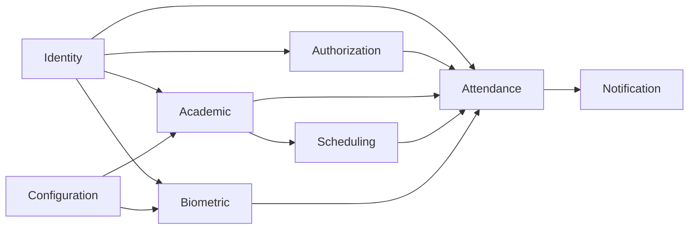

# Domain Map — Bounded Contexts

> The domain map is the central DDD (Domain-Driven Design) artifact.
> It defines the system's boundaries and how they relate to each other.
> Build it first with the team and domain experts in an Event Storming session.

## Before filling in this document: Event Storming

The FaceAttend EDU domain map describes the main business areas and system contexts. Its purpose is to organize the business model so the development team shares a common language and understands how system functions relate to one another.

This document does not describe tables, columns, or database details. It describes the business in terms of entities, responsibilities, rules, events, and contexts.

## Main Contexts

| Context | Type | Purpose | Related requirements |
|---|---|---|---|
| Identity | Cross-cutting supporting subdomain | Manage persons, users, authentication, sessions, and password policies. | RF 1, RNF 4 |
| Authorization | Cross-cutting supporting subdomain | Manage roles, permissions, and role-permission assignments. | RF 1.1.1, RF 1.1.2, RF 4.6 |
| Academic | Core subdomain | Manage schools, programs, periods, cohorts, courses, academic actors, and enrollments. | RF 2, RF 8 |
| Scheduling | Core subdomain | Manage environments, schedule blocks, and class sessions. | RF 2.1, RF 2.3.2 |
| Attendance | System core | Record attendance through facial recognition or alternative methods. Manage justifications and supporting documents. | RF 3, RF 6 |
| Biometric | Supporting subdomain | Store and manage facial and fingerprint embeddings (NoSQL). | RF 3.1.1, RNF 4 |
| Notification | Supporting subdomain | Manage alert types and alerts for system events. | RF 4.1 |
| Configuration | Cross-cutting supporting subdomain | Manage academic, security, and biometric-update configuration parameters. | RF 4 |

---

## 1. Identity

### Purpose
Ensure that only authorized people can access the system. This context handles person management, user credentials, authentication, sessions, and password policies.

### Context Type
Cross-cutting supporting subdomain.

### Relationship to the Project
This domain is necessary because FaceAttend EDU handles sensitive academic information, attendance records, personal data, and biometric parameters. Every other context references Person through external IDs.

### Main Concepts
- Person.
- App_User.
- City.
- Credentials.
- Session.
- Password policy.

### Responsibilities
- Register persons individually or in bulk through CSV files.
- Manage user credentials and authentication.
- Handle password recovery and changes.
- Activate or deactivate users.
- Record sessions and last access.

### Related Requirements
- RF 1: User management.
- RF 1.1: Register users.
- RF 1.2: User registration through CSV.
- RF 1.3: Sign-in.
- RF 1.4: Password recovery.
- RF 1.5: Password change.
- RF 1.6: Activate or deactivate users.
- RF 1.7: Delete users.
- RF 1.8: Consult user information.
- RNF 4: Security.

### Business Rules
- Every App_User must be associated with a valid Person.
- A Person may exist without an active App_User.
- A Person cannot be deleted if they have active associated records.
- Credentials must be stored and transmitted securely.
- Every authentication attempt must be recorded.

### Possible Events
- `UserRegistered`
- `UserUpdated`
- `UserActivated`
- `UserDeactivated`
- `UserDeleted`
- `SessionStarted`
- `PasswordRecovered`
- `PasswordChanged`

### Relationship to Other Contexts
- **Authorization:** needs to know which user has which role.
- **Academic:** needs to identify persons and link them to academic actors.
- **Attendance:** needs to know who the user is and whether they are active.
- **Justifications:** needs to validate who requests and who approves.

---

## 2. Authorization

### Purpose
Control which actions each user may perform based on their assigned roles and permissions.

### Context Type
Cross-cutting supporting subdomain.

### Main Concepts
- Role.
- Permission.
- Role_Permission.
- User_Role.

### Responsibilities
- Define roles (Administrator, Instructor/Teacher, Student/Learner).
- Define permissions per action.
- Associate roles with permissions.
- Assign roles to users per school.

### Related Requirements
- RF 1.1.1: Role assignment.
- RF 1.1.2: Permission assignment.
- RF 4.6: Change a user's role.

### Business Rules
- Every App_User must have at least one assigned role.
- A user's role may be changed only by a user with administrative permissions.
- Access permissions must depend on the assigned role.
- A user cannot execute an action without permission associated with their role.

### Possible Events
- `RoleAssigned`
- `RoleRemoved`
- `PermissionGranted`
- `PermissionRevoked`

---

## 3. Academic

### Purpose
Organize the institutional information needed for the system to relate users, groups, programs, courses, and periods.

### Context Type
Core subdomain.

### Main Concepts
- School.
- Program.
- Academic_Period.
- Cohort.
- Course.
- Academic_Actor_Type.
- Academic_Actor.
- Enrollment.

### Responsibilities
- Register schools (multi-tenant root).
- Register programs and academic periods.
- Register cohorts and courses.
- Manage academic actors (students and instructors).
- Track enrollments.

### Related Requirements
- RF 2: Environment management.
- RF 2.1: Register environments/classrooms.
- RF 2.2: Register cohorts/courses.
- RF 2.3: Assign responsible users.
- RF 8: School management.
- RF 8.1: Add or delete courses.

### Business Rules
- All academic data must belong to a School.
- A Program may be added only if it does not already exist in the same School.
- A Cohort must have a valid instructor before attendance recording begins.
- An Academic_Actor must reference a valid Person.

### Possible Events
- `SchoolRegistered`
- `ProgramCreated`
- `CohortRegistered`
- `EnrollmentCreated`
- `CourseAdded`
- `CourseDeleted`

---

## 4. Scheduling

### Purpose
Manage physical environments, recurring time blocks, and concrete class sessions. Prevents double-booking of rooms and instructors.

### Context Type
Core subdomain.

### Main Concepts
- Environment.
- Schedule_Block.
- Class_Session.

### Responsibilities
- Register environments (classrooms, labs, auditoriums).
- Define schedule blocks (recurring time slots).
- Generate class sessions from schedule blocks.
- Prevent scheduling conflicts.

### Related Requirements
- RF 2.1: Register environments/classrooms.
- RF 2.3.2: Assign schedules.

### Business Rules
- An Environment must exist before being associated with a Cohort or Class_Session.
- A Schedule_Block cannot overlap another Schedule_Block assigned to the same Instructor in the same Environment.
- A time block must have a start time earlier than its end time.

### Possible Events
- `EnvironmentRegistered`
- `ScheduleBlockCreated`
- `ScheduleBlockConflictDetected`
- `ClassSessionOpened`
- `ClassSessionClosed`

---

## 5. Attendance

### Purpose
Reliably record student attendance in class sessions through facial recognition or alternative methods. Manage justifications for absences.

### Context Type
System core.

### Main Concepts
- Attendance_Record.
- Justification_Type.
- Justification.
- Supporting_Document.
- Capture method.
- Attendance status.

### Responsibilities
- Record attendance (Present, Absent, Late, Justified).
- Support multiple capture methods (FACIAL, MANUAL, IMPORT).
- Manage justification requests and reviews.
- Track supporting documents.

### Related Requirements
- RF 3: Generate entry and exit records.
- RF 3.1: Record entries and exits.
- RF 3.1.1: Facial recording.
- RF 3.1.2: Alternative recording.
- RF 6: Justification management.
- RF 6.1: Upload justification supporting documents.
- RF 6.2: Approval and rejection.

### Business Rules
- An academic_actor can have only one attendance_record per class_session.
- The attendance record must correspond to an Open class_session.
- A justification must reference exactly one attendance_record.
- If the justification_type requires an attachment, at least one supporting_document must be uploaded.
- When a justification is approved, the attendance_status updates to "Justified".

### Possible Events
- `AttendanceRecorded`
- `LateArrivalDetected`
- `AbsenceDetected`
- `JustificationRequested`
- `SupportingDocumentUploaded`
- `JustificationApproved`
- `JustificationRejected`

---

## 6. Biometric

### Purpose
Store and manage biometric embeddings (facial and fingerprint) used for identity verification during attendance capture.

### Context Type
Supporting subdomain.

### Persistence
This context persists entirely in **MongoDB** (NoSQL) — no SQL tables.

### Main Concepts
- Facial_Embedding.
- Fingerprint_Embedding.
- Model version.
- Template version.

### Responsibilities
- Store facial embedding vectors.
- Store fingerprint template vectors.
- Manage active/inactive status per embedding.
- Support template versioning for model updates.

### Related Requirements
- RF 3.1.1: Facial recording.
- RNF 4: Security.

### Business Rules
- Biometric embeddings reference a Person via external ID — no cross-context FK.
- Each person may have only one active facial embedding at a time.
- Fingerprint embeddings support up to 10 fingers per person.
- Embedding updates require a Biometric_Update_Case approved by an administrator.

### Possible Events
- `FacialEmbeddingEnrolled`
- `FacialEmbeddingUpdated`
- `FingerprintEmbeddingEnrolled`
- `FingerprintEmbeddingUpdated`

---

## 7. Notification

### Purpose
Generate and manage alerts for system events such as absence thresholds, schedule conflicts, or biometric update requests.

### Context Type
Supporting subdomain.

### Main Concepts
- Alert_Type.
- Alert.

### Responsibilities
- Define alert types (catalog).
- Raise alerts for relevant events.
- Track alert resolution.

### Related Requirements
- RF 4.1: Configure alerts.
- RF 4.1.1: Enable/disable alerts.

### Business Rules
- Alerts are generated by the system for defined event types.
- An alert may be resolved by a user with appropriate permissions.

### Possible Events
- `AlertRaised`
- `AlertResolved`

---

## 8. Configuration

### Purpose
Manage system-wide and per-school configuration parameters, including biometric update workflows.

### Context Type
Cross-cutting supporting subdomain.

### Main Concepts
- Academic_Configuration.
- Security_Configuration.
- Biometric_Update_Case.

### Responsibilities
- Store academic parameters per school (e.g., tardy tolerance).
- Store global security parameters (e.g., max login attempts).
- Manage biometric update request workflow (Pending → In_Review → Approved/Rejected).

### Related Requirements
- RF 4: System configuration.
- RF 4.4: Update user parameters.

### Business Rules
- Academic configuration is scoped per school.
- Security configuration is global.
- Biometric update cases require administrator review.
- The biometric_type field distinguishes FACIAL vs FINGERPRINT cases.

### Possible Events
- `AcademicConfigurationUpdated`
- `SecurityConfigurationUpdated`
- `BiometricUpdateRequested`
- `BiometricUpdateApproved`
- `BiometricUpdateRejected`

---

## Context Relationships

