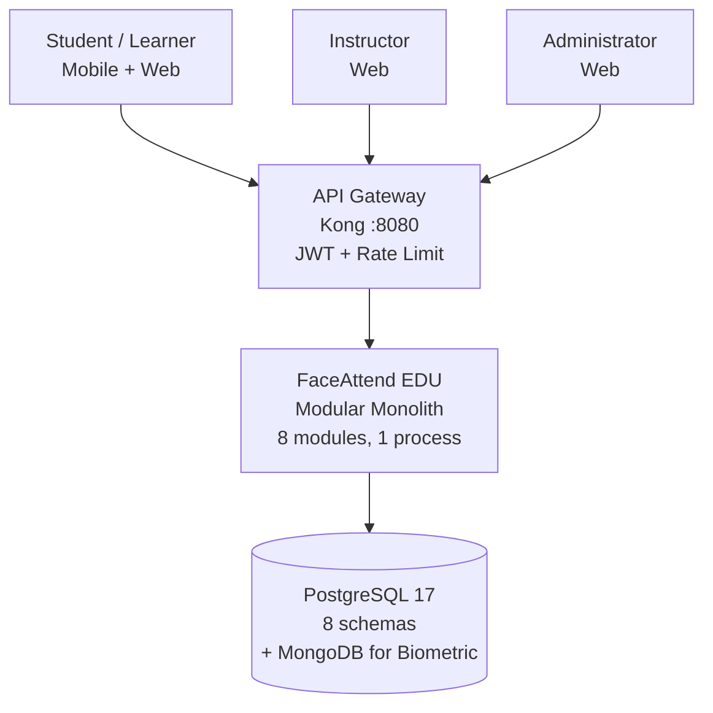
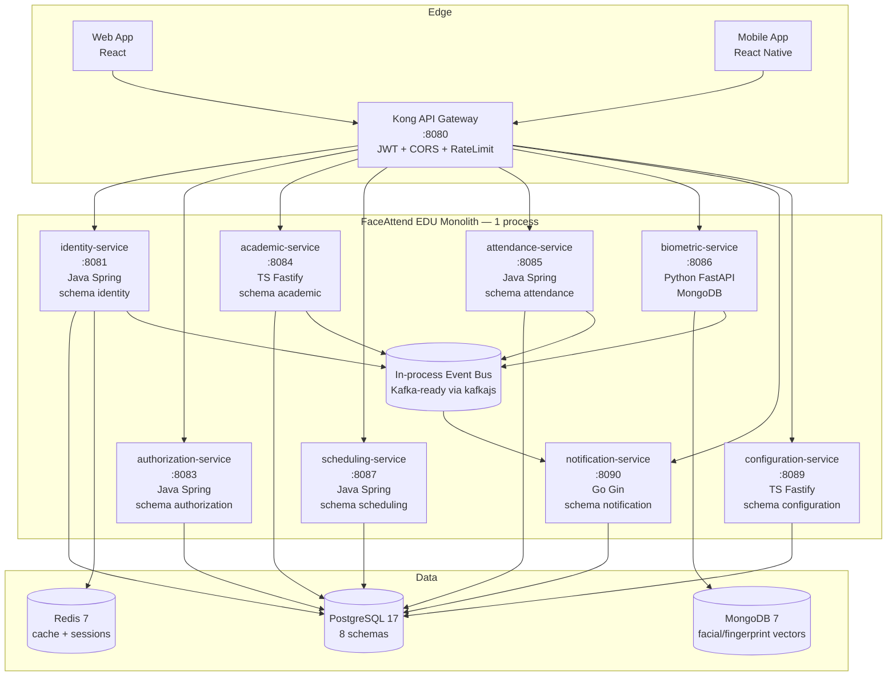

# System Architecture Overview

> **What to fill in here:** The architectural view is the technical snapshot of the system.
> It includes the C4 system and container diagram, service list, and architectural principles.
> This document is created after the main ADRs and guides the implementation.

---

## 1. Adopted architectural style

**Style:** **Modular Monolith (schema-per-context) + Event-Driven (in-process, Kafka-ready)**

**Justification:** 8 bounded contexts (02-domain) run as modules in a single deployable (ADR-002) with one PostgreSQL instance, schema-per-context and DB-role isolation. Avoids 8 independent pipelines for a 3-person SENA team while preserving context boundaries for future Strangler Fig extraction. Biometric in MongoDB is the only polyglot exception (ADR-003). Events are in-process today, Kafka-ready (ADR-006) for when modules are extracted.

**Reference ADRs:** `ADR-002` (modular monolith), `ADR-003` (biometric persistence), `ADR-006` (Kafka), `ADR-007` (API Gateway)

---

## 2. C4 Diagram — System Level (Context)

FaceAttend EDU is a modular monolith serving a single educational institution (SENA cohort context). External actors are Students, Instructors, Administrators; external systems are none (future: institutional academic system).

---

## 3. C4 Diagram — Container Level (FaceAttend EDU)

One deployable process, schema-per-context isolation, Kafka-ready events. See `08-uml/diagrams/source/c4-container-example.md`.

---

## 4. Service catalog

| # | Service | Responsibility | Port | DB | Communication type |
|---|---------|---------------|------|-----|-------------------|
| 01 | identity-service (+auth) | Person, user, authentication, sessions, JWT | 8081 | PostgreSQL | REST + Events |
| 02 | authorization-service | Roles, permissions, role assignments | 8083 | PostgreSQL | REST + Events |
| 03 | academic-service | Students, teachers, courses, enrollments | 8084 | PostgreSQL | REST + Events |
| 04 | scheduling-service | Environments, schedule blocks, class sessions | 8087 | PostgreSQL | REST + Events |
| 05 | attendance-service | Attendance records, justifications | 8085 | PostgreSQL | REST + Events |
| 06 | biometric-service | Facial/fingerprint embeddings | 8086 | MongoDB | REST + Events |
| 07 | notification-service | Alert types, alerts | 8090 | PostgreSQL | REST + Events |
| 08 | configuration-service | Academic/security config values | 8089 | PostgreSQL | REST + Events |
| 99 | api-gateway | Routing, auth, rate limiting | 8080 | Redis (cache) | HTTP Proxy |

> Full detail per service in `09-microservices/service-catalog.md`

> **Note:** `06-iot-service` (IoT_Device, Device_Assignment) exists as a *future* external supporting module for classroom hardware; it is not part of the 8 core business contexts in `02-domain` and is excluded from the monolith v1.1 scope.

---

## 5. Architectural principles

These principles guide the project's technical decisions. Before making an important decision,
verify it is consistent with these principles.

### P1: API-First
Design the API contract (OpenAPI) before implementing the service.
Contracts are the source of truth for consumers.

### P2: Schema per bounded context (single DB)
One logical DB `faceattend_db` with one schema per bounded context; no cross-schema FK. No module directly accesses another module's schema.
Communication is always through API or events.

### P3: Fail Fast, Recover Gracefully
Detect errors early (validation at the edge). When an external service fails,
use Circuit Breaker to prevent cascades. Always define a fallback.

### P4: Observability by Design
From day 1: structured JSON logs, metrics with Prometheus,
distributed traces with Jaeger/Zipkin. It is not optional or a story for "later".

### P5: Security & Privacy by Design
Biometric vectors are encrypted at rest (ADR-016), PII minimized in logs/traces per `00-governance/security-policy.md` and Law 1581 (ADR-017), JWT with short-lived access + refresh, RBAC checked at Gateway and service layers.

---

## 6. Adopted architectural patterns

| Pattern | Adopted | Reference |
|---------|---------|-----------|
| API Gateway (Kong OSS, DB-less) | Yes | ADR-007, `pattern-guide.md#api-gateway` |
| Database per Service — variant: schema-per-context in single PG instance | Yes (schema) | ADR-002, ADR-003 |
| Hexagonal Architecture (Ports & Adapters) | Yes | `hexagonal-architecture.md` |
| CQRS | No — read/write models co-located; re-evaluate at 10k rps | — |
| Event Sourcing | No — events for integration, not source of truth | — |
| Circuit Breaker (Resilience4j/opossum) | Yes — for Gateway→Monolith and Monolith→MongoDB | ADR-002, `pattern-guide.md#circuit-breaker` |
| Saga (choreographed via events) | Yes — Attendance + Biometric + Notification | ADR-004 |
| Outbox Pattern (transactional) | Yes — exactly-once event publish per module | ADR-004 |
| Retry with Exponential Backoff + DLQ | Yes — Kafka DLQ per `02-domain/domain-events.md` | ADR-006 |

---

## 7. Cross-cutting concerns

Transversal concerns that apply to ALL services:

| Concern | Adopted solution | Where it is configured |
|---------|----------------|------------------------|
| Authentication / Authorization | JWT + validation in API Gateway | `00-governance/security-policy.md` |
| Logging | Structured JSON + Correlation ID | Shared logger in internal lib |
| Tracing | OpenTelemetry → Jaeger | Middleware in each service |
| Health Checks | GET /health (liveness) + GET /health/ready (readiness) | Service template |
| Error format | Standard ErrorResponse | `07-api/contracts/openapi/_shared.yaml` |
| Rate Limiting | At the API Gateway | Kong/NGINX configuration |
| CORS | Configured in API Gateway | |
| Circuit Breaker | Resiliency4j / opossum per service | Pattern in `pattern-guide.md` |

---

## 8. Registered architectural technical debt

| ID | Description | Impact | Priority | Target sprint |
|----|-------------|--------|---------|--------------|
| AT-001 | Single PostgreSQL instance is SPOF for all schemas — no per-schema HA | Medium (single institution, but blocks HA) | P2 | Sprint 6 — evaluate per-schema backup + read replica |
| AT-002 | No import-boundary lint rule: `domain/` of one module can still import another module's `domain/` | Medium — erodes future extractability | P1 | Sprint 3 — add eslint import-boundary + CI check |
| AT-003 | Notification-service Go runtime adds 4th runtime for 2 tables — ops overhead | Low — isolated, low churn | P3 | Evaluate consolidating to TS/Fastify if Go learning cost > benefit |

> See also: `15-project-control/technical-backlog.md` and ADRs `ADR-002`, `ADR-005`

---

## 9. Planned evolution

| Version | Architectural change | Motivation | Estimated date | ADR |
|---------|---------------------|------------|----------------|-----|
| v1.1 | Remove Audit bounded context; Configuration becomes 08 | Simplify domain, infra logging instead | 2026-09 (done) | `refactor/remove-audit-domain` |
| v1.2 | Add per-module import-boundary CI check | Preserve extractability (AT-002) | Sprint 3 | ADR-002 |
| v2.0 | Extract `attendance-service` as first independent service (Strangler Fig) | Highest load, first to need independent scaling | Q1 2027 | ADR-002/004 |
| v2.1 | gRPC for Monolith→Monolith hot path if latency >50ms P95 | Reduce JSON overhead internal | Q2 2027 | TBD |

---

## Key correlations

- Domain bounded contexts → `02-domain/domain-map.md`
- Specific decision ADRs → `05-architecture/decisions/`
- Hexagonal architecture per service → `05-architecture/hexagonal-architecture.md`
- Applied patterns → `05-architecture/pattern-guide.md`
- Per-service detail → `09-microservices/service-catalog.md`
- UML diagrams → `08-uml/`
