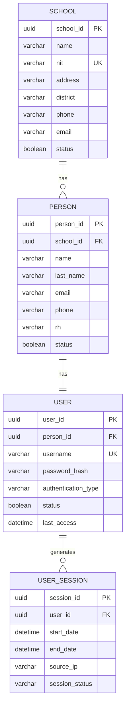

# Domain: Identity

> **Owner:** Identity bounded context
> **DB Engine:** PostgreSQL 17 — ACID transactions, relational integrity, multi-tenant isolation
>
> **Engine justification:**
> - Strong relational guarantees for school-person-user relationships.
> - UUID primary keys for distributed ID generation across microservices.
> - TIMESTAMPTZ for timezone-aware audit fields.

---

## 1. Table: school

**Purpose:** Institutional record of each school in the multi-tenant platform.

```sql
CREATE TABLE school (
  -- Business fields
  school_id     UUID        PRIMARY KEY DEFAULT gen_random_uuid(),
  name          VARCHAR     NOT NULL,
  nit           VARCHAR     NOT NULL UNIQUE,
  address       VARCHAR,
  district      VARCHAR,
  phone         VARCHAR,
  email         VARCHAR,

  -- Status fields
  status        BOOLEAN     NOT NULL DEFAULT true,

  -- Audit (in all tables)
  created_at    TIMESTAMPTZ NOT NULL DEFAULT NOW(),
  updated_at    TIMESTAMPTZ NOT NULL DEFAULT NOW(),
  deleted_at    TIMESTAMPTZ,
  created_by    UUID,
  updated_by    UUID
);

CREATE UNIQUE INDEX uq_school_nit ON school (nit);
CREATE INDEX idx_school_deleted ON school (deleted_at) WHERE deleted_at IS NULL;
```

**Data dictionary:**

| Column | Type | Description | Example |
|--------|------|-------------|---------|
| school_id | UUID | Auto-generated unique identifier for the school | `550e8400-e29b-41d4-a716-446655440000` |
| name | VARCHAR | Institution name | `Escuela Nacional` |
| nit | VARCHAR | Tax identification number (NIT), globally unique | `900123456-7` |
| address | VARCHAR | Physical address | `Calle 123 #45-67` |
| district | VARCHAR | District or zone the school belongs to | `Centro` |
| phone | VARCHAR | Contact phone number | `+57 300 123 4567` |
| email | VARCHAR | Institutional email address | `info@escuela.edu.co` |
| status | BOOLEAN | Active/inactive flag (soft delete alternative) | `true` |
| created_at | TIMESTAMPTZ | When the record was created | `2024-01-15T10:30:00Z` |
| updated_at | TIMESTAMPTZ | When the record was last updated | `2024-01-15T10:30:00Z` |
| deleted_at | TIMESTAMPTZ | NULL = active; with value = soft-deleted | `NULL` |
| created_by | UUID | User who created this record | `550e8400-...` |
| updated_by | UUID | User who last updated this record | `550e8400-...` |

**Modeling decisions:**
1. `nit` is globally unique — each school is identified by its tax ID.
2. `school_id` is the logical partition key (multi-tenant): all other tables reference this ID as an isolation filter.
3. Soft delete via `deleted_at`: records are never physically deleted, enabling audit and recovery.

---

## 2. Table: person

**Purpose:** Generic record of any person associated with a school (student, teacher, admin staff, etc.).

```sql
CREATE TABLE person (
  -- Business fields
  person_id   UUID        PRIMARY KEY DEFAULT gen_random_uuid(),
  school_id   UUID        NOT NULL,
  name        VARCHAR     NOT NULL,
  last_name   VARCHAR     NOT NULL,
  email       VARCHAR,
  phone       VARCHAR,
  rh          VARCHAR(3),

  -- Status fields
  status      BOOLEAN     NOT NULL DEFAULT true,

  -- Audit (in all tables)
  created_at  TIMESTAMPTZ NOT NULL DEFAULT NOW(),
  updated_at  TIMESTAMPTZ NOT NULL DEFAULT NOW(),
  deleted_at  TIMESTAMPTZ,
  created_by  UUID,
  updated_by  UUID
);

CREATE UNIQUE INDEX uq_person_email_school ON person (school_id, email);
CREATE INDEX idx_person_school ON person (school_id);
CREATE INDEX idx_person_deleted ON person (deleted_at) WHERE deleted_at IS NULL;
```

**Data dictionary:**

| Column | Type | Description | Example |
|--------|------|-------------|---------|
| person_id | UUID | Auto-generated unique identifier for the person | `550e8400-e29b-41d4-a716-446655440001` |
| school_id | UUID | School this person belongs to (FK → school) | `550e8400-...` |
| name | VARCHAR | First name(s) | `Juan` |
| last_name | VARCHAR | Last name(s) | `Perez` |
| email | VARCHAR | Email address | `juan@escuela.edu.co` |
| phone | VARCHAR | Phone number | `+57 300 987 6543` |
| rh | VARCHAR(3) | Blood type (A+, O-, etc.) | `O+` |
| status | BOOLEAN | Active/inactive flag | `true` |
| created_at | TIMESTAMPTZ | When the record was created | `2024-01-15T10:30:00Z` |
| updated_at | TIMESTAMPTZ | When the record was last updated | `2024-01-15T10:30:00Z` |
| deleted_at | TIMESTAMPTZ | NULL = active; with value = soft-deleted | `NULL` |
| created_by | UUID | User who created this record | `550e8400-...` |
| updated_by | UUID | User who last updated this record | `550e8400-...` |

**Modeling decisions:**
1. `Person` is a shared base table; Student, Teacher, and User reference it by `person_id`.
2. The pair (school_id, email) is unique — the same person can have different emails across different schools.
3. `rh` (blood type) is stored as VARCHAR(3) matching the ENUM Blood_Type values, useful for medical emergencies.

---

## 3. Table: "user"

**Purpose:** Login credentials and authentication record for a system user. Linked 1:1 with Person.

```sql
CREATE TABLE "user" (
  -- Business fields
  user_id             UUID        PRIMARY KEY DEFAULT gen_random_uuid(),
  person_id           UUID        NOT NULL UNIQUE,
  username            VARCHAR     NOT NULL UNIQUE,
  password_hash       VARCHAR     NOT NULL,
  authentication_type VARCHAR     NOT NULL,

  -- Status fields
  status              BOOLEAN     NOT NULL DEFAULT true,

  -- Audit (in all tables)
  created_at          TIMESTAMPTZ NOT NULL DEFAULT NOW(),
  updated_at          TIMESTAMPTZ NOT NULL DEFAULT NOW(),
  deleted_at          TIMESTAMPTZ,
  created_by          UUID,
  updated_by          UUID,

  -- Extra
  last_access         TIMESTAMPTZ
);

CREATE UNIQUE INDEX uq_user_username ON "user" (username);
CREATE UNIQUE INDEX uq_user_person ON "user" (person_id);
CREATE INDEX idx_user_deleted ON "user" (deleted_at) WHERE deleted_at IS NULL;
```

**Data dictionary:**

| Column | Type | Description | Example |
|--------|------|-------------|---------|
| user_id | UUID | Auto-generated unique identifier for the user | `550e8400-e29b-41d4-a716-446655440002` |
| person_id | UUID | Linked person (1:1 relationship, FK → person) | `550e8400-...` |
| username | VARCHAR | Login username, globally unique | `jperez` |
| password_hash | VARCHAR | Hashed password (never stored in plaintext) | `$2b$10$...` |
| authentication_type | VARCHAR | Auth method: Local, Windows, or External | `Local` |
| status | BOOLEAN | Active/inactive flag | `true` |
| created_at | TIMESTAMPTZ | When the record was created | `2024-01-15T10:30:00Z` |
| updated_at | TIMESTAMPTZ | When the record was last updated | `2024-01-15T10:30:00Z` |
| deleted_at | TIMESTAMPTZ | NULL = active; with value = soft-deleted | `NULL` |
| created_by | UUID | User who created this record | `550e8400-...` |
| updated_by | UUID | User who last updated this record | `550e8400-...` |
| last_access | TIMESTAMPTZ | Last login timestamp | `2024-06-01T08:15:00Z` |

**Modeling decisions:**
1. 1:1 relationship with Person — each person has at most one user account.
2. `authentication_type` supports multiple methods: local (password), Windows (AD/LDAP), or external (OAuth).
3. `last_access` enables inactive user detection and activity auditing.

---

## 4. Table: user_session

**Purpose:** Record of each user login session to the system.

```sql
CREATE TABLE user_session (
  -- Business fields
  session_id     UUID        PRIMARY KEY DEFAULT gen_random_uuid(),
  user_id        UUID        NOT NULL,
  start_date     TIMESTAMPTZ NOT NULL,
  end_date       TIMESTAMPTZ,
  source_ip      VARCHAR,

  -- Status fields
  session_status VARCHAR     NOT NULL,

  -- Audit (in all tables)
  created_at     TIMESTAMPTZ NOT NULL DEFAULT NOW(),
  updated_at     TIMESTAMPTZ NOT NULL DEFAULT NOW(),
  deleted_at     TIMESTAMPTZ,
  created_by     UUID,
  updated_by     UUID
);

CREATE INDEX idx_session_user ON user_session (user_id);
CREATE INDEX idx_session_status ON user_session (session_status);
CREATE INDEX idx_session_deleted ON user_session (deleted_at) WHERE deleted_at IS NULL;
```

**Data dictionary:**

| Column | Type | Description | Example |
|--------|------|-------------|---------|
| session_id | UUID | Auto-generated unique session identifier | `550e8400-e29b-41d4-a716-446655440003` |
| user_id | UUID | Session owner (FK → "user") | `550e8400-...` |
| start_date | TIMESTAMPTZ | Session start time | `2024-06-01T08:15:00Z` |
| end_date | TIMESTAMPTZ | Session end time (NULL if still active) | `NULL` |
| source_ip | VARCHAR | Client IP address | `192.168.1.100` |
| session_status | VARCHAR | Session state: Active or Closed | `Active` |
| created_at | TIMESTAMPTZ | When the record was created | `2024-06-01T08:15:00Z` |
| updated_at | TIMESTAMPTZ | When the record was last updated | `2024-06-01T08:15:00Z` |
| deleted_at | TIMESTAMPTZ | NULL = active; with value = soft-deleted | `NULL` |
| created_by | UUID | User who created this record | `550e8400-...` |
| updated_by | UUID | User who last updated this record | `550e8400-...` |

**Modeling decisions:**
1. `session_status` is VARCHAR instead of BOOLEAN to support future states (e.g., Expired, Locked).
2. `end_date` NULL indicates an active session — efficient way to detect open sessions.
3. `source_ip` enables security auditing and suspicious access detection.

---

## 5. Enums

| Enum | Values |
|------|--------|
| Blood_Type | A+, A-, B+, B-, AB+, AB-, O+, O- |

---

## 6. Relationship Diagram



---

## 7. Cross-Context Relationships

| From | To | Reference Type | Mechanism |
|------|----|----------------|-----------|
| Person.school_id | School.school_id | FK (internal) | Direct relationship within Identity |
| Authorization.User_Role.user_id | User.user_id | External ID (no FK) | Cross-context reference by UUID |
| Academic.Student.person_id | Person.person_id | External ID (no FK) | Cross-context reference by UUID |
| Academic.Teacher.person_id | Person.person_id | External ID (no FK) | Cross-context reference by UUID |
| Attendance.Justification.reviewed_by | User.user_id | External ID (no FK) | Cross-context reference by UUID |
| Configuration.Facial_Update_Case.requested_by | User.user_id | External ID (no FK) | Cross-context reference by UUID |
| Audit.Audit_Event.actor_id | User.user_id | External ID (no FK) | Cross-context reference by UUID |

---

## 8. Correlations

- Domain entities that map to these tables → `02-domain/entities-and-rules.md`
- Saga and Outbox pattern for distributed consistency → `05-architecture/pattern-guide.md`
- Data for each service in detail → `09-microservices/services/identity-service/data-model.md`
- How data is accessed via API → `07-api/contracts/openapi/`
