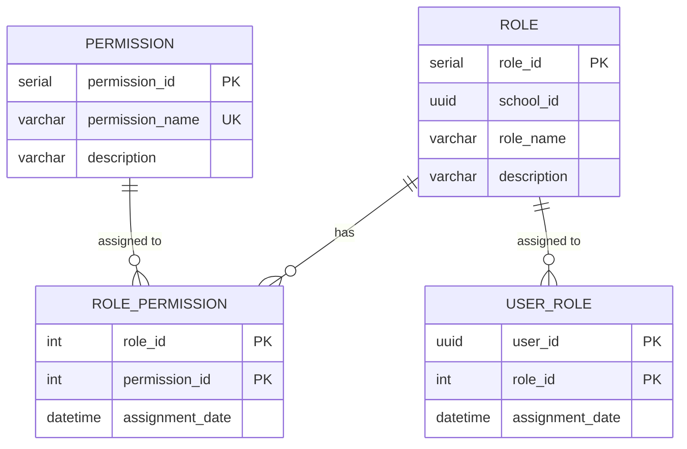

# Domain: Authorization

> **Owner:** Authorization bounded context
> **DB Engine:** PostgreSQL 17 — ACID transactions, relational integrity for role-permission associations
>
> **Engine justification:**
> - M:N relationships between roles, permissions, and users require relational integrity.
> - SERIAL primary keys for internal identifiers not exposed across services.

---

## Design Principles

- Authorization does **NOT** depend directly on Person.
- `user_id` acts as an external reference to the Identity context.
- Each role is school-specific (multi-tenant via `school_id`).

---

## 1. Table: role

**Purpose:** Definition of available roles within each school (e.g., Admin, Teacher, Student).

```sql
CREATE TABLE role (
  -- Business fields
  role_id       SERIAL      PRIMARY KEY,
  school_id     UUID        NOT NULL,
  role_name     VARCHAR     NOT NULL,
  description   VARCHAR,

  -- Audit (in all tables)
  created_at    TIMESTAMPTZ NOT NULL DEFAULT NOW(),
  updated_at    TIMESTAMPTZ NOT NULL DEFAULT NOW(),
  deleted_at    TIMESTAMPTZ,
  created_by    UUID,
  updated_by    UUID
);

CREATE UNIQUE INDEX uq_role_name_school ON role (school_id, role_name);
CREATE INDEX idx_role_deleted ON role (deleted_at) WHERE deleted_at IS NULL;
```

**Data dictionary:**

| Column | Type | Description | Example |
|--------|------|-------------|---------|
| role_id | SERIAL | Auto-incremental role identifier | `1` |
| school_id | UUID | Owning school (external reference) | `550e8400-...` |
| role_name | VARCHAR | Role name within the school | `Admin` |
| description | VARCHAR | Role description | `Full system administrator` |
| created_at | TIMESTAMPTZ | When the record was created | `2024-01-15T10:30:00Z` |
| updated_at | TIMESTAMPTZ | When the record was last updated | `2024-01-15T10:30:00Z` |
| deleted_at | TIMESTAMPTZ | NULL = active; with value = soft-deleted | `NULL` |
| created_by | UUID | User who created this record | `550e8400-...` |
| updated_by | UUID | User who last updated this record | `550e8400-...` |

**Modeling decisions:**
1. `role_id` is SERIAL (auto-incremental) because it is a purely internal identifier — not exposed between services.
2. Uniqueness on (school_id, role_name) allows each school to define its own roles without conflicts.
3. Soft delete via `deleted_at` preserves role history for audit purposes.

---

## 2. Table: permission

**Purpose:** Global catalog of permissions available in the system.

```sql
CREATE TABLE permission (
  -- Business fields
  permission_id   SERIAL      PRIMARY KEY,
  permission_name VARCHAR     NOT NULL UNIQUE,
  description     VARCHAR,

  -- Audit (in all tables)
  created_at      TIMESTAMPTZ NOT NULL DEFAULT NOW(),
  updated_at      TIMESTAMPTZ NOT NULL DEFAULT NOW(),
  deleted_at      TIMESTAMPTZ,
  created_by      UUID,
  updated_by      UUID
);

CREATE UNIQUE INDEX uq_permission_name ON permission (permission_name);
CREATE INDEX idx_permission_deleted ON permission (deleted_at) WHERE deleted_at IS NULL;
```

**Data dictionary:**

| Column | Type | Description | Example |
|--------|------|-------------|---------|
| permission_id | SERIAL | Auto-incremental permission identifier | `1` |
| permission_name | VARCHAR | Unique permission name (namespace convention) | `attendance:read` |
| description | VARCHAR | Permission description | `View attendance records` |
| created_at | TIMESTAMPTZ | When the record was created | `2024-01-15T10:30:00Z` |
| updated_at | TIMESTAMPTZ | When the record was last updated | `2024-01-15T10:30:00Z` |
| deleted_at | TIMESTAMPTZ | NULL = active; with value = soft-deleted | `NULL` |
| created_by | UUID | User who created this record | `550e8400-...` |
| updated_by | UUID | User who last updated this record | `550e8400-...` |

**Modeling decisions:**
1. Permissions are global (not per-school) — the same permission structure applies to all schools.
2. `permission_name` follows a namespace convention (e.g., `attendance:read`, `student:write`).
3. No `school_id` because permissions are timeless and do not vary by school.

---

## 3. Table: role_permission

**Purpose:** Association between roles and permissions (what each role can do).

```sql
CREATE TABLE role_permission (
  -- Business fields
  role_id         INT         NOT NULL,
  permission_id   INT         NOT NULL,
  assignment_date TIMESTAMPTZ NOT NULL DEFAULT NOW(),

  -- Audit (in all tables)
  created_at      TIMESTAMPTZ NOT NULL DEFAULT NOW(),
  updated_at      TIMESTAMPTZ NOT NULL DEFAULT NOW(),
  deleted_at      TIMESTAMPTZ,
  created_by      UUID,
  updated_by      UUID,

  PRIMARY KEY (role_id, permission_id)
);

ALTER TABLE role_permission ADD CONSTRAINT fk_rp_role
  FOREIGN KEY (role_id) REFERENCES role(role_id);
ALTER TABLE role_permission ADD CONSTRAINT fk_rp_permission
  FOREIGN KEY (permission_id) REFERENCES permission(permission_id);
```

**Data dictionary:**

| Column | Type | Description | Example |
|--------|------|-------------|---------|
| role_id | INT | Role receiving the permission (FK → role) | `1` |
| permission_id | INT | Permission being assigned (FK → permission) | `3` |
| assignment_date | TIMESTAMPTZ | When the permission was assigned to the role | `2024-01-15T10:30:00Z` |
| created_at | TIMESTAMPTZ | When the record was created | `2024-01-15T10:30:00Z` |
| updated_at | TIMESTAMPTZ | When the record was last updated | `2024-01-15T10:30:00Z` |
| deleted_at | TIMESTAMPTZ | NULL = active; with value = soft-deleted | `NULL` |
| created_by | UUID | User who created this record | `550e8400-...` |
| updated_by | UUID | User who last updated this record | `550e8400-...` |

**Modeling decisions:**
1. Composite primary key (role_id, permission_id) — M:N relationship.
2. `assignment_date` records when the permission was granted, useful for auditing.
3. CASCADE delete: removing a role or permission removes the association.

---

## 4. Table: user_role

**Purpose:** Assignment of roles to specific users.

```sql
CREATE TABLE user_role (
  -- Business fields
  user_id         UUID        NOT NULL,
  role_id         INT         NOT NULL,
  assignment_date TIMESTAMPTZ NOT NULL DEFAULT NOW(),

  -- Audit (in all tables)
  created_at      TIMESTAMPTZ NOT NULL DEFAULT NOW(),
  updated_at      TIMESTAMPTZ NOT NULL DEFAULT NOW(),
  deleted_at      TIMESTAMPTZ,
  created_by      UUID,
  updated_by      UUID,

  PRIMARY KEY (user_id, role_id)
);

ALTER TABLE user_role ADD CONSTRAINT fk_ur_role
  FOREIGN KEY (role_id) REFERENCES role(role_id);
```

**Data dictionary:**

| Column | Type | Description | Example |
|--------|------|-------------|---------|
| user_id | UUID | User receiving the role (external ID → Identity."user") | `550e8400-...` |
| role_id | INT | Role being assigned (FK → role) | `1` |
| assignment_date | TIMESTAMPTZ | When the role was assigned to the user | `2024-01-15T10:30:00Z` |
| created_at | TIMESTAMPTZ | When the record was created | `2024-01-15T10:30:00Z` |
| updated_at | TIMESTAMPTZ | When the record was last updated | `2024-01-15T10:30:00Z` |
| deleted_at | TIMESTAMPTZ | NULL = active; with value = soft-deleted | `NULL` |
| created_by | UUID | User who created this record | `550e8400-...` |
| updated_by | UUID | User who last updated this record | `550e8400-...` |

**Modeling decisions:**
1. `user_id` is an external reference (UUID from Identity."user") — **no physical FK** to respect bounded context isolation.
2. A user can have multiple roles (M:N).
3. Cross-context consistency is resolved via API: when assigning a role, the system validates that the user_id exists in Identity.

---

## 5. Relationship Diagram



---

## 6. Cross-Context Relationships

| From | To | Reference Type | Mechanism |
|------|----|----------------|-----------|
| User_Role.user_id | Identity."user".user_id | External ID (no FK) | Cross-context reference by UUID |
| Role.school_id | Identity.School.school_id | External ID (no FK) | Cross-context reference by UUID |

> **Note:** Physical FKs exist only within Authorization (role ↔ permission ↔ role_permission).
> References to Identity are resolved at the application/API level.

---

## 7. Correlations

- Domain entities that map to these tables → `02-domain/entities-and-rules.md`
- Saga and Outbox pattern for distributed consistency → `05-architecture/pattern-guide.md`
- Data for each service in detail → `09-microservices/services/authorization-service/data-model.md`
- How data is accessed via API → `07-api/contracts/openapi/`
