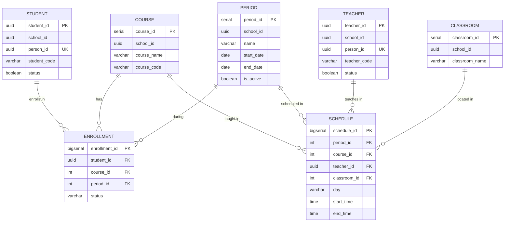

# Domain: Academic

> **Owner:** Academic bounded context
> **DB Engine:** PostgreSQL 17 — ACID transactions, complex relationships, schedule conflict prevention
>
> **Engine justification:**
> - Complex relational model with multiple FKs and unique constraints for schedule conflict prevention.
> - SERIAL/BIGSERIAL keys for high-volume tables (enrollment, schedule).

---

## Design Principles

- Academic owns: student, teacher, course, classroom, period, enrollment, schedule.
- Person does **NOT** own Student/Teacher — they are academic profiles.
- Student and Teacher reference Person by `person_id` as external IDs (no cross-context FK).

---

## 1. Enums

| Enum | Values |
|------|--------|
| Enrollment_Status | Active, Withdrawn, Completed |
| Days | Lunes, Martes, Miercoles, Jueves, Viernes, Sabado, Domingo |

---

## 2. Table: student

**Purpose:** Academic profile of a student. Linked to a Person by `person_id`.

```sql
CREATE TABLE student (
  -- Business fields
  student_id    UUID        PRIMARY KEY DEFAULT gen_random_uuid(),
  school_id     UUID        NOT NULL,
  person_id     UUID        NOT NULL UNIQUE,
  student_code  VARCHAR     NOT NULL,

  -- Status fields
  status        BOOLEAN     NOT NULL DEFAULT true,

  -- Audit (in all tables)
  created_at    TIMESTAMPTZ NOT NULL DEFAULT NOW(),
  updated_at    TIMESTAMPTZ NOT NULL DEFAULT NOW(),
  deleted_at    TIMESTAMPTZ,
  created_by    UUID,
  updated_by    UUID
);

CREATE UNIQUE INDEX uq_student_code_school ON student (school_id, student_code);
CREATE UNIQUE INDEX uq_student_person ON student (person_id);
CREATE INDEX idx_student_deleted ON student (deleted_at) WHERE deleted_at IS NULL;
```

**Data dictionary:**

| Column | Type | Description | Example |
|--------|------|-------------|---------|
| student_id | UUID | Auto-generated unique identifier for the student | `550e8400-e29b-41d4-a716-446655440010` |
| school_id | UUID | School the student belongs to | `550e8400-...` |
| person_id | UUID | Linked person (external ID → Identity.person) | `550e8400-...` |
| student_code | VARCHAR | Institutional student code | `EST-2024-001` |
| status | BOOLEAN | Active/inactive flag | `true` |
| created_at | TIMESTAMPTZ | When the record was created | `2024-01-15T10:30:00Z` |
| updated_at | TIMESTAMPTZ | When the record was last updated | `2024-01-15T10:30:00Z` |
| deleted_at | TIMESTAMPTZ | NULL = active; with value = soft-deleted | `NULL` |
| created_by | UUID | User who created this record | `550e8400-...` |
| updated_by | UUID | User who last updated this record | `550e8400-...` |

**Modeling decisions:**
1. `student_code` is the institutional code — may differ from the UUID.
2. 1:1 relationship with Person via `person_id` (no cross-context FK).
3. A student belongs to a single school.

---

## 3. Table: teacher

**Purpose:** Academic profile of a teacher. Linked to a Person by `person_id`.

```sql
CREATE TABLE teacher (
  -- Business fields
  teacher_id    UUID        PRIMARY KEY DEFAULT gen_random_uuid(),
  school_id     UUID        NOT NULL,
  person_id     UUID        NOT NULL UNIQUE,
  teacher_code  VARCHAR     NOT NULL,

  -- Status fields
  status        BOOLEAN     NOT NULL DEFAULT true,

  -- Audit (in all tables)
  created_at    TIMESTAMPTZ NOT NULL DEFAULT NOW(),
  updated_at    TIMESTAMPTZ NOT NULL DEFAULT NOW(),
  deleted_at    TIMESTAMPTZ,
  created_by    UUID,
  updated_by    UUID
);

CREATE UNIQUE INDEX uq_teacher_code_school ON teacher (school_id, teacher_code);
CREATE UNIQUE INDEX uq_teacher_person ON teacher (person_id);
CREATE INDEX idx_teacher_deleted ON teacher (deleted_at) WHERE deleted_at IS NULL;
```

**Data dictionary:**

| Column | Type | Description | Example |
|--------|------|-------------|---------|
| teacher_id | UUID | Auto-generated unique identifier for the teacher | `550e8400-e29b-41d4-a716-446655440011` |
| school_id | UUID | School the teacher belongs to | `550e8400-...` |
| person_id | UUID | Linked person (external ID → Identity.person) | `550e8400-...` |
| teacher_code | VARCHAR | Institutional teacher code | `PROF-2024-001` |
| status | BOOLEAN | Active/inactive flag | `true` |
| created_at | TIMESTAMPTZ | When the record was created | `2024-01-15T10:30:00Z` |
| updated_at | TIMESTAMPTZ | When the record was last updated | `2024-01-15T10:30:00Z` |
| deleted_at | TIMESTAMPTZ | NULL = active; with value = soft-deleted | `NULL` |
| created_by | UUID | User who created this record | `550e8400-...` |
| updated_by | UUID | User who last updated this record | `550e8400-...` |

---

## 4. Table: course

**Purpose:** Catalog of courses/subjects taught at the school.

```sql
CREATE TABLE course (
  -- Business fields
  course_id     SERIAL      PRIMARY KEY,
  school_id     UUID        NOT NULL,
  course_name   VARCHAR     NOT NULL,
  course_code   VARCHAR     NOT NULL,

  -- Status fields
  status        BOOLEAN     NOT NULL DEFAULT true,

  -- Audit (in all tables)
  created_at    TIMESTAMPTZ NOT NULL DEFAULT NOW(),
  updated_at    TIMESTAMPTZ NOT NULL DEFAULT NOW(),
  deleted_at    TIMESTAMPTZ,
  created_by    UUID,
  updated_by    UUID
);

CREATE UNIQUE INDEX uq_course_code_school ON course (school_id, course_code);
CREATE INDEX idx_course_deleted ON course (deleted_at) WHERE deleted_at IS NULL;
```

**Data dictionary:**

| Column | Type | Description | Example |
|--------|------|-------------|---------|
| course_id | SERIAL | Auto-incremental course identifier | `1` |
| school_id | UUID | Owning school | `550e8400-...` |
| course_name | VARCHAR | Course name | `Mathematics` |
| course_code | VARCHAR | Course code | `MAT-101` |
| status | BOOLEAN | Active/inactive flag | `true` |
| created_at | TIMESTAMPTZ | When the record was created | `2024-01-15T10:30:00Z` |
| updated_at | TIMESTAMPTZ | When the record was last updated | `2024-01-15T10:30:00Z` |
| deleted_at | TIMESTAMPTZ | NULL = active; with value = soft-deleted | `NULL` |
| created_by | UUID | User who created this record | `550e8400-...` |
| updated_by | UUID | User who last updated this record | `550e8400-...` |

---

## 5. Table: classroom

**Purpose:** Record of physical classrooms where classes are held.

```sql
CREATE TABLE classroom (
  -- Business fields
  classroom_id    SERIAL      PRIMARY KEY,
  school_id       UUID        NOT NULL,
  classroom_name  VARCHAR     NOT NULL,

  -- Status fields
  status          BOOLEAN     NOT NULL DEFAULT true,

  -- Audit (in all tables)
  created_at      TIMESTAMPTZ NOT NULL DEFAULT NOW(),
  updated_at      TIMESTAMPTZ NOT NULL DEFAULT NOW(),
  deleted_at      TIMESTAMPTZ,
  created_by      UUID,
  updated_by      UUID
);

CREATE UNIQUE INDEX uq_classroom_name_school ON classroom (school_id, classroom_name);
CREATE INDEX idx_classroom_deleted ON classroom (deleted_at) WHERE deleted_at IS NULL;
```

**Data dictionary:**

| Column | Type | Description | Example |
|--------|------|-------------|---------|
| classroom_id | SERIAL | Auto-incremental classroom identifier | `1` |
| school_id | UUID | Owning school | `550e8400-...` |
| classroom_name | VARCHAR | Classroom name | `Room 101` |
| status | BOOLEAN | Active/inactive flag | `true` |
| created_at | TIMESTAMPTZ | When the record was created | `2024-01-15T10:30:00Z` |
| updated_at | TIMESTAMPTZ | When the record was last updated | `2024-01-15T10:30:00Z` |
| deleted_at | TIMESTAMPTZ | NULL = active; with value = soft-deleted | `NULL` |
| created_by | UUID | User who created this record | `550e8400-...` |
| updated_by | UUID | User who last updated this record | `550e8400-...` |

---

## 6. Table: period

**Purpose:** Academic periods (semesters, trimesters, etc.).

```sql
CREATE TABLE period (
  -- Business fields
  period_id   SERIAL      PRIMARY KEY,
  school_id   UUID        NOT NULL,
  name        VARCHAR     NOT NULL,
  start_date  DATE        NOT NULL,
  end_date    DATE        NOT NULL,

  -- Status fields
  is_active   BOOLEAN     NOT NULL DEFAULT false,

  -- Audit (in all tables)
  created_at  TIMESTAMPTZ NOT NULL DEFAULT NOW(),
  updated_at  TIMESTAMPTZ NOT NULL DEFAULT NOW(),
  deleted_at  TIMESTAMPTZ,
  created_by  UUID,
  updated_by  UUID
);

CREATE UNIQUE INDEX uq_period_name_school ON period (school_id, name);
CREATE INDEX idx_period_deleted ON period (deleted_at) WHERE deleted_at IS NULL;
```

**Data dictionary:**

| Column | Type | Description | Example |
|--------|------|-------------|---------|
| period_id | SERIAL | Auto-incremental period identifier | `1` |
| school_id | UUID | Owning school | `550e8400-...` |
| name | VARCHAR | Period name | `2026-S1` |
| start_date | DATE | Period start date | `2026-01-15` |
| end_date | DATE | Period end date | `2026-06-30` |
| is_active | BOOLEAN | Whether this is the current active period | `true` |
| created_at | TIMESTAMPTZ | When the record was created | `2024-01-15T10:30:00Z` |
| updated_at | TIMESTAMPTZ | When the record was last updated | `2024-01-15T10:30:00Z` |
| deleted_at | TIMESTAMPTZ | NULL = active; with value = soft-deleted | `NULL` |
| created_by | UUID | User who created this record | `550e8400-...` |
| updated_by | UUID | User who last updated this record | `550e8400-...` |

**Modeling decisions:**
1. `is_active` allows identifying the current period without computing date ranges.
2. Only one period can be active per school (business rule, not schema-level).

---

## 7. Table: enrollment

**Purpose:** Student enrollment record for a course within a specific period.

```sql
CREATE TABLE enrollment (
  -- Business fields
  enrollment_id     BIGSERIAL   PRIMARY KEY,
  school_id         UUID        NOT NULL,
  student_id        UUID        NOT NULL,
  course_id         INT         NOT NULL,
  period_id         INT         NOT NULL,
  enrollment_date   TIMESTAMPTZ NOT NULL,

  -- Status fields
  status            VARCHAR     NOT NULL DEFAULT 'Active',

  -- Audit (in all tables)
  created_at        TIMESTAMPTZ NOT NULL DEFAULT NOW(),
  updated_at        TIMESTAMPTZ NOT NULL DEFAULT NOW(),
  deleted_at        TIMESTAMPTZ,
  created_by        UUID,
  updated_by        UUID
);

CREATE UNIQUE INDEX uq_enrollment_student_course_period
  ON enrollment (student_id, course_id, period_id);
CREATE INDEX idx_enrollment_student ON enrollment (student_id);
CREATE INDEX idx_enrollment_course ON enrollment (course_id);
CREATE INDEX idx_enrollment_period ON enrollment (period_id);
CREATE INDEX idx_enrollment_deleted ON enrollment (deleted_at) WHERE deleted_at IS NULL;

ALTER TABLE enrollment ADD CONSTRAINT fk_enrollment_student
  FOREIGN KEY (student_id) REFERENCES student(student_id);
ALTER TABLE enrollment ADD CONSTRAINT fk_enrollment_course
  FOREIGN KEY (course_id) REFERENCES course(course_id);
ALTER TABLE enrollment ADD CONSTRAINT fk_enrollment_period
  FOREIGN KEY (period_id) REFERENCES period(period_id);
```

**Data dictionary:**

| Column | Type | Description | Example |
|--------|------|-------------|---------|
| enrollment_id | BIGSERIAL | Auto-incremental enrollment identifier | `1` |
| school_id | UUID | School | `550e8400-...` |
| student_id | UUID | Enrolled student (FK → student) | `550e8400-...` |
| course_id | INT | Course enrolled in (FK → course) | `1` |
| period_id | INT | Academic period (FK → period) | `1` |
| enrollment_date | TIMESTAMPTZ | When the enrollment was made | `2024-01-15T10:30:00Z` |
| status | VARCHAR | Lifecycle status: Active, Withdrawn, Completed | `Active` |
| created_at | TIMESTAMPTZ | When the record was created | `2024-01-15T10:30:00Z` |
| updated_at | TIMESTAMPTZ | When the record was last updated | `2024-01-15T10:30:00Z` |
| deleted_at | TIMESTAMPTZ | NULL = active; with value = soft-deleted | `NULL` |
| created_by | UUID | User who created this record | `550e8400-...` |
| updated_by | UUID | User who last updated this record | `550e8400-...` |

**Modeling decisions:**
1. Unique constraint on (student_id, course_id, period_id) ensures one enrollment per student-course-period.
2. `status` uses values: Active (enrolled), Withdrawn (dropped), Completed (passed).
3. `BIGSERIAL` because the table can grow significantly over time.

---

## 8. Table: schedule

**Purpose:** Class schedule programming (which teacher teaches which course in which classroom and day).

```sql
CREATE TABLE schedule (
  -- Business fields
  schedule_id     BIGSERIAL   PRIMARY KEY,
  school_id       UUID        NOT NULL,
  period_id       INT         NOT NULL,
  course_id       INT         NOT NULL,
  teacher_id      UUID        NOT NULL,
  classroom_id    INT         NOT NULL,
  day             VARCHAR     NOT NULL,
  start_time      TIME        NOT NULL,
  end_time        TIME        NOT NULL,

  -- Audit (in all tables)
  created_at      TIMESTAMPTZ NOT NULL DEFAULT NOW(),
  updated_at      TIMESTAMPTZ NOT NULL DEFAULT NOW(),
  deleted_at      TIMESTAMPTZ,
  created_by      UUID,
  updated_by      UUID
);

CREATE UNIQUE INDEX uq_schedule_classroom_slot
  ON schedule (classroom_id, day, start_time, period_id);
CREATE UNIQUE INDEX uq_schedule_teacher_slot
  ON schedule (teacher_id, day, start_time, period_id);
CREATE INDEX idx_schedule_period ON schedule (period_id);
CREATE INDEX idx_schedule_course ON schedule (course_id);
CREATE INDEX idx_schedule_teacher ON schedule (teacher_id);
CREATE INDEX idx_schedule_classroom ON schedule (classroom_id);
CREATE INDEX idx_schedule_deleted ON schedule (deleted_at) WHERE deleted_at IS NULL;

ALTER TABLE schedule ADD CONSTRAINT fk_schedule_period
  FOREIGN KEY (period_id) REFERENCES period(period_id);
ALTER TABLE schedule ADD CONSTRAINT fk_schedule_course
  FOREIGN KEY (course_id) REFERENCES course(course_id);
ALTER TABLE schedule ADD CONSTRAINT fk_schedule_teacher
  FOREIGN KEY (teacher_id) REFERENCES teacher(teacher_id);
ALTER TABLE schedule ADD CONSTRAINT fk_schedule_classroom
  FOREIGN KEY (classroom_id) REFERENCES classroom(classroom_id);
```

**Data dictionary:**

| Column | Type | Description | Example |
|--------|------|-------------|---------|
| schedule_id | BIGSERIAL | Auto-incremental schedule identifier | `1` |
| school_id | UUID | School | `550e8400-...` |
| period_id | INT | Academic period (FK → period) | `1` |
| course_id | INT | Course (FK → course) | `1` |
| teacher_id | UUID | Teacher delivering the class (FK → teacher) | `550e8400-...` |
| classroom_id | INT | Classroom where it is held (FK → classroom) | `1` |
| day | VARCHAR | Day of the week (ENUM Days) | `Lunes` |
| start_time | TIME | Class start time | `08:00` |
| end_time | TIME | Class end time | `09:30` |
| created_at | TIMESTAMPTZ | When the record was created | `2024-01-15T10:30:00Z` |
| updated_at | TIMESTAMPTZ | When the record was last updated | `2024-01-15T10:30:00Z` |
| deleted_at | TIMESTAMPTZ | NULL = active; with value = soft-deleted | `NULL` |
| created_by | UUID | User who created this record | `550e8400-...` |
| updated_by | UUID | User who last updated this record | `550e8400-...` |

**Modeling decisions:**
1. Two unique constraints prevent double-booking conflicts (classroom or teacher).
2. `day` is ENUM to ensure valid values.
3. `start_time` and `end_time` are TIME (no timezone) — timezone is handled at the application level.

---

## 9. Relationship Diagram



---

## 10. Cross-Context Relationships

| From | To | Reference Type | Mechanism |
|------|----|----------------|-----------|
| Student.person_id | Identity.Person.person_id | External ID (no FK) | Cross-context reference by UUID |
| Teacher.person_id | Identity.Person.person_id | External ID (no FK) | Cross-context reference by UUID |
| Attendance.Class_Session.schedule_id | Academic.Schedule.schedule_id | External ID (no FK) | Cross-context reference by BIGINT |
| IoT.Device_Assignment.classroom_id | Academic.Classroom.classroom_id | External ID (no FK) | Cross-context reference by SERIAL |

---

## 11. Correlations

- Domain entities that map to these tables → `02-domain/entities-and-rules.md`
- Saga and Outbox pattern for distributed consistency → `05-architecture/pattern-guide.md`
- Data for each service in detail → `09-microservices/services/academic-service/data-model.md`
- How data is accessed via API → `07-api/contracts/openapi/`
