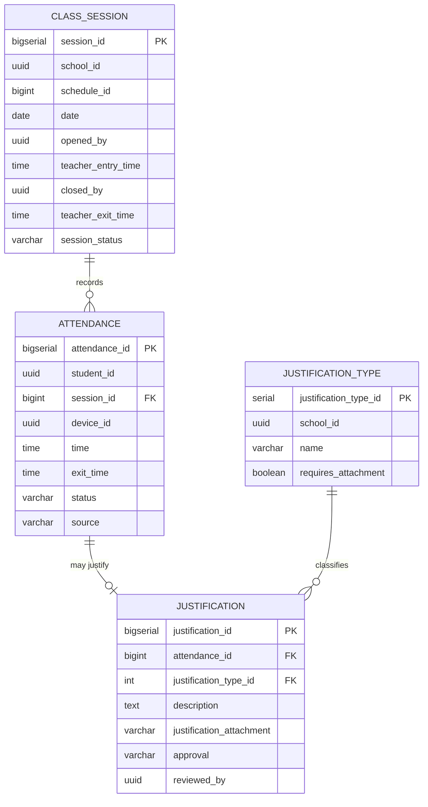

# Domain: Attendance

> **Owner:** Attendance bounded context
> **DB Engine:** PostgreSQL 17 — ACID transactions, session-based attendance tracking
>
> **Engine justification:**
> - Attendance records require transactional integrity (one record per student per session).
> - Class_Session state machine (Open/Closed/Cancelled) needs reliable status tracking.
> - Justification workflow (Pending/Approved/Rejected) requires ACID guarantees.

---

## Design Principles

- Attendance has **NO** FK toward Academic or IoT.
- `student_id`, `schedule_id`, and `device_id` are external IDs.
- `Class_Session` represents a real occurrence of a scheduled class.
- Attendance can only be recorded while the associated session is `Open`.
- Cross-context consistency is resolved via API/events.

---

## 1. Enums

| Enum | Values |
|------|--------|
| Attendance_Status | Present, Absent, Late, Justified |
| Class_Session_Status | Open, Closed, Cancelled |
| Approval_Status | Pending, Approved, Rejected |

---

## 2. Table: class_session

**Purpose:** Represents a real occurrence of a scheduled class. The teacher opens it when starting and closes it when finishing.

```sql
CREATE TABLE class_session (
  -- Business fields
  session_id          BIGSERIAL   PRIMARY KEY,
  school_id           UUID        NOT NULL,
  schedule_id         BIGINT      NOT NULL,
  date                DATE        NOT NULL,
  opened_by           UUID,
  teacher_entry_time  TIME,
  closed_by           UUID,
  teacher_exit_time   TIME,

  -- Status fields
  session_status      VARCHAR     NOT NULL DEFAULT 'Open',

  -- Audit (in all tables)
  created_at          TIMESTAMPTZ NOT NULL DEFAULT NOW(),
  updated_at          TIMESTAMPTZ NOT NULL DEFAULT NOW(),
  deleted_at          TIMESTAMPTZ,
  created_by          UUID,
  updated_by          UUID
);

CREATE UNIQUE INDEX uq_session_schedule_date ON class_session (schedule_id, date);
CREATE INDEX idx_session_schedule ON class_session (schedule_id);
CREATE INDEX idx_session_date ON class_session (date);
CREATE INDEX idx_session_deleted ON class_session (deleted_at) WHERE deleted_at IS NULL;
```

**Data dictionary:**

| Column | Type | Description | Example |
|--------|------|-------------|---------|
| session_id | BIGSERIAL | Auto-incremental session identifier | `1` |
| school_id | UUID | School | `550e8400-...` |
| schedule_id | BIGINT | Associated schedule (external ID → Academic.schedule) | `1` |
| date | DATE | Session date | `2024-06-01` |
| opened_by | UUID | Teacher ID who opened the class (may be a substitute, external ID) | `550e8400-...` |
| teacher_entry_time | TIME | When the teacher opened/initiated the class | `08:00` |
| closed_by | UUID | Teacher ID who closed the class (external ID) | `550e8400-...` |
| teacher_exit_time | TIME | When the teacher closed/ended the class | `09:30` |
| session_status | VARCHAR | Session state: Open, Closed, Cancelled | `Open` |
| created_at | TIMESTAMPTZ | When the record was created | `2024-06-01T08:00:00Z` |
| updated_at | TIMESTAMPTZ | When the record was last updated | `2024-06-01T08:00:00Z` |
| deleted_at | TIMESTAMPTZ | NULL = active; with value = soft-deleted | `NULL` |
| created_by | UUID | User who created this record | `550e8400-...` |
| updated_by | UUID | User who last updated this record | `550e8400-...` |

**Modeling decisions:**
1. A session is created only when the teacher starts the class — no pre-creation for each day.
2. `opened_by` can differ from the teacher assigned to the schedule (substitution).
3. If the session is never opened, no row exists for that day.
4. `schedule_id` is an external reference to Academic — no cross-context FK.

---

## 3. Table: attendance

**Purpose:** Individual attendance record of a student in a class session.

```sql
CREATE TABLE attendance (
  -- Business fields
  attendance_id   BIGSERIAL   PRIMARY KEY,
  school_id       UUID        NOT NULL,
  student_id      UUID        NOT NULL,
  session_id      BIGINT      NOT NULL,
  device_id       UUID,
  time            TIME        NOT NULL,
  exit_time       TIME,

  -- Status fields
  status          VARCHAR     NOT NULL,
  source          VARCHAR     NOT NULL,

  -- Audit (in all tables)
  created_at      TIMESTAMPTZ NOT NULL DEFAULT NOW(),
  updated_at      TIMESTAMPTZ NOT NULL DEFAULT NOW(),
  deleted_at      TIMESTAMPTZ,
  created_by      UUID,
  updated_by      UUID
);

CREATE UNIQUE INDEX uq_attendance_student_session
  ON attendance (student_id, session_id);
CREATE INDEX idx_attendance_student ON attendance (student_id);
CREATE INDEX idx_attendance_session ON attendance (session_id);
CREATE INDEX idx_attendance_device ON attendance (device_id);
CREATE INDEX idx_attendance_deleted ON attendance (deleted_at) WHERE deleted_at IS NULL;

ALTER TABLE attendance ADD CONSTRAINT fk_attendance_session
  FOREIGN KEY (session_id) REFERENCES class_session(session_id);
```

**Data dictionary:**

| Column | Type | Description | Example |
|--------|------|-------------|---------|
| attendance_id | BIGSERIAL | Auto-incremental attendance record identifier | `1` |
| school_id | UUID | School | `550e8400-...` |
| student_id | UUID | Student (external ID → Academic.student) | `550e8400-...` |
| session_id | BIGINT | Class session (FK → class_session) | `1` |
| device_id | UUID | IoT device that recorded attendance (external ID) | `550e8400-...` |
| time | TIME | Student check-in time | `08:05` |
| exit_time | TIME | Student check-out time | `09:25` |
| status | VARCHAR | Attendance status: Present, Absent, Late, Justified | `Present` |
| source | VARCHAR | How attendance was captured: Manual, IoT, Biometric, Import | `IoT` |
| created_at | TIMESTAMPTZ | When the record was created | `2024-06-01T08:05:00Z` |
| updated_at | TIMESTAMPTZ | When the record was last updated | `2024-06-01T08:05:00Z` |
| deleted_at | TIMESTAMPTZ | NULL = active; with value = soft-deleted | `NULL` |
| created_by | UUID | User who created this record | `550e8400-...` |
| updated_by | UUID | User who last updated this record | `550e8400-...` |

**Modeling decisions:**
1. A student can only have one attendance record per session (uniqueness on student_id, session_id).
2. `source` records how attendance was captured: Manual (teacher), IoT (device), Biometric (face/fingerprint), Import (bulk upload).
3. `exit_time` allows calculating duration of stay in class.
4. Attendance can only be recorded if `class_session.session_status = Open`.

---

## 4. Table: justification_type

**Purpose:** Catalog of justification types for absences.

```sql
CREATE TABLE justification_type (
  -- Business fields
  justification_type_id  SERIAL      PRIMARY KEY,
  school_id              UUID        NOT NULL,
  name                   VARCHAR     NOT NULL,
  description            VARCHAR,
  requires_attachment    BOOLEAN     NOT NULL DEFAULT false,

  -- Status fields
  status                 BOOLEAN     NOT NULL DEFAULT true,

  -- Audit (in all tables)
  created_at             TIMESTAMPTZ NOT NULL DEFAULT NOW(),
  updated_at             TIMESTAMPTZ NOT NULL DEFAULT NOW(),
  deleted_at             TIMESTAMPTZ,
  created_by             UUID,
  updated_by             UUID
);

CREATE UNIQUE INDEX uq_justification_type_name_school
  ON justification_type (school_id, name);
CREATE INDEX idx_justification_type_deleted ON justification_type (deleted_at) WHERE deleted_at IS NULL;
```

**Data dictionary:**

| Column | Type | Description | Example |
|--------|------|-------------|---------|
| justification_type_id | SERIAL | Auto-incremental justification type identifier | `1` |
| school_id | UUID | Owning school | `550e8400-...` |
| name | VARCHAR | Type name | `Medical leave` |
| description | VARCHAR | Type description | `Validated medical incapacity` |
| requires_attachment | BOOLEAN | Whether supporting attachment is required | `true` |
| status | BOOLEAN | Active/inactive flag | `true` |
| created_at | TIMESTAMPTZ | When the record was created | `2024-01-15T10:30:00Z` |
| updated_at | TIMESTAMPTZ | When the record was last updated | `2024-01-15T10:30:00Z` |
| deleted_at | TIMESTAMPTZ | NULL = active; with value = soft-deleted | `NULL` |
| created_by | UUID | User who created this record | `550e8400-...` |
| updated_by | UUID | User who last updated this record | `550e8400-...` |

---

## 5. Table: justification

**Purpose:** Justification request for a specific absence. Linked to an attendance record.

```sql
CREATE TABLE justification (
  -- Business fields
  justification_id        BIGSERIAL   PRIMARY KEY,
  attendance_id           BIGINT      NOT NULL UNIQUE,
  justification_type_id   INT         NOT NULL,
  description             TEXT        NOT NULL,
  justification_attachment VARCHAR,

  -- Status fields
  approval                VARCHAR     NOT NULL DEFAULT 'Pending',

  -- Audit (in all tables)
  created_at              TIMESTAMPTZ NOT NULL DEFAULT NOW(),
  updated_at              TIMESTAMPTZ NOT NULL DEFAULT NOW(),
  deleted_at              TIMESTAMPTZ,
  created_by              UUID,
  updated_by              UUID,

  -- Extra
  reviewed_by             UUID,
  reviewed_at             TIMESTAMPTZ
);

CREATE UNIQUE INDEX uq_justification_attendance ON justification (attendance_id);
CREATE INDEX idx_justification_type ON justification (justification_type_id);
CREATE INDEX idx_justification_reviewer ON justification (reviewed_by);
CREATE INDEX idx_justification_deleted ON justification (deleted_at) WHERE deleted_at IS NULL;

ALTER TABLE justification ADD CONSTRAINT fk_justification_attendance
  FOREIGN KEY (attendance_id) REFERENCES attendance(attendance_id);
ALTER TABLE justification ADD CONSTRAINT fk_justification_type
  FOREIGN KEY (justification_type_id) REFERENCES justification_type(justification_type_id);
```

**Data dictionary:**

| Column | Type | Description | Example |
|--------|------|-------------|---------|
| justification_id | BIGSERIAL | Auto-incremental justification identifier | `1` |
| attendance_id | BIGINT | Attendance record being justified (FK → attendance, UNIQUE) | `1` |
| justification_type_id | INT | Justification type (FK → justification_type) | `1` |
| description | TEXT | Justification reason/description | `Medical appointment` |
| justification_attachment | VARCHAR | Attachment file path or URL | `/docs/justification_001.pdf` |
| approval | VARCHAR | Approval status: Pending, Approved, Rejected | `Pending` |
| created_at | TIMESTAMPTZ | When the record was created | `2024-06-01T10:00:00Z` |
| updated_at | TIMESTAMPTZ | When the record was last updated | `2024-06-01T10:00:00Z` |
| deleted_at | TIMESTAMPTZ | NULL = active; with value = soft-deleted | `NULL` |
| created_by | UUID | User who created this record | `550e8400-...` |
| updated_by | UUID | User who last updated this record | `550e8400-...` |
| reviewed_by | UUID | User who reviewed (external ID → Identity."user") | `550e8400-...` |
| reviewed_at | TIMESTAMPTZ | Review timestamp | `2024-06-02T14:00:00Z` |

**Modeling decisions:**
1. 1:1 relationship with Attendance — each absence has at most one justification.
2. `reviewed_by` is an external ID from Identity."user" — no cross-context FK.
3. Approval follows a workflow: Pending → Approved/Rejected.

---

## 6. Relationship Diagram



---

## 7. Cross-Context Relationships

| From | To | Reference Type | Mechanism |
|------|----|----------------|-----------|
| Class_Session.schedule_id | Academic.Schedule.schedule_id | External ID (no FK) | Cross-context reference by BIGINT |
| Class_Session.opened_by / closed_by | Academic.Teacher.teacher_id | External ID (no FK) | Cross-context reference by UUID |
| Attendance.student_id | Academic.Student.student_id | External ID (no FK) | Cross-context reference by UUID |
| Attendance.device_id | IoT.IoT_Device.device_id | External ID (no FK) | Cross-context reference by UUID |
| Justification.reviewed_by | Identity."user".user_id | External ID (no FK) | Cross-context reference by UUID |

---

## 8. Correlations

- Domain entities that map to these tables → `02-domain/entities-and-rules.md`
- Saga and Outbox pattern for distributed consistency → `05-architecture/pattern-guide.md`
- Data for each service in detail → `09-microservices/services/attendance-service/data-model.md`
- How data is accessed via API → `07-api/contracts/openapi/`
