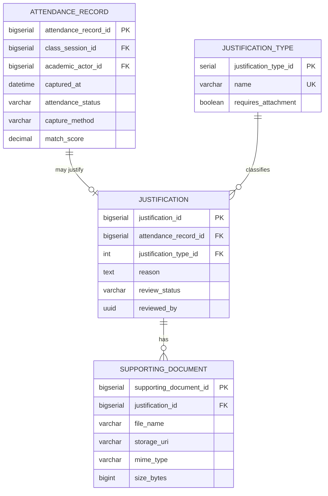

# Domain: Attendance

> **Owner:** Attendance bounded context
> **DB Engine:** PostgreSQL 17 — ACID transactions, session-based attendance tracking
>
> **Engine justification:**
> - Attendance records require transactional integrity (one record per actor per session).
> - Justification workflow (Pending/Approved/Rejected) requires ACID guarantees.
> - Supporting documents tracked separately for flexibility.

---

## Design Principles

- Attendance has **NO** FK toward Scheduling or Academic.
- `class_session_id` and `academic_actor_id` are external IDs.
- Attendance can only be recorded while the associated session is `Open`.

---

## 1. Table: attendance_record

**Purpose:** Individual attendance record of an academic_actor in a class_session.

```sql
CREATE TABLE attendance_record (
  -- Business fields
  attendance_record_id  BIGSERIAL   PRIMARY KEY,
  class_session_id      BIGINT      NOT NULL,
  academic_actor_id     BIGINT      NOT NULL,
  captured_at           TIMESTAMPTZ,

  -- Status fields
  attendance_status     VARCHAR     NOT NULL,
  capture_method        VARCHAR     NOT NULL,
  match_score           DECIMAL(5,4),

  -- Audit (in all tables)
  created_at            TIMESTAMPTZ NOT NULL DEFAULT NOW(),
  updated_at            TIMESTAMPTZ NOT NULL DEFAULT NOW(),
  deleted_at            TIMESTAMPTZ,
  created_by            UUID,
  updated_by            UUID,
  deleted_by            UUID,
  row_version           BIGINT      NOT NULL DEFAULT 1
);

CREATE UNIQUE INDEX uq_attendance_session_actor
  ON attendance_record (class_session_id, academic_actor_id);
CREATE INDEX idx_attendance_actor ON attendance_record (academic_actor_id);
CREATE INDEX idx_attendance_deleted ON attendance_record (deleted_at) WHERE deleted_at IS NULL;
```

**Data dictionary:**

| Column | Type | Description | Example |
|--------|------|-------------|---------|
| attendance_record_id | BIGSERIAL | Auto-incremental record identifier | `1` |
| class_session_id | BIGINT | Class session (external ID → Scheduling.class_session) | `1` |
| academic_actor_id | BIGINT | Actor being tracked (external ID → Academic.academic_actor) | `1` |
| captured_at | TIMESTAMPTZ | When attendance was captured | `2024-06-01T08:05:00Z` |
| attendance_status | VARCHAR | Status: Present, Absent, Late, Justified | `Present` |
| capture_method | VARCHAR | Method: FACIAL, MANUAL, IMPORT | `FACIAL` |
| match_score | DECIMAL(5,4) | Biometric match score (0.0000..1.0000) | `0.9876` |
| created_at | TIMESTAMPTZ | When the record was created | `2024-06-01T08:05:00Z` |
| updated_at | TIMESTAMPTZ | When the record was last updated | `2024-06-01T08:05:00Z` |
| deleted_at | TIMESTAMPTZ | NULL = active; with value = soft-deleted | `NULL` |
| created_by | UUID | User who created this record | `550e8400-...` |
| updated_by | UUID | User who last updated this record | `550e8400-...` |
| deleted_by | UUID | User who soft-deleted this record | `NULL` |
| row_version | BIGINT | Optimistic lock version counter | `1` |

**Modeling decisions:**
1. One record per actor per session (uniqueness on class_session_id, academic_actor_id).
2. `match_score` stores biometric confidence for FACIAL captures.
3. `capture_method` replaces the old `source` field with a controlled vocabulary.

---

## 2. Table: justification_type

**Purpose:** Catalog of justification types for absences.

```sql
CREATE TABLE justification_type (
  -- Business fields
  justification_type_id  SERIAL      PRIMARY KEY,
  name                   VARCHAR     NOT NULL UNIQUE,
  description            VARCHAR,
  requires_attachment    BOOLEAN     NOT NULL DEFAULT false,

  -- Status fields
  status                 BOOLEAN     NOT NULL DEFAULT true,

  -- Audit (in all tables)
  created_at             TIMESTAMPTZ NOT NULL DEFAULT NOW(),
  updated_at             TIMESTAMPTZ NOT NULL DEFAULT NOW(),
  deleted_at             TIMESTAMPTZ,
  created_by             UUID,
  updated_by             UUID,
  deleted_by             UUID,
  row_version            BIGINT      NOT NULL DEFAULT 1
);
```

**Data dictionary:**

| Column | Type | Description | Example |
|--------|------|-------------|---------|
| justification_type_id | SERIAL | Auto-incremental type identifier | `1` |
| name | VARCHAR | Unique type name | `Medical leave` |
| description | VARCHAR | Type description | `Validated medical incapacity` |
| requires_attachment | BOOLEAN | Whether supporting document is required | `true` |
| status | BOOLEAN | Active/inactive flag | `true` |
| created_at | TIMESTAMPTZ | When the record was created | `2024-01-15T10:30:00Z` |
| updated_at | TIMESTAMPTZ | When the record was last updated | `2024-01-15T10:30:00Z` |
| deleted_at | TIMESTAMPTZ | NULL = active; with value = soft-deleted | `NULL` |
| created_by | UUID | User who created this record | `550e8400-...` |
| updated_by | UUID | User who last updated this record | `550e8400-...` |
| deleted_by | UUID | User who soft-deleted this record | `NULL` |
| row_version | BIGINT | Optimistic lock version counter | `1` |

---

## 3. Table: justification

**Purpose:** Justification request for a specific absence. Linked 1:1 to attendance_record.

```sql
CREATE TABLE justification (
  -- Business fields
  justification_id        BIGSERIAL   PRIMARY KEY,
  attendance_record_id    BIGINT      NOT NULL UNIQUE,
  justification_type_id   INT         NOT NULL,
  reason                  TEXT        NOT NULL,
  submitted_at            TIMESTAMPTZ NOT NULL,

  -- Status fields
  review_status           VARCHAR     NOT NULL,

  -- Audit (in all tables)
  created_at              TIMESTAMPTZ NOT NULL DEFAULT NOW(),
  updated_at              TIMESTAMPTZ NOT NULL DEFAULT NOW(),
  deleted_at              TIMESTAMPTZ,
  created_by              UUID,
  updated_by              UUID,
  deleted_by              UUID,
  row_version             BIGINT      NOT NULL DEFAULT 1,

  -- Extra
  reviewed_by             UUID,
  reviewed_at             TIMESTAMPTZ
);

CREATE INDEX idx_justification_type ON justification (justification_type_id);
CREATE INDEX idx_justification_reviewer ON justification (reviewed_by);
```

**Data dictionary:**

| Column | Type | Description | Example |
|--------|------|-------------|---------|
| justification_id | BIGSERIAL | Auto-incremental justification identifier | `1` |
| attendance_record_id | BIGINT | Attendance record (FK → attendance_record, UNIQUE) | `1` |
| justification_type_id | INT | Type of justification (FK → justification_type) | `1` |
| reason | TEXT | Detailed justification reason | `Medical appointment` |
| submitted_at | TIMESTAMPTZ | When the justification was submitted | `2024-06-01T10:00:00Z` |
| review_status | VARCHAR | Status: Pending, Approved, Rejected | `Pending` |
| created_at | TIMESTAMPTZ | When the record was created | `2024-06-01T10:00:00Z` |
| updated_at | TIMESTAMPTZ | When the record was last updated | `2024-06-01T10:00:00Z` |
| deleted_at | TIMESTAMPTZ | NULL = active; with value = soft-deleted | `NULL` |
| created_by | UUID | User who created this record | `550e8400-...` |
| updated_by | UUID | User who last updated this record | `550e8400-...` |
| deleted_by | UUID | User who soft-deleted this record | `NULL` |
| row_version | BIGINT | Optimistic lock version counter | `1` |
| reviewed_by | UUID | Reviewing user (external ID → Identity.app_user) | `550e8400-...` |
| reviewed_at | TIMESTAMPTZ | When the justification was reviewed | `2024-06-02T14:00:00Z` |

---

## 4. Table: supporting_document

**Purpose:** Files attached to a justification (medical certificates, etc.).

```sql
CREATE TABLE supporting_document (
  -- Business fields
  supporting_document_id  BIGSERIAL   PRIMARY KEY,
  justification_id        BIGINT      NOT NULL,
  file_name               VARCHAR     NOT NULL,
  storage_uri             VARCHAR     NOT NULL,
  mime_type               VARCHAR     NOT NULL,
  size_bytes              BIGINT      NOT NULL,

  -- Audit (in all tables)
  created_at              TIMESTAMPTZ NOT NULL DEFAULT NOW(),
  updated_at              TIMESTAMPTZ NOT NULL DEFAULT NOW(),
  deleted_at              TIMESTAMPTZ,
  created_by              UUID,
  updated_by              UUID,
  deleted_by              UUID,
  row_version             BIGINT      NOT NULL DEFAULT 1
);

CREATE INDEX idx_document_justification ON supporting_document (justification_id);
```

**Data dictionary:**

| Column | Type | Description | Example |
|--------|------|-------------|---------|
| supporting_document_id | BIGSERIAL | Auto-incremental document identifier | `1` |
| justification_id | BIGINT | Parent justification (FK → justification) | `1` |
| file_name | VARCHAR | Original file name | `medical_cert.pdf` |
| storage_uri | VARCHAR | Storage path or URL | `/docs/justifications/001/medical_cert.pdf` |
| mime_type | VARCHAR | MIME type of the file | `application/pdf` |
| size_bytes | BIGINT | File size in bytes | `245760` |
| created_at | TIMESTAMPTZ | When the record was created | `2024-06-01T10:00:00Z` |
| updated_at | TIMESTAMPTZ | When the record was last updated | `2024-06-01T10:00:00Z` |
| deleted_at | TIMESTAMPTZ | NULL = active; with value = soft-deleted | `NULL` |
| created_by | UUID | User who created this record | `550e8400-...` |
| updated_by | UUID | User who last updated this record | `550e8400-...` |
| deleted_by | UUID | User who soft-deleted this record | `NULL` |
| row_version | BIGINT | Optimistic lock version counter | `1` |

---

## 5. Relationship Diagram



---

## 6. Cross-Context Relationships

| From | To | Reference Type | Mechanism |
|------|----|----------------|-----------|
| Attendance_Record.class_session_id | Scheduling.Class_Session.class_session_id | External ID (no FK) | Cross-context reference by BIGINT |
| Attendance_Record.academic_actor_id | Academic.Academic_Actor.academic_actor_id | External ID (no FK) | Cross-context reference by BIGINT |
| Justification.reviewed_by | Identity.App_User.user_id | External ID (no FK) | Cross-context reference by UUID |

---

## 7. Correlations

- Domain entities that map to these tables → `02-domain/entities-and-rules.md`
- Saga and Outbox pattern for distributed consistency → `05-architecture/pattern-guide.md`
- Data for each service in detail → `09-microservices/services/attendance-service/data-model.md`
- How data is accessed via API → `07-api/contracts/openapi/`
