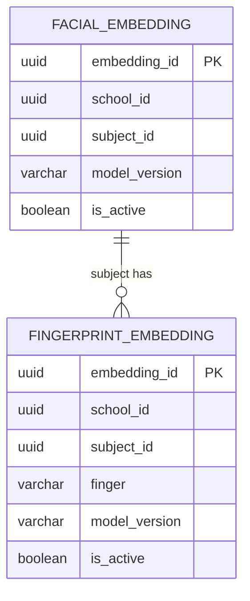

# Domain: Biometric

> **Owner:** Biometric bounded context
> **DB Engine:** MongoDB 7 (NoSQL) — document collections for flexible embedding storage
>
> **Engine justification:**
> - Facial and fingerprint embeddings are variable-length vectors — document storage is natural.
> - MongoDB supports vector search indexes for similarity matching.
> - Schema flexibility accommodates different embedding model versions.

---

## Design Principles

- Biometric does **NOT** know Person — `subject_id` represents an external identity.
- This context persists in **NoSQL** (MongoDB), not in a relational database.
- The collections below are a logical/document representation.
- DBML does not natively model document schemas, so no real FKs exist between collections.
- ID references are resolved at the application level.

---

## 1. Collection: facial_embeddings

**Purpose:** Storage of facial embeddings (numeric vectors representing a face).

```javascript
// MongoDB Collection: facial_embeddings
{
  _id: ObjectId,

  // Business fields
  embedding_id: UUID,
  school_id: UUID,
  subject_id: UUID,
  embedding: [Float],
  model_version: String,

  // Status fields
  is_active: Boolean,

  // Audit (in all documents)
  created_at: Date,
  updated_at: Date,
  deleted_at: Date,
  created_by: UUID,
  updated_by: UUID
}
```

**Data dictionary:**

| Field | Type | Description | Example |
|-------|------|-------------|---------|
| embedding_id | UUID | Unique identifier for the embedding | `550e8400-e29b-41d4-a716-446655440020` |
| school_id | UUID | Owning school | `550e8400-...` |
| subject_id | UUID | External identity (→ Identity.person) | `550e8400-...` |
| embedding | Array[Float] | Facial embedding vector (512/1024 dimensions) | `[0.12, -0.45, ...]` |
| model_version | String | AI model version used to generate embedding | `face_net_v2.1` |
| is_active | Boolean | Whether this is the current active embedding | `true` |
| created_at | Date | When the document was created | `2024-01-15T10:30:00Z` |
| updated_at | Date | When the document was last updated | `2024-01-15T10:30:00Z` |
| deleted_at | Date | NULL = active; with value = soft-deleted | `null` |
| created_by | UUID | User who created this document | `550e8400-...` |
| updated_by | UUID | User who last updated this document | `550e8400-...` |

**Indexes:**

| Name | Fields | Type | Justification |
|------|--------|------|---------------|
| idx_embedding_subject_active | (subject_id, is_active) | Compound | Find active embeddings per subject |
| idx_embedding_school | school_id | Simple | Filter by school |
| idx_embedding_deleted | deleted_at | Sparse | Filter out soft-deleted documents |

**Modeling decisions:**
1. A subject can have multiple embeddings (history, different models).
2. `is_active` identifies the current embedding — older ones are deactivated.
3. `model_version` tracks which AI model generated the embedding.
4. Stored in MongoDB because embedding vectors are flexible documents and similarity search is more efficient in NoSQL.

---

## 2. Collection: fingerprint_embeddings

**Purpose:** Storage of fingerprint biometric templates.

```javascript
// MongoDB Collection: fingerprint_embeddings
{
  _id: ObjectId,

  // Business fields
  embedding_id: UUID,
  school_id: UUID,
  subject_id: UUID,
  template: [Float],
  finger: String,
  model_version: String,

  // Status fields
  is_active: Boolean,

  // Audit (in all documents)
  created_at: Date,
  updated_at: Date,
  deleted_at: Date,
  created_by: UUID,
  updated_by: UUID
}
```

**Data dictionary:**

| Field | Type | Description | Example |
|-------|------|-------------|---------|
| embedding_id | UUID | Unique identifier for the template | `550e8400-e29b-41d4-a716-446655440021` |
| school_id | UUID | Owning school | `550e8400-...` |
| subject_id | UUID | External identity (→ Identity.person) | `550e8400-...` |
| template | Array[Float] | Fingerprint biometric template | `[0.23, -0.67, ...]` |
| finger | String | Finger registered | `right_thumb` |
| model_version | String | AI model version used to generate template | `fingerprint_v1.3` |
| is_active | Boolean | Whether this is the current active template | `true` |
| created_at | Date | When the document was created | `2024-01-15T10:30:00Z` |
| updated_at | Date | When the document was last updated | `2024-01-15T10:30:00Z` |
| deleted_at | Date | NULL = active; with value = soft-deleted | `null` |
| created_by | UUID | User who created this document | `550e8400-...` |
| updated_by | UUID | User who last updated this document | `550e8400-...` |

**Indexes:**

| Name | Fields | Type | Justification |
|------|--------|------|---------------|
| idx_fingerprint_subject_finger_active | (subject_id, finger, is_active) | Compound | Find active template by subject and finger |
| idx_fingerprint_school | school_id | Simple | Filter by school |
| idx_fingerprint_deleted | deleted_at | Sparse | Filter out soft-deleted documents |

**Modeling decisions:**
1. A subject can have multiple fingerprints (each finger is a separate record).
2. `finger` identifies which finger was registered — enables verification against the specific finger.
3. `is_active` allows maintaining a history of updated templates.

---

## 3. Relationship Diagram

> **Note:** `Facial_Update_Case` belongs to the Configuration domain (see `08-configuration.md`).



---

## 4. Cross-Context Relationships

| From | To | Reference Type | Mechanism |
|------|----|----------------|-----------|
| Facial_Embedding.subject_id | Identity.Person.person_id | External ID (no FK) | Cross-context reference by UUID |
| Fingerprint_Embedding.subject_id | Identity.Person.person_id | External ID (no FK) | Cross-context reference by UUID |

> **Note:** Since this context persists in MongoDB, no physical FKs exist. All references are resolved at the application level via calls to the corresponding services.

---

## 5. Correlations

- Domain entities that map to these collections → `02-domain/entities-and-rules.md`
- Saga and Outbox pattern for distributed consistency → `05-architecture/pattern-guide.md`
- Data for each service in detail → `09-microservices/services/biometric-service/data-model.md`
- How data is accessed via API → `07-api/contracts/openapi/`
