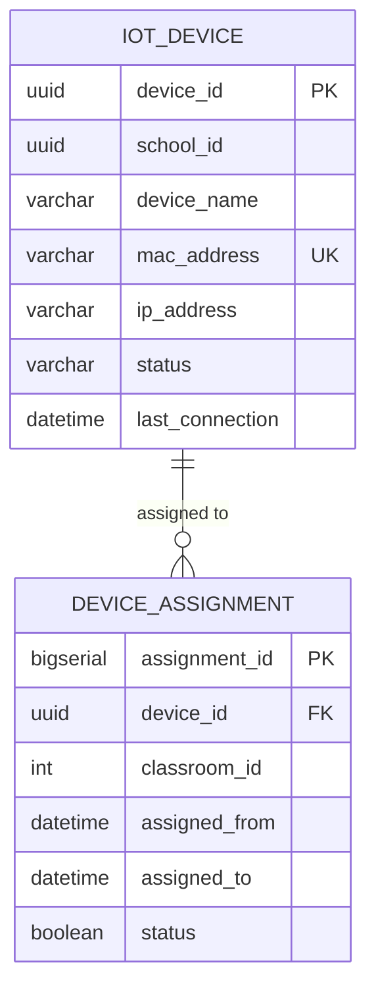

# Domain: IoT

> **Owner:** IoT bounded context
> **DB Engine:** PostgreSQL 17 — ACID transactions, device lifecycle management
>
> **Engine justification:**
> - Device assignment history requires relational integrity.
> - MAC address uniqueness is critical for device identification.
> - Timely connection monitoring benefits from indexed timestamp queries.

---

## Design Principles

- IoT does **NOT** depend on Classroom via FK.
- A device can change classrooms over time.
- `classroom_id` is an external reference to Academic — no cross-context FK.

---

## 1. Enums

| Enum | Values |
|------|--------|
| Device_Status | Active, Inactive, Maintenance |

---

## 2. Table: iot_device

**Purpose:** Record of IoT devices (cameras, fingerprint readers, sensors) installed at the school.

```sql
CREATE TABLE iot_device (
  -- Business fields
  device_id        UUID         PRIMARY KEY DEFAULT gen_random_uuid(),
  school_id        UUID         NOT NULL,
  device_name      VARCHAR      NOT NULL,
  mac_address      VARCHAR      UNIQUE,
  ip_address       VARCHAR,

  -- Status fields
  status           VARCHAR      NOT NULL DEFAULT 'Active',

  -- Audit (in all tables)
  created_at       TIMESTAMPTZ  NOT NULL DEFAULT NOW(),
  updated_at       TIMESTAMPTZ  NOT NULL DEFAULT NOW(),
  deleted_at       TIMESTAMPTZ,
  created_by       UUID,
  updated_by       UUID,

  -- Extra
  last_connection  TIMESTAMPTZ,
  observation      TEXT
);

CREATE UNIQUE INDEX uq_device_mac ON iot_device (mac_address);
CREATE INDEX idx_device_school ON iot_device (school_id);
CREATE INDEX idx_device_status ON iot_device (status);
CREATE INDEX idx_device_deleted ON iot_device (deleted_at) WHERE deleted_at IS NULL;
```

**Data dictionary:**

| Column | Type | Description | Example |
|--------|------|-------------|---------|
| device_id | UUID | Auto-generated unique identifier for the device | `550e8400-e29b-41d4-a716-446655440030` |
| school_id | UUID | School where it is installed | `550e8400-...` |
| device_name | VARCHAR | Descriptive device name | `Camera Room 101` |
| mac_address | VARCHAR | MAC address (unique physical identifier) | `AA:BB:CC:DD:EE:FF` |
| ip_address | VARCHAR | Current IP address | `192.168.1.50` |
| status | VARCHAR | Device state: Active, Inactive, Maintenance | `Active` |
| created_at | TIMESTAMPTZ | When the record was created | `2024-01-15T10:30:00Z` |
| updated_at | TIMESTAMPTZ | When the record was last updated | `2024-01-15T10:30:00Z` |
| deleted_at | TIMESTAMPTZ | NULL = active; with value = soft-deleted | `NULL` |
| created_by | UUID | User who created this record | `550e8400-...` |
| updated_by | UUID | User who last updated this record | `550e8400-...` |
| last_connection | TIMESTAMPTZ | Last time the device connected to the system | `2024-06-01T08:00:00Z` |
| observation | TEXT | Notes/observations about the device | `Installed in corner` |

**Modeling decisions:**
1. `mac_address` is UNIQUE because it is the hardware's physical identifier.
2. `last_connection` enables monitoring of disconnected or problematic devices.
3. `status` has three states: Active (operational), Inactive (deactivated), Maintenance (under maintenance).
4. No FK with Academic.classroom — assignment is temporary and managed in device_assignment.

---

## 3. Table: device_assignment

**Purpose:** History of device-to-classroom assignments. Records which device was in which classroom and when.

```sql
CREATE TABLE device_assignment (
  -- Business fields
  assignment_id  BIGSERIAL   PRIMARY KEY,
  device_id      UUID        NOT NULL,
  classroom_id   INT         NOT NULL,
  assigned_from  TIMESTAMPTZ NOT NULL,
  assigned_to    TIMESTAMPTZ,

  -- Status fields
  status         BOOLEAN     NOT NULL DEFAULT true,

  -- Audit (in all tables)
  created_at     TIMESTAMPTZ NOT NULL DEFAULT NOW(),
  updated_at     TIMESTAMPTZ NOT NULL DEFAULT NOW(),
  deleted_at     TIMESTAMPTZ,
  created_by     UUID,
  updated_by     UUID
);

CREATE INDEX idx_assignment_device ON device_assignment (device_id);
CREATE INDEX idx_assignment_classroom ON device_assignment (classroom_id);
CREATE UNIQUE INDEX uq_device_assignment_start
  ON device_assignment (device_id, assigned_from);
CREATE INDEX idx_assignment_deleted ON device_assignment (deleted_at) WHERE deleted_at IS NULL;

ALTER TABLE device_assignment ADD CONSTRAINT fk_assignment_device
  FOREIGN KEY (device_id) REFERENCES iot_device(device_id);
```

**Data dictionary:**

| Column | Type | Description | Example |
|--------|------|-------------|---------|
| assignment_id | BIGSERIAL | Auto-incremental assignment identifier | `1` |
| device_id | UUID | Assigned device (FK → iot_device) | `550e8400-...` |
| classroom_id | INT | Classroom where assigned (external ID → Academic.classroom) | `1` |
| assigned_from | TIMESTAMPTZ | Assignment start date/time | `2024-01-15T10:30:00Z` |
| assigned_to | TIMESTAMPTZ | Assignment end date/time (NULL = current assignment) | `NULL` |
| status | BOOLEAN | Whether the assignment is active | `true` |
| created_at | TIMESTAMPTZ | When the record was created | `2024-01-15T10:30:00Z` |
| updated_at | TIMESTAMPTZ | When the record was last updated | `2024-01-15T10:30:00Z` |
| deleted_at | TIMESTAMPTZ | NULL = active; with value = soft-deleted | `NULL` |
| created_by | UUID | User who created this record | `550e8400-...` |
| updated_by | UUID | User who last updated this record | `550e8400-...` |

**Modeling decisions:**
1. History table: `assigned_to` NULL indicates the current assignment.
2. Tracks device movement between classrooms over time.
3. `classroom_id` is an external reference to Academic — no cross-context FK.
4. Consistency resolved via API: when creating an assignment, the system validates that the classroom_id exists in Academic.

---

## 4. Relationship Diagram



---

## 5. Cross-Context Relationships

| From | To | Reference Type | Mechanism |
|------|----|----------------|-----------|
| Device_Assignment.classroom_id | Academic.Classroom.classroom_id | External ID (no FK) | Cross-context reference by SERIAL |
| Attendance.device_id | IoT.IoT_Device.device_id | External ID (no FK) | Cross-context reference by UUID (from Attendance to IoT) |

> **Note:** The Attendance → IoT relationship is a reverse reference: Attendance queries IoT for device information, but IoT does not depend on Attendance.

---

## 6. Correlations

- Domain entities that map to these tables → `02-domain/entities-and-rules.md`
- Saga and Outbox pattern for distributed consistency → `05-architecture/pattern-guide.md`
- Data for each service in detail → `09-microservices/services/iot-service/data-model.md`
- How data is accessed via API → `07-api/contracts/openapi/`
