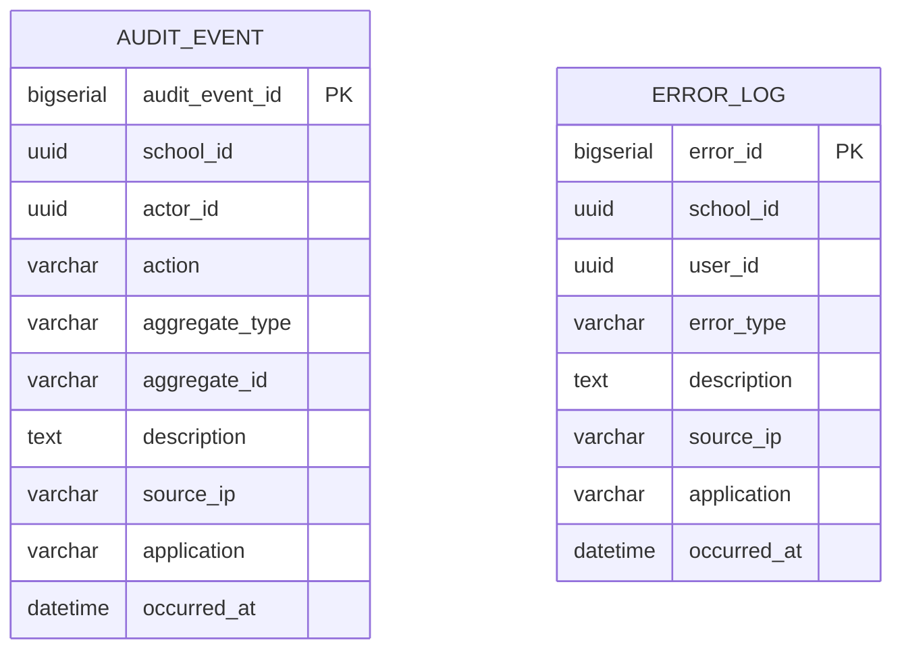

# Domain: Audit

> **Owner:** Audit bounded context
> **DB Engine:** PostgreSQL 17 — append-only writes, immutable audit trail
>
> **Engine justification:**
> - Audit records are write-once, read-many (WORM) — append-only pattern.
> - Indexed timestamps enable efficient range queries for compliance reporting.
> - Immutable records guarantee audit trail integrity.

---

## Design Principles

- Audit does **NOT** depend directly on User.
- `actor_id` is an external reference — allows recording actions even if the user is later deleted.
- `school_id` is nullable because global system events may not belong to a specific school.
- Audit can be physically separated from other services.

---

## 1. Table: audit_event

**Purpose:** Record of every relevant action performed in the system (who did what, when, from where).

```sql
CREATE TABLE audit_event (
  -- Business fields
  audit_event_id  BIGSERIAL   PRIMARY KEY,
  school_id       UUID,
  actor_id        UUID,
  action          VARCHAR     NOT NULL,
  aggregate_type  VARCHAR     NOT NULL,
  aggregate_id    VARCHAR,
  description     TEXT,
  source_ip       VARCHAR,
  application     VARCHAR,

  -- Audit (in all tables)
  occurred_at     TIMESTAMPTZ NOT NULL,
  created_at      TIMESTAMPTZ NOT NULL DEFAULT NOW(),
  updated_at      TIMESTAMPTZ NOT NULL DEFAULT NOW(),
  deleted_at      TIMESTAMPTZ,
  created_by      UUID,
  updated_by      UUID
);

CREATE INDEX idx_audit_actor ON audit_event (actor_id);
CREATE INDEX idx_audit_aggregate ON audit_event (aggregate_type, aggregate_id);
CREATE INDEX idx_audit_date ON audit_event (occurred_at);
CREATE INDEX idx_audit_school ON audit_event (school_id);
CREATE INDEX idx_audit_deleted ON audit_event (deleted_at) WHERE deleted_at IS NULL;
```

**Data dictionary:**

| Column | Type | Description | Example |
|--------|------|-------------|---------|
| audit_event_id | BIGSERIAL | Auto-incremental audit event identifier | `1` |
| school_id | UUID | Affected school (NULL for global events) | `550e8400-...` |
| actor_id | UUID | User who performed the action (external ID → Identity."user") | `550e8400-...` |
| action | VARCHAR | Action performed: CREATE, UPDATE, DELETE, LOGIN, etc. | `CREATE` |
| aggregate_type | VARCHAR | Affected entity type: Student, Enrollment, etc. | `Student` |
| aggregate_id | VARCHAR | ID of the affected entity | `550e8400-...` |
| description | TEXT | Human-readable event description | `Student enrolled in Math 101` |
| source_ip | VARCHAR | IP from which the action was performed | `192.168.1.100` |
| application | VARCHAR | Application/module that generated the event | `academic-service` |
| occurred_at | TIMESTAMPTZ | When the event actually occurred | `2024-06-01T08:15:00Z` |
| created_at | TIMESTAMPTZ | When the record was created | `2024-06-01T08:15:00Z` |
| updated_at | TIMESTAMPTZ | When the record was last updated | `2024-06-01T08:15:00Z` |
| deleted_at | TIMESTAMPTZ | NULL = active; with value = soft-deleted | `NULL` |
| created_by | UUID | User who created this record | `550e8400-...` |
| updated_by | UUID | User who last updated this record | `550e8400-...` |

**Modeling decisions:**
1. `actor_id` is nullable because system events (e.g., automated scheduler) may not have a human actor.
2. `aggregate_type` + `aggregate_id` implement the generic audit pattern — applies to any entity.
3. `occurred_at` captures the actual event time; `created_at` captures when the audit row was inserted.
4. `school_id` nullable allows global system events not tied to a specific school.

---

## 2. Table: error_log

**Purpose:** Record of system errors and exceptions.

```sql
CREATE TABLE error_log (
  -- Business fields
  error_id      BIGSERIAL   PRIMARY KEY,
  school_id     UUID,
  user_id       UUID,
  error_type    VARCHAR     NOT NULL,
  description   TEXT        NOT NULL,
  source_ip     VARCHAR,
  application   VARCHAR,

  -- Audit (in all tables)
  occurred_at   TIMESTAMPTZ NOT NULL,
  created_at    TIMESTAMPTZ NOT NULL DEFAULT NOW(),
  updated_at    TIMESTAMPTZ NOT NULL DEFAULT NOW(),
  deleted_at    TIMESTAMPTZ,
  created_by    UUID,
  updated_by    UUID
);

CREATE INDEX idx_error_user ON error_log (user_id);
CREATE INDEX idx_error_date ON error_log (occurred_at);
CREATE INDEX idx_error_school ON error_log (school_id);
CREATE INDEX idx_error_deleted ON error_log (deleted_at) WHERE deleted_at IS NULL;
```

**Data dictionary:**

| Column | Type | Description | Example |
|--------|------|-------------|---------|
| error_id | BIGSERIAL | Auto-incremental error identifier | `1` |
| school_id | UUID | School where the error occurred (NULL for global) | `550e8400-...` |
| user_id | UUID | User who caused the error (external ID → Identity."user") | `550e8400-...` |
| error_type | VARCHAR | Error classification: VALIDATION, AUTH, SYSTEM, etc. | `AUTH` |
| description | TEXT | Detailed error description | `Invalid credentials after 3 attempts` |
| source_ip | VARCHAR | Originating IP address | `192.168.1.100` |
| application | VARCHAR | Application that generated the error | `auth-service` |
| occurred_at | TIMESTAMPTZ | When the error actually occurred | `2024-06-01T08:15:00Z` |
| created_at | TIMESTAMPTZ | When the record was created | `2024-06-01T08:15:00Z` |
| updated_at | TIMESTAMPTZ | When the record was last updated | `2024-06-01T08:15:00Z` |
| deleted_at | TIMESTAMPTZ | NULL = active; with value = soft-deleted | `NULL` |
| created_by | UUID | User who created this record | `550e8400-...` |
| updated_by | UUID | User who last updated this record | `550e8400-...` |

**Modeling decisions:**
1. `user_id` is nullable because system errors may not be associated with a user.
2. `error_type` enables efficient error classification and filtering.
3. Similar to audit_event but focused on errors/exceptions rather than business actions.

---

## 3. Relationship Diagram



---

## 4. Cross-Context Relationships

| From | To | Reference Type | Mechanism |
|------|----|----------------|-----------|
| Audit_Event.actor_id | Identity."user".user_id | External ID (no FK) | Cross-context reference by UUID |
| Audit_Event.school_id | Identity.School.school_id | External ID (no FK) | Cross-context reference by UUID |
| Error_Log.user_id | Identity."user".user_id | External ID (no FK) | Cross-context reference by UUID |
| Error_Log.school_id | Identity.School.school_id | External ID (no FK) | Cross-context reference by UUID |

> **Note:** Audit is write-only (append-only). Records are never modified or deleted. This guarantees audit trail integrity.

---

## 5. Correlations

- Domain entities that map to these tables → `02-domain/entities-and-rules.md`
- Saga and Outbox pattern for distributed consistency → `05-architecture/pattern-guide.md`
- Data for each service in detail → `09-microservices/services/audit-service/data-model.md`
- How data is accessed via API → `07-api/contracts/openapi/`
