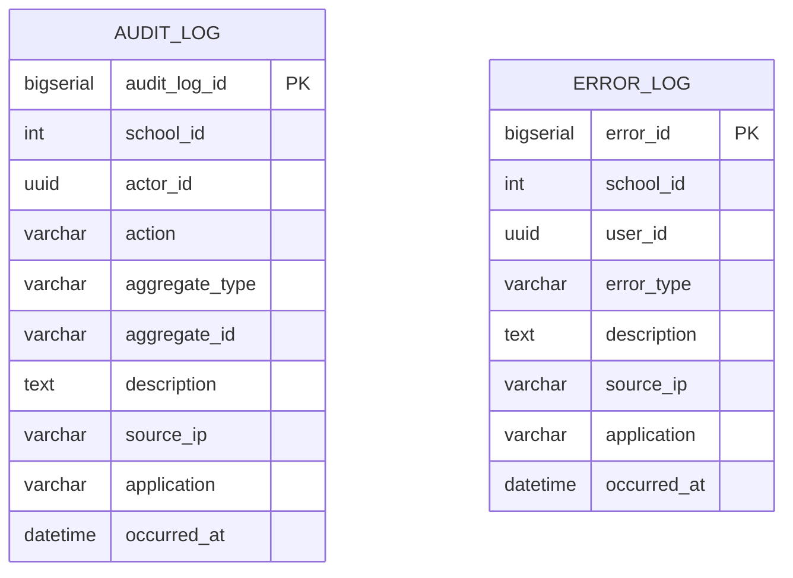

# Domain: Audit

> **Owner:** Audit bounded context
> **DB Engine:** PostgreSQL 17 — append-only writes, immutable audit trail
>
> **Engine justification:**
> - Audit records are write-once, read-many (WORM) — append-only pattern.
> - Indexed timestamps enable efficient range queries for compliance reporting.
> - Immutable records guarantee audit trail integrity.

---

## Design Principles

- Audit does **NOT** depend directly on User or School.
- `actor_id` and `school_id` are external references.

---

## 1. Table: audit_log

**Purpose:** Record of every relevant action performed in the system.

```sql
CREATE TABLE audit_log (
  -- Business fields
  audit_log_id    BIGSERIAL   PRIMARY KEY,
  school_id       INT,
  actor_id        UUID,
  action          VARCHAR     NOT NULL,
  aggregate_type  VARCHAR     NOT NULL,
  aggregate_id    VARCHAR,
  description     TEXT,
  source_ip       VARCHAR,
  application     VARCHAR,
  occurred_at     TIMESTAMPTZ NOT NULL,

  -- Audit (in all tables)
  created_at      TIMESTAMPTZ NOT NULL DEFAULT NOW(),
  updated_at      TIMESTAMPTZ NOT NULL DEFAULT NOW(),
  deleted_at      TIMESTAMPTZ,
  created_by      UUID,
  updated_by      UUID,
  deleted_by      UUID,
  row_version     BIGINT      NOT NULL DEFAULT 1
);

CREATE INDEX idx_audit_actor ON audit_log (actor_id);
CREATE INDEX idx_audit_aggregate ON audit_log (aggregate_type, aggregate_id);
CREATE INDEX idx_audit_date ON audit_log (occurred_at);
CREATE INDEX idx_audit_school ON audit_log (school_id);
```

**Data dictionary:**

| Column | Type | Description | Example |
|--------|------|-------------|---------|
| audit_log_id | BIGSERIAL | Auto-incremental audit identifier | `1` |
| school_id | INT | Affected school (external ID, NULL for global events) | `1` |
| actor_id | UUID | User who performed the action (external ID → Identity.app_user) | `550e8400-...` |
| action | VARCHAR | Action: CREATE, UPDATE, DELETE, LOGIN, etc. | `CREATE` |
| aggregate_type | VARCHAR | Affected entity type | `Enrollment` |
| aggregate_id | VARCHAR | ID of the affected entity | `1` |
| description | TEXT | Human-readable event description | `Student enrolled in Calculus I` |
| source_ip | VARCHAR | IP from which the action was performed | `192.168.1.100` |
| application | VARCHAR | Application that generated the event | `academic-service` |
| occurred_at | TIMESTAMPTZ | When the event actually occurred | `2024-06-01T08:15:00Z` |
| created_at | TIMESTAMPTZ | When the audit record was created | `2024-06-01T08:15:00Z` |
| updated_at | TIMESTAMPTZ | When the audit record was last updated | `2024-06-01T08:15:00Z` |
| deleted_at | TIMESTAMPTZ | NULL = active; with value = soft-deleted | `NULL` |
| created_by | UUID | User who created this record | `550e8400-...` |
| updated_by | UUID | User who last updated this record | `550e8400-...` |
| deleted_by | UUID | User who soft-deleted this record | `NULL` |
| row_version | BIGINT | Optimistic lock version counter | `1` |

---

## 2. Table: error_log

**Purpose:** Record of system errors and exceptions.

```sql
CREATE TABLE error_log (
  -- Business fields
  error_id      BIGSERIAL   PRIMARY KEY,
  school_id     INT,
  user_id       UUID,
  error_type    VARCHAR     NOT NULL,
  description   TEXT        NOT NULL,
  source_ip     VARCHAR,
  application   VARCHAR,
  occurred_at   TIMESTAMPTZ NOT NULL,

  -- Audit (in all tables)
  created_at    TIMESTAMPTZ NOT NULL DEFAULT NOW(),
  updated_at    TIMESTAMPTZ NOT NULL DEFAULT NOW(),
  deleted_at    TIMESTAMPTZ,
  created_by    UUID,
  updated_by    UUID,
  deleted_by    UUID,
  row_version   BIGINT      NOT NULL DEFAULT 1
);

CREATE INDEX idx_error_user ON error_log (user_id);
CREATE INDEX idx_error_date ON error_log (occurred_at);
CREATE INDEX idx_error_school ON error_log (school_id);
```

**Data dictionary:**

| Column | Type | Description | Example |
|--------|------|-------------|---------|
| error_id | BIGSERIAL | Auto-incremental error identifier | `1` |
| school_id | INT | School where error occurred (NULL for global) | `1` |
| user_id | UUID | User who caused the error (external ID → Identity.app_user) | `550e8400-...` |
| error_type | VARCHAR | Error classification: VALIDATION, AUTH, SYSTEM | `AUTH` |
| description | TEXT | Detailed error description | `Invalid credentials after 3 attempts` |
| source_ip | VARCHAR | Originating IP address | `192.168.1.100` |
| application | VARCHAR | Application that generated the error | `identity-service` |
| occurred_at | TIMESTAMPTZ | When the error actually occurred | `2024-06-01T08:15:00Z` |
| created_at | TIMESTAMPTZ | When the record was created | `2024-06-01T08:15:00Z` |
| updated_at | TIMESTAMPTZ | When the record was last updated | `2024-06-01T08:15:00Z` |
| deleted_at | TIMESTAMPTZ | NULL = active; with value = soft-deleted | `NULL` |
| created_by | UUID | User who created this record | `550e8400-...` |
| updated_by | UUID | User who last updated this record | `550e8400-...` |
| deleted_by | UUID | User who soft-deleted this record | `NULL` |
| row_version | BIGINT | Optimistic lock version counter | `1` |

---

## 3. Relationship Diagram



---

## 4. Cross-Context Relationships

| From | To | Reference Type | Mechanism |
|------|----|----------------|-----------|
| Audit_Log.actor_id | Identity.App_User.user_id | External ID (no FK) | Cross-context reference by UUID |
| Audit_Log.school_id | Academic.School.school_id | External ID (no FK) | Cross-context reference by SERIAL |
| Error_Log.user_id | Identity.App_User.user_id | External ID (no FK) | Cross-context reference by UUID |
| Error_Log.school_id | Academic.School.school_id | External ID (no FK) | Cross-context reference by SERIAL |

> **Note:** Audit is write-only (append-only). Records are never modified or deleted.

---

## 5. Correlations

- Domain entities that map to these tables → `02-domain/entities-and-rules.md`
- Saga and Outbox pattern for distributed consistency → `05-architecture/pattern-guide.md`
- Data for each service in detail → `09-microservices/services/audit-service/data-model.md`
- How data is accessed via API → `07-api/contracts/openapi/`
