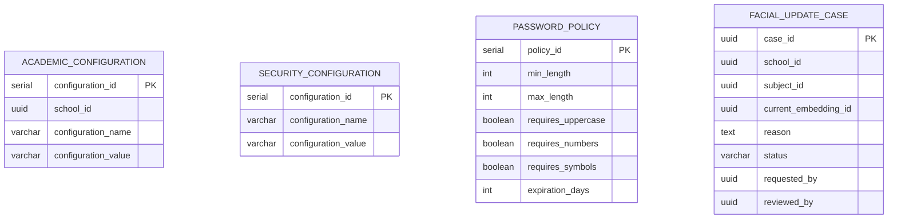

# Domain: Configuration

> **Owner:** Configuration bounded context
> **DB Engine:** PostgreSQL 17 — key-value configuration storage with relational structure
>
> **Engine justification:**
> - Configuration parameters require ACID transactions for safe updates.
> - Relational structure enables validation of configuration values.
> - Separated tables for academic, security, and password policies allow independent management.

---

## Design Principles

- Configuration is cross-cutting — it does not directly relate to User/Person.
- Allows parameterizing system behavior without code changes.
- Some configurations are per-school (multi-tenant), others are global.

---

## 1. Enums

| Enum | Values |
|------|--------|
| Facial_Update_Case_Status | Pending, In_Review, Approved, Rejected |

---

## 2. Table: academic_configuration

**Purpose:** Configurable parameters per school that affect academic behavior.

```sql
CREATE TABLE academic_configuration (
  -- Business fields
  configuration_id    SERIAL      PRIMARY KEY,
  school_id           UUID        NOT NULL,
  configuration_name  VARCHAR     NOT NULL,
  configuration_value VARCHAR     NOT NULL,
  description         VARCHAR,

  -- Audit (in all tables)
  created_at          TIMESTAMPTZ NOT NULL DEFAULT NOW(),
  updated_at          TIMESTAMPTZ NOT NULL DEFAULT NOW(),
  deleted_at          TIMESTAMPTZ,
  created_by          UUID,
  updated_by          UUID
);

CREATE UNIQUE INDEX uq_academic_configuration
  ON academic_configuration (school_id, configuration_name);
CREATE INDEX idx_academic_configuration_deleted
  ON academic_configuration (deleted_at) WHERE deleted_at IS NULL;
```

**Data dictionary:**

| Column | Type | Description | Example |
|--------|------|-------------|---------|
| configuration_id | SERIAL | Auto-incremental configuration identifier | `1` |
| school_id | UUID | Owning school | `550e8400-...` |
| configuration_name | VARCHAR | Parameter name | `tardy_tolerance_minutes` |
| configuration_value | VARCHAR | Parameter value (stored as string, parsed at app level) | `15` |
| description | VARCHAR | Parameter description | `Minutes after start time before marking as late` |
| created_at | TIMESTAMPTZ | When the record was created | `2024-01-15T10:30:00Z` |
| updated_at | TIMESTAMPTZ | When the record was last updated | `2024-01-15T10:30:00Z` |
| deleted_at | TIMESTAMPTZ | NULL = active; with value = soft-deleted | `NULL` |
| created_by | UUID | User who created this record | `550e8400-...` |
| updated_by | UUID | User who last updated this record | `550e8400-...` |

**Modeling decisions:**
1. `configuration_value` is VARCHAR to support any value type (number, boolean, string). Conversion is handled at the application level.
2. Per-school: each school can have its own parameters (e.g., different tardy tolerance).
3. Example configurations: `tardy_tolerance_minutes`, `max_course_capacity`, `school_start_hour`.

---

## 3. Table: security_configuration

**Purpose:** System-wide security configuration parameters (not per-school).

```sql
CREATE TABLE security_configuration (
  -- Business fields
  configuration_id    SERIAL      PRIMARY KEY,
  configuration_name  VARCHAR     NOT NULL,
  configuration_value VARCHAR     NOT NULL,
  description         VARCHAR,

  -- Audit (in all tables)
  created_at          TIMESTAMPTZ NOT NULL DEFAULT NOW(),
  updated_at          TIMESTAMPTZ NOT NULL DEFAULT NOW(),
  deleted_at          TIMESTAMPTZ,
  created_by          UUID,
  updated_by          UUID
);

CREATE INDEX idx_security_configuration_deleted
  ON security_configuration (deleted_at) WHERE deleted_at IS NULL;
```

**Data dictionary:**

| Column | Type | Description | Example |
|--------|------|-------------|---------|
| configuration_id | SERIAL | Auto-incremental configuration identifier | `1` |
| configuration_name | VARCHAR | Security parameter name | `max_login_attempts` |
| configuration_value | VARCHAR | Parameter value | `5` |
| description | VARCHAR | Parameter description | `Maximum failed login attempts before lockout` |
| created_at | TIMESTAMPTZ | When the record was created | `2024-01-15T10:30:00Z` |
| updated_at | TIMESTAMPTZ | When the record was last updated | `2024-01-15T10:30:00Z` |
| deleted_at | TIMESTAMPTZ | NULL = active; with value = soft-deleted | `NULL` |
| created_by | UUID | User who created this record | `550e8400-...` |
| updated_by | UUID | User who last updated this record | `550e8400-...` |

**Modeling decisions:**
1. No `school_id` because security configuration is global — applies to all schools.
2. Examples: `max_login_attempts`, `session_timeout_minutes`, `require_2fa`.
3. `configuration_value` is VARCHAR for the same reason as academic_configuration.

---

## 4. Table: password_policy

**Purpose:** System password policy (complexity requirements, expiration, etc.).

```sql
CREATE TABLE password_policy (
  -- Business fields
  policy_id           SERIAL      PRIMARY KEY,
  min_length          INT         NOT NULL DEFAULT 8,
  max_length          INT         NOT NULL DEFAULT 20,
  requires_uppercase  BOOLEAN     NOT NULL DEFAULT true,
  requires_numbers    BOOLEAN     NOT NULL DEFAULT true,
  requires_symbols    BOOLEAN     NOT NULL DEFAULT true,
  expiration_days     INT         NOT NULL DEFAULT 90,

  -- Audit (in all tables)
  created_at          TIMESTAMPTZ NOT NULL DEFAULT NOW(),
  updated_at          TIMESTAMPTZ NOT NULL DEFAULT NOW(),
  deleted_at          TIMESTAMPTZ,
  created_by          UUID,
  updated_by          UUID
);

CREATE INDEX idx_password_policy_deleted
  ON password_policy (deleted_at) WHERE deleted_at IS NULL;
```

**Data dictionary:**

| Column | Type | Description | Example |
|--------|------|-------------|---------|
| policy_id | SERIAL | Auto-incremental policy identifier | `1` |
| min_length | INT | Minimum password length | `8` |
| max_length | INT | Maximum password length | `20` |
| requires_uppercase | BOOLEAN | Whether at least one uppercase letter is required | `true` |
| requires_numbers | BOOLEAN | Whether at least one number is required | `true` |
| requires_symbols | BOOLEAN | Whether at least one symbol is required | `true` |
| expiration_days | INT | Days before password expires | `90` |
| created_at | TIMESTAMPTZ | When the record was created | `2024-01-15T10:30:00Z` |
| updated_at | TIMESTAMPTZ | When the record was last updated | `2024-01-15T10:30:00Z` |
| deleted_at | TIMESTAMPTZ | NULL = active; with value = soft-deleted | `NULL` |
| created_by | UUID | User who created this record | `550e8400-...` |
| updated_by | UUID | User who last updated this record | `550e8400-...` |

**Modeling decisions:**
1. Singleton table (one policy for the entire system) — not multi-tenant.
2. Sensible default values that can be adjusted by an administrator.
3. Separated from security_configuration because it has specific structured fields (not generic name/value).

---

## 5. Table: facial_update_case

**Purpose:** Cases for requesting facial embedding updates (when the face changes significantly).

```sql
CREATE TABLE facial_update_case (
  -- Business fields
  case_id              UUID        PRIMARY KEY,
  school_id            UUID        NOT NULL,
  subject_id           UUID        NOT NULL,
  current_embedding_id UUID,
  reason               TEXT        NOT NULL,

  -- Status fields
  status               VARCHAR     NOT NULL DEFAULT 'Pending',

  -- Audit (in all tables)
  created_at           TIMESTAMPTZ NOT NULL DEFAULT NOW(),
  updated_at           TIMESTAMPTZ NOT NULL DEFAULT NOW(),
  deleted_at           TIMESTAMPTZ,
  created_by           UUID,
  updated_by           UUID,

  -- Extra
  requested_by         UUID,
  requested_at         TIMESTAMPTZ,
  reviewed_by          UUID,
  reviewed_at          TIMESTAMPTZ,
  resolution_notes     VARCHAR
);

CREATE INDEX idx_facial_case_subject ON facial_update_case (subject_id);
CREATE INDEX idx_facial_case_school ON facial_update_case (school_id);
CREATE INDEX idx_facial_case_status ON facial_update_case (status);
CREATE INDEX idx_facial_case_deleted ON facial_update_case (deleted_at) WHERE deleted_at IS NULL;
```

**Data dictionary:**

| Column | Type | Description | Example |
|--------|------|-------------|---------|
| case_id | UUID | Auto-generated unique case identifier | `550e8400-e29b-41d4-a716-446655440040` |
| school_id | UUID | School | `550e8400-...` |
| subject_id | UUID | External identity (→ Identity.person) | `550e8400-...` |
| current_embedding_id | UUID | Active embedding at time of request (→ Biometric) | `550e8400-...` |
| reason | TEXT | Reason for the update request | `Significant weight change` |
| status | VARCHAR | Case status: Pending, In_Review, Approved, Rejected | `Pending` |
| created_at | TIMESTAMPTZ | When the record was created | `2024-06-01T10:00:00Z` |
| updated_at | TIMESTAMPTZ | When the record was last updated | `2024-06-01T10:00:00Z` |
| deleted_at | TIMESTAMPTZ | NULL = active; with value = soft-deleted | `NULL` |
| created_by | UUID | User who created this record | `550e8400-...` |
| updated_by | UUID | User who last updated this record | `550e8400-...` |
| requested_by | UUID | Requesting user (external ID → Identity."user") | `550e8400-...` |
| requested_at | TIMESTAMPTZ | When the request was submitted | `2024-06-01T10:00:00Z` |
| reviewed_by | UUID | Reviewing user (external ID → Identity."user") | `550e8400-...` |
| reviewed_at | TIMESTAMPTZ | When the request was reviewed | `2024-06-02T14:00:00Z` |
| resolution_notes | VARCHAR | Notes from the review | `Approved — new photo captured` |

**Modeling decisions:**
1. `current_embedding_id` references by ID (no real FK) to the active embedding in Biometric — may be facial or fingerprint.
2. State flow: Pending → In_Review → Approved/Rejected.
3. `requested_by` and `reviewed_by` are external IDs from Identity."user".

---

## 6. Relationship Diagram



---

## 7. Cross-Context Relationships

| From | To | Reference Type | Mechanism |
|------|----|----------------|-----------|
| Academic_Configuration.school_id | Identity.School.school_id | External ID (no FK) | Cross-context reference by UUID |
| Facial_Update_Case.subject_id | Identity.Person.person_id | External ID (no FK) | Cross-context reference by UUID |
| Facial_Update_Case.current_embedding_id | Biometric.Facial_Embedding.embedding_id | External ID (no FK) | Cross-context reference by UUID |
| Facial_Update_Case.requested_by | Identity."user".user_id | External ID (no FK) | Cross-context reference by UUID |
| Facial_Update_Case.reviewed_by | Identity."user".user_id | External ID (no FK) | Cross-context reference by UUID |

> **Note:** Configuration is mostly self-contained. Its values are consumed by other services via API or loaded into memory at application startup.

---

## 8. Correlations

- Domain entities that map to these tables → `02-domain/entities-and-rules.md`
- Saga and Outbox pattern for distributed consistency → `05-architecture/pattern-guide.md`
- Data for each service in detail → `09-microservices/services/configuration-service/data-model.md`
- How data is accessed via API → `07-api/contracts/openapi/`
