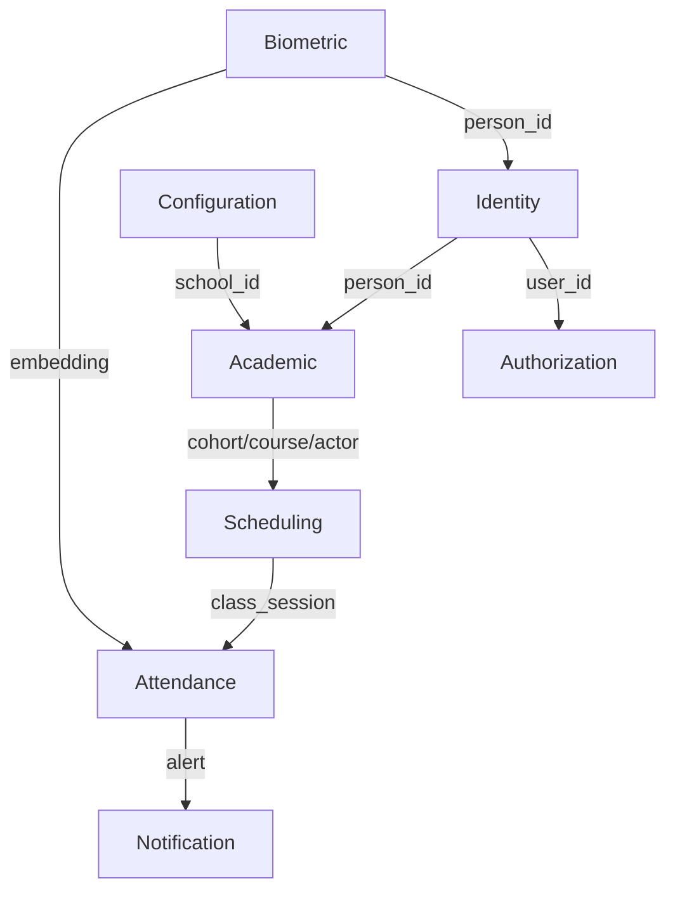

# Data Models — FaceAttend EDU

> **Status:** completed — cut-off 2026-09-22, aligned to DBML v7 (`FULL/database/faceattend_edu_mr_v4.dbml`, sole authority). This file summarizes the model living in `06-data/domains/`. Per-domain DDL detail is in the child files; here go the index, traceability and cross-cutting decisions.
> **Principle:** Single logical DB `faceattend_db` (PostgreSQL 17) with one schema per bounded context; no cross-schema FK. Cross-context references are logical IDs resolved via API/events. MongoDB holds biometric embeddings only.

---

## 1. Model index by domain

| # | Bounded Context | Source file (full DDL) | DB / Engine | Tables / Collections | Entities (02-domain) |
|---|---|---|---|---|---|
| 01 | Identity | `domains/01-identity.md` | PostgreSQL 17, schema `identity` | 4 tables: `person`, `app_user`, `user_session`, `password_policy` (+ legacy `city`, see count note) | Person, App_User |
| 02 | Authorization | `domains/02-authorization.md` | PostgreSQL 17, schema `authorization` | 4 tables: `role`, `permission`, `role_permission`, `user_role` | Role, Permission, Role_Permission, User_Role |
| 03 | Academic | `domains/03-academic.md` | PostgreSQL 17, schema `academic` | 8 tables: `school`, `program`, `academic_period`, `cohort`, `course`, `academic_actor_type`, `academic_actor`, `enrollment` | School, Program, Academic_Period, Cohort, Course, Academic_Actor_Type, Academic_Actor, Enrollment |
| 04 | Scheduling | `domains/04-scheduling.md` | PostgreSQL 17, schema `scheduling` | 3 tables: `environment`, `schedule_block`, `class_session` | Environment, Schedule_Block, Class_Session |
| 05 | Attendance | `domains/05-attendance.md` | PostgreSQL 17, schema `attendance` | 5 tables: `attendance_record`, `justification_type`, `justification`, `supporting_document`, `attendance_report` (derived) | Attendance_Record, Justification_Type, Justification, Supporting_Document, Attendance_Report |
| 06 | Biometric | `domains/06-biometric.md` | **MongoDB 7 + 1 SQL table** | `biometric_update_case` (logical owner; physically hosted in `configuration`) + collections `facial_embeddings`, `fingerprint_embeddings` | Biometric_Update_Case, Facial_Embedding, Fingerprint_Embedding |
| 07 | Notification | `domains/07-notification.md` | PostgreSQL 17, schema `notification` | 2 tables: `alert_type`, `alert` | Alert_Type, Alert |
| 08 | Configuration | `domains/08-configuration.md` | PostgreSQL 17, schema `configuration` | 2 tables: `academic_configuration`, `security_configuration` (+ transient host of `biometric_update_case`) | Academic_Configuration, Security_Configuration |
| | **Total** | | PostgreSQL 17 (`faceattend_db`) + MongoDB | **29 SQL tables (DBML) + 2 Mongo collections** | **28 entities + 4 VOs** |

> **Count note (DBML v7):** 29 SQL tables. `identity.city` is **removed from the DBML** (external API) but the deployed database still has it — `01-ms-identity-db` creates `identity.city` and Kong still routes `/api/v1/cities` (legacy endpoints, marked deprecated in `07-api`). Audit (`audit_log`/`error_log`) was removed from the model (platform observability), and `attendance.attendance_report` is a derived projection outside the 3NF core.
>
> **Running database vs DBML:** the deployed schema set also includes 7 `quality` tables (`quality_project`, `quality_evaluation`, `quality_evaluation_item`, `process_assessment`, `process_assessment_rating`, `istqb_assessment`, `istqb_assessment_item`) created by `07-ms-configuration-db` — quality tooling, not part of the DBML model. Total: 37 tables (29 model + legacy `city` + 7 `quality`).

---

## 2. Schema per bounded context — service → schema (single DB)

| Service (09-microservices) | Port | Schema in `faceattend_db` | Type | Owned domain |
|---|---|---|---|---|
| `01-ms-identity` | 8081 | `identity` | PostgreSQL | Identity |
| `02-ms-authorization` | 8082 | `authorization` | PostgreSQL | Authorization |
| `03-ms-academic` | 8083 | `academic` | PostgreSQL | Academic |
| `04-ms-scheduling` | 8084 | `scheduling` | PostgreSQL | Scheduling |
| `05-ms-attendance` | 8085 | `attendance` | PostgreSQL | Attendance |
| `06-ms-biometric` | 8086 | `biometric` (schema created; embeddings in MongoDB) | **MongoDB + SQL case** | Biometric (`biometric_update_case` physically in `configuration`) |
| `07-ms-configuration` | 8087 | `configuration` | PostgreSQL | Configuration |
| `08-ms-notification` | 8088 | `notification` | PostgreSQL | Notification |
| `09-ms-quality` (tooling, not a bounded context) | 8089 | `quality` | PostgreSQL | ISO 25010/29110/ISTQB (`quality_project`, `quality_evaluation`, `process_assessment`, `istqb_assessment`) |
| `kong-gateway` (99-api-gateway) | 8000 / 8001 | Redis | Rate-limit store | — infrastructure, no domain |

> **Schemas:** 9 in practice — the 8 bounded contexts seeded by `database-init/01-init-schemas.sql` plus `quality`, created by the configuration changelog. Ports from `FULL/COMPOSE.md`.

**Engine justification per service:** see header of each file in `domains/`. Summary: PostgreSQL for ACID/relational/multi-tenant; MongoDB in Biometric for variable-length vectors and vector search. No Audit service — observability is platform-provided.

---

## 3. Entity (02-domain) → Table/Collection (06-data) traceability

| Entity | Table / Collection | Context | Type |
|---|---|---|---|
| Person | `person` | Identity | Table |
| App_User | `app_user` | Identity | Table |
| Role | `role` | Authorization | Table |
| Permission | `permission` | Authorization | Table |
| Role_Permission | `role_permission` | Authorization | Table |
| User_Role | `user_role` | Authorization | Table |
| School | `school` | Academic | Table |
| Program | `program` | Academic | Table |
| Academic_Period | `academic_period` | Academic | Table |
| Cohort | `cohort` | Academic | Table |
| Course | `course` | Academic | Table |
| Academic_Actor_Type | `academic_actor_type` | Academic | Table |
| Academic_Actor | `academic_actor` | Academic | Table |
| Enrollment | `enrollment` | Academic | Table |
| Environment | `environment` | Scheduling | Table |
| Schedule_Block | `schedule_block` | Scheduling | Table |
| Class_Session | `class_session` | Scheduling | Table |
| Attendance_Record | `attendance_record` | Attendance | Table |
| Justification_Type | `justification_type` | Attendance | Table |
| Justification | `justification` | Attendance | Table |
| Supporting_Document | `supporting_document` | Attendance | Table |
| Attendance_Report | `attendance_report` | Attendance | Table (derived projection, no FKs) |
| Biometric_Update_Case | `biometric_update_case` | Biometric (SQL, physically in `configuration`) | Table |
| **Facial_Embedding** | `facial_embeddings` | Biometric | **MongoDB collection** — *no SQL table by design* |
| **Fingerprint_Embedding** | `fingerprint_embeddings` | Biometric | **MongoDB collection** — *no SQL table by design* |
| Alert_Type | `alert_type` | Notification | Table |
| Alert | `alert` | Notification | Table |
| Academic_Configuration | `academic_configuration` | Configuration | Table |
| Security_Configuration | `security_configuration` | Configuration | Table |

**City/Audit clarification:** `identity.city` is deprecated in the DBML (external `countriesnow.space` API) but the table and its endpoints are still deployed (legacy — see count note above); Audit (`audit_log`/`error_log`) was removed — observability is platform-provided. The automatic detector flag on `Facial_Embedding`/`Fingerprint_Embedding` is correct by design: they persist in MongoDB with `_id: ObjectId`, `person_id: UUID` external, `encoding: [Float]`, indexes `(person_id, is_active)` and `(person_id, finger_number, is_active)`.

---

## 4. Cross-cutting modeling principles

### 4.1 Schema per bounded context (mandatory)
No cross-schema FK. Cross-context references are **logical IDs** (UUID for cross-context entities; INT/BIGINT/SMALLINT for local catalogs per DBML v7) with no physical FK, resolved via API/events. Single logical DB `faceattend_db`, one schema per context.

### 4.2 Standard audit fields
All SQL tables include:

```sql
created_at  TIMESTAMP NOT NULL,     -- seeded by fn_audit_timestamps() trigger
updated_at  TIMESTAMP NOT NULL,
deleted_at  TIMESTAMP,            -- NULL = active (soft delete)
created_by  UUID,
updated_by  UUID,
deleted_by  UUID,
row_version BIGINT NOT NULL DEFAULT 1  -- optimistic locking
```

The trigger `fn_audit_timestamps()` (one per table, e.g. `trg_person_audit_timestamps`) fills the
values: on `INSERT` it sets `created_at`/`updated_at`/`row_version` when null, on `UPDATE` it
bumps `updated_at = NOW()` and `row_version = OLD.row_version + 1`. Timestamps are plain
`TIMESTAMP` (no time zone) in the DBML and in the deployed DDL.

Observability is platform-provided (Audit context removed from the relational model).

### 4.3 Soft delete
Logical delete via `deleted_at`. Partial indexes `WHERE deleted_at IS NULL` on high-volume tables (`person`, `academic_actor`, `enrollment`, `attendance_record`).

### 4.4 Naming conventions

```sql
-- Tables:  snake_case, singular           → school, attendance_record
-- Columns: snake_case                     → credit_hours, starts_at
-- FKs:     [table]_id                     → school_id, person_id
-- Indexes: idx_[table]_[column(s)]        → idx_attendance_actor
-- Unique:  uq_[table]_[column(s)]         → uq_enrollment_actor_cohort
-- PK:      pk_[table]                     → pk_person
-- Timestamps: always TIMESTAMP
-- Enums:   native PostgreSQL ENUM (user_session_status, authentication_type,
--          enrollment_status, class_session_status, attendance_status,
--          capture_method incl. IOT, review_status, biometric_type, update_status)
-- Checks:  VARCHAR/SMALLINT + CHECK (document_type CC/TI/CE/PP, blood_type,
--          day_of_week 1..7, chk_period_dates, chk_block_time, chk_finger_number)
```

### 4.5 Cross-context references (no physical FK)

| Source | Target | Mechanism |
|---|---|---|
| `Academic.school.city_id` | External `countriesnow.space` API | VARCHAR NULL, no FK (`city` deprecated) |
| `Academic.academic_actor.person_id` | `Identity.person` | External ID (UUID) |
| `Authorization.user_role.user_id` | `Identity.app_user` | External ID (UUID) |
| `Scheduling.schedule_block.*` | `Academic.cohort/course/actor` | External ID |
| `Attendance.attendance_record.*` | `Scheduling.class_session` / `Academic.academic_actor` | External ID |
| `Attendance.justification.reviewed_by` | `Identity.app_user` | External ID |
| `Attendance.attendance_report.school_id/cohort_id/generated_by` | Academic / Identity | Derived projection, no FKs |
| `Biometric.biometric_update_case.person_id/requested_by/reviewed_by` | `Identity.person` / `Identity.app_user` | External ID (UUID) |
| `Biometric.biometric_update_case.current_embedding_ref` | `Biometric.*_embeddings._id` | Cross-paradigm SQL→Mongo (logical VARCHAR) |
| `Notification.alert.academic_actor_id` | `Academic.academic_actor` | External ID |

> Storing only the external ID is the normalized form; `school.city_name/district/country` are display fields from the external city API, not denormalization.

---

## 5. Normalization

**Verdict: 3NF core, 0 intentional denormalizations; `attendance_report` is a derived JSONB projection outside the 3NF core.** Full analysis in `06-data/normalization-assessment.md` (1NF/2NF/3NF matrix table by table, BCNF, and justification of what looks like denormalization but is not — logical FK without physical constraint, nullable FK, SQL→Mongo reference).

---

## 6. Migration strategy

**Tool:** **Liquibase** `4.29.0` for PostgreSQL (ADR-010) — one **containerized job per schema**,
chained by `depends_on: service_completed_successfully` in `database/docker-compose.yml`
(`identity → authorization → academic → scheduling → attendance → biometric → configuration → notification`).
There is **no Flyway** and no per-service migration runner; MongoDB needs no migration tool
(embeddings are schemaless).

**Naming:**
```
database/<NN>-ms-<context>-db/changelog/changelog-master.yaml   # includes the changesets
database/<NN>-ms-<context>-db/01-ddl/001-create-person-table.yaml
    id: id-002-create-trigger-person                            # changeset id (immutable)
    04-tcl/001-triggers-audit-timestamps.yaml                   # triggers / functions
    02-dml/…seeds…                                              # catalog seeds (SEEDS.md)
```

**Rules:**
```
✓ Forward-only, one changeset per logical change, with rollback block
✓ Seeds live in the same changelog chain (database/SEEDS.md) — never edited, only extended
✗ Never edit a changeset already applied (id + author + path form the identity)
✗ DROP COLUMN/TABLE only after code deprecation (2 releases)
```

Compatible changes (add nullable, add NOT NULL with DEFAULT, CREATE INDEX CONCURRENTLY) vs incompatible (rename → 2 phases: add new + copy + dual-write, then drop). Full reference: `FULL/COMPOSE.md` §2.

---

## 7. High-level diagram (per service)

Each domain owns its ER in its file (`domains/0*.md` § Relationship Diagram). Platform level:



---

## 8. Engine decisions

| Engine | When used here | When avoided |
|---|---|---|
| **PostgreSQL 17** | 9 schemas (8 bounded contexts + `quality`) — ACID transactions, school/program/cohort hierarchies, anti-double-booking constraints, 1:1 justification | — |
| **MongoDB 7** | Biometric — variable-length vectors, model-version flexibility, vector search | Critical multi-document cross transactions |
| **Redis** | Kong `rate-limiting` policy only (no app caching yet, ADR-015) | Source of truth |

---

## Correlations

- Entities and rules → `02-domain/entities-and-rules.md`
- Context map → `02-domain/domain-map.md`
- Per-domain DDL (source of truth) → `06-data/domains/0*.md`
- Normalization → `06-data/normalization-assessment.md`
- Saga / Outbox → `05-architecture/pattern-guide.md`
- API contracts → `07-api/contracts/openapi/`
- Catalog and ownership → `09-microservices/service-catalog.md`, `09-microservices/data-ownership-matrix.md`
