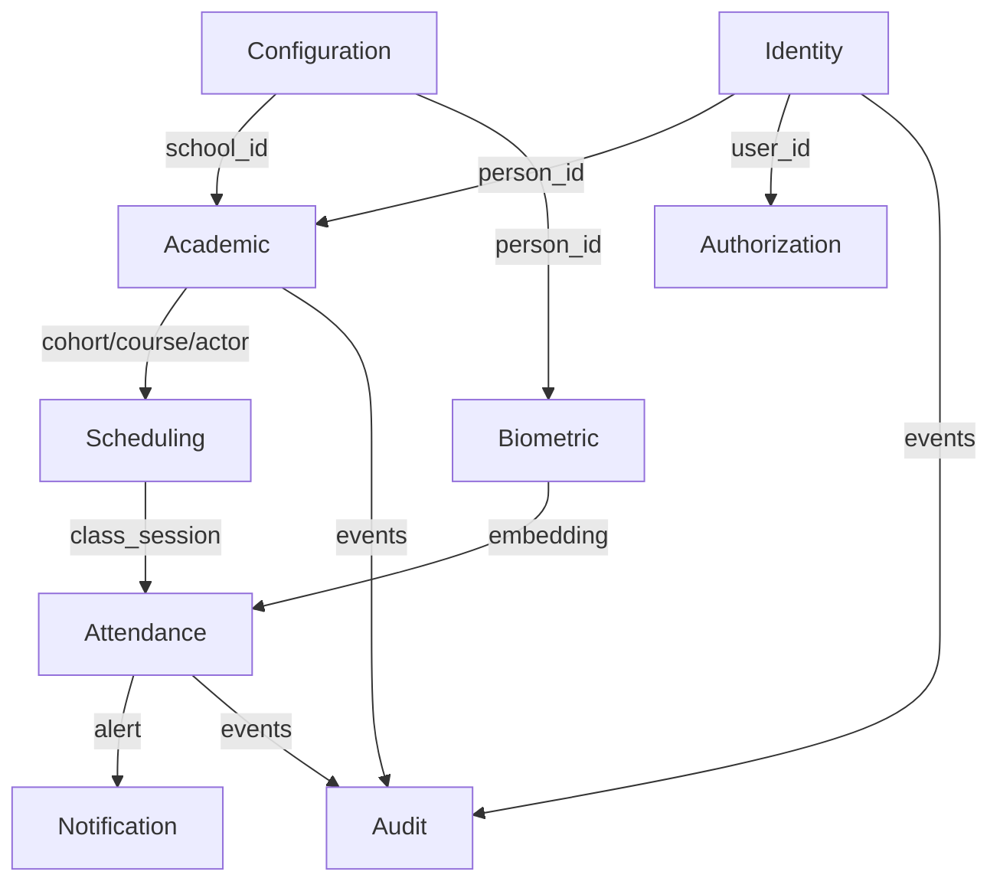

# Data Models — FaceAttend EDU

> **Stato:** diligenciado — corte 2026-09-22. Este archivo resume el modelo físico real que vive en `06-data/domains/`. El detalle DDL por dominio está en los archivos hijos (fuente de verdad); aquí va el índice, la trazabilidad y las decisiones transversales.
> **Principio:** Database per Service — cada servicio tiene su propia DB; ningún servicio hace JOIN a otra DB. La comunicación es por API o eventos.

---

## 1. Índice del modelo por dominio

| # | Bounded Context | Archivo fuente (DDL completo) | DB / Engine | Tablas / Colecciones | Entidades (02-domain) |
|---|---|---|---|---|---|
| 01 | Identity | `domains/01-identity.md` | PostgreSQL 17 | 5 tablas: `city`, `person`, `app_user`, `user_session`, `password_policy` | Person, App_User, City |
| 02 | Authorization | `domains/02-authorization.md` | PostgreSQL 17 | 4 tablas: `role`, `permission`, `role_permission`, `user_role` | Role, Permission, Role_Permission, User_Role |
| 03 | Academic | `domains/03-academic.md` | PostgreSQL 17 | 8 tablas: `school`, `program`, `academic_period`, `cohort`, `course`, `academic_actor_type`, `academic_actor`, `enrollment` | School, Program, Academic_Period, Cohort, Course, Academic_Actor_Type, Academic_Actor, Enrollment |
| 04 | Scheduling | `domains/04-scheduling.md` | PostgreSQL 17 | 3 tablas: `environment`, `schedule_block`, `class_session` | Environment, Schedule_Block, Class_Session |
| 05 | Attendance | `domains/05-attendance.md` | PostgreSQL 17 | 4 tablas: `attendance_record`, `justification_type`, `justification`, `supporting_document` | Attendance_Record, Justification_Type, Justification, Supporting_Document |
| 06 | Biometric | `domains/06-biometric.md` | **MongoDB 7** | 2 colecciones: `facial_embeddings`, `fingerprint_embeddings` | Facial_Embedding, Fingerprint_Embedding |
| 07 | Notification | `domains/07-notification.md` | PostgreSQL 17 | 2 tablas: `alert_type`, `alert` | Alert_Type, Alert |
| 08 | Audit | `domains/08-audit.md` | PostgreSQL 17 | 2 tablas: `audit_log`, `error_log` | Audit_Log, Error_Log |
| 09 | Configuration | `domains/09-configuration.md` | PostgreSQL 17 | 3 tablas: `academic_configuration`, `security_configuration`, `biometric_update_case` | Academic_Configuration, Security_Configuration, Biometric_Update_Case |
| | **Total** | | 8× PostgreSQL + 1× MongoDB | **31 tablas SQL + 2 colecciones Mongo** | **29 entidades + 4 VOs** |

> **Nota de conteo:** el informe `informe-consistencia.md` reportó 30 tablas. Aquí se documentan 31 SQL porque `password_policy` (singleton global en Identity) históricamente se contó o no según criterio. A efectos de trazabilidad son 30 tablas de negocio multi-fila + 1 singleton = 31.

---

## 2. Database per Service — servicio → BD

| Servicio (09-microservices) | Puerto | BD | Tipo | Dominios que posee |
|---|---|---|---|---|
| `01-identity-service` | 8081 | `faceattend_identity` | PostgreSQL | Identity (+ `password_policy`) |
| `02-authorization-service` | 8083 | `faceattend_authorization` | PostgreSQL | Authorization |
| `03-academic-service` | 8084 | `faceattend_academic` | PostgreSQL | Academic |
| `04-scheduling-service` | 8087 | `faceattend_scheduling` | PostgreSQL | Scheduling |
| `05-attendance-service` | 8085 | `faceattend_attendance` | PostgreSQL | Attendance |
| `06-biometric-service` | 8086 | `faceattend_biometric` | **MongoDB** | Biometric |
| `07-notification-service` | 8090 | `faceattend_notification` | PostgreSQL | Notification |
| `08-audit-service` | 8088 | `faceattend_audit` | PostgreSQL | Audit (append-only) |
| `09-configuration-service` | 8089 | `faceattend_configuration` | PostgreSQL | Configuration |
| `99-api-gateway` | 8080 | Redis (cache) | Cache | — infraestructura, sin dominio |

**Engine justification por servicio:** ver encabezado de cada archivo en `domains/`. Resumen: PostgreSQL para ACID/relacional/multi-tenant; MongoDB en Biometric para vectores de longitud variable y vector-search.

---

## 3. Trazabilidad Entidad (02-domain) → Tabla/Colección (06-data)

| Entidad | Tabla / Colección | Contexto | Tipo |
|---|---|---|---|
| Person | `person` | Identity | Tabla |
| App_User | `app_user` | Identity | Tabla |
| City | `city` | Identity | Tabla |
| Role | `role` | Authorization | Tabla |
| Permission | `permission` | Authorization | Tabla |
| Role_Permission | `role_permission` | Authorization | Tabla |
| User_Role | `user_role` | Authorization | Tabla |
| School | `school` | Academic | Tabla |
| Program | `program` | Academic | Tabla |
| Academic_Period | `academic_period` | Academic | Tabla |
| Cohort | `cohort` | Academic | Tabla |
| Course | `course` | Academic | Tabla |
| Academic_Actor_Type | `academic_actor_type` | Academic | Tabla |
| Academic_Actor | `academic_actor` | Academic | Tabla |
| Enrollment | `enrollment` | Academic | Tabla |
| Environment | `environment` | Scheduling | Tabla |
| Schedule_Block | `schedule_block` | Scheduling | Tabla |
| Class_Session | `class_session` | Scheduling | Tabla |
| Attendance_Record | `attendance_record` | Attendance | Tabla |
| Justification_Type | `justification_type` | Attendance | Tabla |
| Justification | `justification` | Attendance | Tabla |
| Supporting_Document | `supporting_document` | Attendance | Tabla |
| **Facial_Embedding** | `facial_embeddings` | Biometric | **Colección MongoDB** — *sin tabla SQL por diseño* |
| **Fingerprint_Embedding** | `fingerprint_embeddings` | Biometric | **Colección MongoDB** — *sin tabla SQL por diseño* |
| Alert_Type | `alert_type` | Notification | Tabla |
| Alert | `alert` | Notification | Tabla |
| Audit_Log | `audit_log` | Audit | Tabla |
| Error_Log | `error_log` | Audit | Tabla |
| Academic_Configuration | `academic_configuration` | Configuration | Tabla |
| Security_Configuration | `security_configuration` | Configuration | Tabla |
| Biometric_Update_Case | `biometric_update_case` | Configuration | Tabla |

**Aclaración auditoría:** el detector automático marcó `Facial_Embedding`/`Fingerprint_Embedding` como "sin tabla evidente". Es correcto que no haya tabla SQL: persisten en MongoDB con `_id: ObjectId`, `person_id: UUID` externo, `encoding: [Float]`, índices `(person_id, is_active)` y `(person_id, finger_number, is_active)`. La trazabilidad está documentada en `domains/06-biometric.md` §1-3 y en `entities-and-rules.md` §6.

---

## 4. Principios de modelado (transversales)

### 4.1 Database per Service (obligatorio)
Ningún servicio accede a la BD de otro. Las referencias cross-context son **IDs públicos** (UUID/SERIAL/BIGSERIAL) sin FK física, resueltas por API/eventos.

### 4.2 Campos de auditoría estándar
Todas las tablas SQL incluyen:

```sql
created_at  TIMESTAMPTZ NOT NULL DEFAULT NOW(),
updated_at  TIMESTAMPTZ NOT NULL DEFAULT NOW(),
deleted_at  TIMESTAMPTZ,            -- NULL = activo (soft delete)
created_by  UUID,
updated_by  UUID,
deleted_by  UUID,
row_version BIGINT NOT NULL DEFAULT 1  -- locking optimista
```

Audit (`audit_log`/`error_log`) es **append-only** (RN-44): nunca UPDATE/DELETE.

### 4.3 Soft delete
Borrado lógico por `deleted_at`. Índices parciales `WHERE deleted_at IS NULL` en tablas de alto volumen (`person`, `academic_actor`, `enrollment`, `attendance_record`).

### 4.4 Convenciones de nombres

```sql
-- Tablas:  snake_case, singular           → school, attendance_record
-- Columnas: snake_case                     → credit_hours, starts_at
-- FKs:     [tabla]_id                     → school_id, person_id
-- Índices: idx_[tabla]_[columna(s)]       → idx_attendance_actor
-- Únicos:  uq_[tabla]_[columna(s)]        → uq_enrollment_actor_cohort
-- Timestamps: siempre TIMESTAMPTZ
-- Enums:   VARCHAR con validación de aplicación (FACIAL/MANUAL/IMPORT, etc.)
```

### 4.5 Referencias cross-context (sin FK física)

| Origen | Destino | Mecanismo |
|---|---|---|
| `Academic.school.city_id` | `Identity.city` | External ID (SERIAL, sin FK) |
| `Academic.academic_actor.person_id` | `Identity.person` | External ID (UUID) |
| `Authorization.user_role.user_id` | `Identity.app_user` | External ID (UUID) |
| `Scheduling.schedule_block.*` | `Academic.cohort/course/actor` | External ID |
| `Attendance.attendance_record.*` | `Scheduling.class_session` / `Academic.academic_actor` | External ID |
| `Attendance.justification.reviewed_by` | `Identity.app_user` | External ID |
| `Configuration.biometric_update_case.*` | `Identity.person` / `Identity.app_user` | External ID |
| `Configuration.biometric_update_case.current_embedding_ref` | `Biometric.*_embeddings._id` | Cross-paradigma SQL→Mongo (VARCHAR lógico) |
| `Notification.alert.academic_actor_id` | `Academic.academic_actor` | External ID |
| `Audit.*.actor_id / school_id` | `Identity` / `Academic` | External ID |

> Almacenar solo el ID externo sin duplicar `school_name`, `city_name`, etc. es la forma normalizada; duplicarlo sí sería denormalización (y no se hace).

---

## 5. Normalización

**Veredicto: 3NF sin excepciones, 0 denormalizaciones intencionales.** Análisis completo en `06-data/normalization-assessment.md` (matriz 1NF/2NF/3NF tabla por tabla, BCNF, y justificación de lo que parece denormalización y no lo es — FK sin constraint físico, FK nulable, referencia SQL→Mongo).

---

## 6. Estrategia de migraciones

**Herramienta:** Flyway (PostgreSQL) / mongock o equivalente (MongoDB) — *definir por servicio en `09-microservices/services/NN-*/runbook.md`*

**Nomenclatura:**
```
V{NNN}__{snake_case_descripcion}.sql
Ej: V001__create_city_and_person.sql
    V002__create_academic_tables.sql
    S001__seed_roles_permissions.sql
```

**Reglas:**
```
✓ Forward-only, una migración por cambio lógico
✓ Seed en migraciones separadas prefijo S
✗ Nunca editar migración ya ejecutada en algún entorno
✗ DROP COLUMN/TABLE solo tras deprecación en código (2 releases)
```

Cambios compatibles (add nullable, add NOT NULL con DEFAULT, CREATE INDEX CONCURRENTLY) vs incompatibles (rename → 2 fases: add new + copy + dual-write, luego drop).

---

## 7. Diagrama de alto nivel (por servicio)

Cada dominio tiene su ER en su archivo (`domains/0*.md` § Relationship Diagram). A nivel plataforma:



---

## 8. Decisiones de motor

| Motor | Cuándo se usa aquí | Cuándo se evita |
|---|---|---|
| **PostgreSQL 17** | 8 servicios — transacciones ACID, jerarquías escuela/programa/cohort, constraints anti-doble-reserva, 1:1 justificación | — |
| **MongoDB 7** | Biometric — vectores de longitud variable, flexibilidad de versión de modelo, vector search | Transacciones cruzadas multi-documento críticas |
| **Redis** | API Gateway (cache/rate limit) | Fuente de verdad |

---

## Correlaciones

- Entidades y reglas → `02-domain/entities-and-rules.md`
- Mapa de contextos → `02-domain/domain-map.md`
- DDL por dominio (fuente de verdad) → `06-data/domains/0*.md`
- Normalización → `06-data/normalization-assessment.md`
- Saga / Outbox → `05-architecture/pattern-guide.md`
- Contratos API → `07-api/contracts/openapi/`
- Catálogo y ownership → `09-microservices/service-catalog.md`, `09-microservices/data-ownership-matrix.md`
