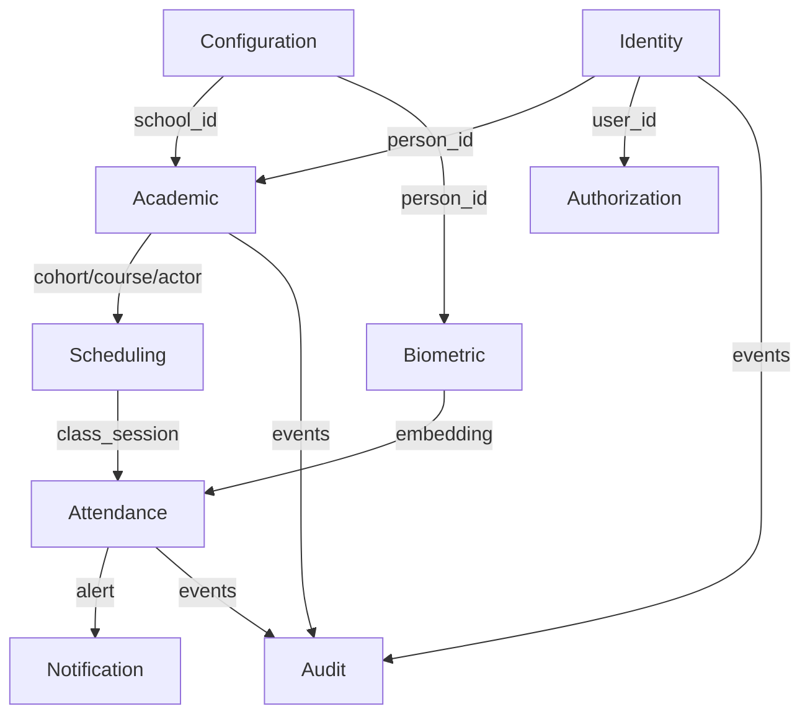

# Data Models — FaceAttend EDU

> **Status:** completed — cut-off 2026-09-22. This file summarizes the real physical model living in `06-data/domains/`. Per-domain DDL detail is in the child files (source of truth); here go the index, traceability and cross-cutting decisions.
> **Principle:** Database per Service — each service owns its DB; no service JOINs another DB. Communication is via API or events.

---

## 1. Model index by domain

| # | Bounded Context | Source file (full DDL) | DB / Engine | Tables / Collections | Entities (02-domain) |
|---|---|---|---|---|---|
| 01 | Identity | `domains/01-identity.md` | PostgreSQL 17 | 5 tables: `city`, `person`, `app_user`, `user_session`, `password_policy` | Person, App_User, City |
| 02 | Authorization | `domains/02-authorization.md` | PostgreSQL 17 | 4 tables: `role`, `permission`, `role_permission`, `user_role` | Role, Permission, Role_Permission, User_Role |
| 03 | Academic | `domains/03-academic.md` | PostgreSQL 17 | 8 tables: `school`, `program`, `academic_period`, `cohort`, `course`, `academic_actor_type`, `academic_actor`, `enrollment` | School, Program, Academic_Period, Cohort, Course, Academic_Actor_Type, Academic_Actor, Enrollment |
| 04 | Scheduling | `domains/04-scheduling.md` | PostgreSQL 17 | 3 tables: `environment`, `schedule_block`, `class_session` | Environment, Schedule_Block, Class_Session |
| 05 | Attendance | `domains/05-attendance.md` | PostgreSQL 17 | 4 tables: `attendance_record`, `justification_type`, `justification`, `supporting_document` | Attendance_Record, Justification_Type, Justification, Supporting_Document |
| 06 | Biometric | `domains/06-biometric.md` | **MongoDB 7** | 2 collections: `facial_embeddings`, `fingerprint_embeddings` | Facial_Embedding, Fingerprint_Embedding |
| 07 | Notification | `domains/07-notification.md` | PostgreSQL 17 | 2 tables: `alert_type`, `alert` | Alert_Type, Alert |
| 08 | Audit | `domains/08-audit.md` | PostgreSQL 17 | 2 tables: `audit_log`, `error_log` | Audit_Log, Error_Log |
| 09 | Configuration | `domains/09-configuration.md` | PostgreSQL 17 | 3 tables: `academic_configuration`, `security_configuration`, `biometric_update_case` | Academic_Configuration, Security_Configuration, Biometric_Update_Case |
| | **Total** | | 8× PostgreSQL + 1× MongoDB | **31 SQL tables + 2 Mongo collections** | **29 entities + 4 VOs** |

> **Count note:** the `consistency-report.md` reported 30 tables. Here 31 SQL are documented because `password_policy` (global singleton in Identity) was historically counted or not depending on the criterion. For traceability purposes there are 30 multi-row business tables + 1 singleton = 31.

---

## 2. Database per Service — service → DB

| Service (09-microservices) | Port | DB | Type | Owned domains |
|---|---|---|---|---|
| `01-identity-service` | 8081 | `faceattend_identity` | PostgreSQL | Identity (+ `password_policy`) |
| `02-authorization-service` | 8083 | `faceattend_authorization` | PostgreSQL | Authorization |
| `03-academic-service` | 8084 | `faceattend_academic` | PostgreSQL | Academic |
| `04-scheduling-service` | 8087 | `faceattend_scheduling` | PostgreSQL | Scheduling |
| `05-attendance-service` | 8085 | `faceattend_attendance` | PostgreSQL | Attendance |
| `06-biometric-service` | 8086 | `faceattend_biometric` | **MongoDB** | Biometric |
| `07-notification-service` | 8090 | `faceattend_notification` | PostgreSQL | Notification |
| `08-audit-service` | 8088 | `faceattend_audit` | PostgreSQL | Audit (append-only) |
| `09-configuration-service` | 8089 | `faceattend_configuration` | PostgreSQL | Configuration |
| `99-api-gateway` | 8080 | Redis (cache) | Cache | — infrastructure, no domain |

**Engine justification per service:** see header of each file in `domains/`. Summary: PostgreSQL for ACID/relational/multi-tenant; MongoDB in Biometric for variable-length vectors and vector search.

---

## 3. Entity (02-domain) → Table/Collection (06-data) traceability

| Entity | Table / Collection | Context | Type |
|---|---|---|---|
| Person | `person` | Identity | Table |
| App_User | `app_user` | Identity | Table |
| City | `city` | Identity | Table |
| Role | `role` | Authorization | Table |
| Permission | `permission` | Authorization | Table |
| Role_Permission | `role_permission` | Authorization | Table |
| User_Role | `user_role` | Authorization | Table |
| School | `school` | Academic | Table |
| Program | `program` | Academic | Table |
| Academic_Period | `academic_period` | Academic | Table |
| Cohort | `cohort` | Academic | Table |
| Course | `course` | Academic | Table |
| Academic_Actor_Type | `academic_actor_type` | Academic | Table |
| Academic_Actor | `academic_actor` | Academic | Table |
| Enrollment | `enrollment` | Academic | Table |
| Environment | `environment` | Scheduling | Table |
| Schedule_Block | `schedule_block` | Scheduling | Table |
| Class_Session | `class_session` | Scheduling | Table |
| Attendance_Record | `attendance_record` | Attendance | Table |
| Justification_Type | `justification_type` | Attendance | Table |
| Justification | `justification` | Attendance | Table |
| Supporting_Document | `supporting_document` | Attendance | Table |
| **Facial_Embedding** | `facial_embeddings` | Biometric | **MongoDB collection** — *no SQL table by design* |
| **Fingerprint_Embedding** | `fingerprint_embeddings` | Biometric | **MongoDB collection** — *no SQL table by design* |
| Alert_Type | `alert_type` | Notification | Table |
| Alert | `alert` | Notification | Table |
| Audit_Log | `audit_log` | Audit | Table |
| Error_Log | `error_log` | Audit | Table |
| Academic_Configuration | `academic_configuration` | Configuration | Table |
| Security_Configuration | `security_configuration` | Configuration | Table |
| Biometric_Update_Case | `biometric_update_case` | Configuration | Table |

**Audit clarification:** the automatic detector flagged `Facial_Embedding`/`Fingerprint_Embedding` as "with no evident table". It is correct that there is no SQL table: they persist in MongoDB with `_id: ObjectId`, `person_id: UUID` external, `encoding: [Float]`, indexes `(person_id, is_active)` and `(person_id, finger_number, is_active)`. Traceability is documented in `domains/06-biometric.md` §1-3 and in `entities-and-rules.md` §6.

---

## 4. Cross-cutting modeling principles

### 4.1 Database per Service (mandatory)
No service accesses another service DB. Cross-context references are **public IDs** (UUID/SERIAL/BIGSERIAL) with no physical FK, resolved via API/events.

### 4.2 Standard audit fields
All SQL tables include:

```sql
created_at  TIMESTAMPTZ NOT NULL DEFAULT NOW(),
updated_at  TIMESTAMPTZ NOT NULL DEFAULT NOW(),
deleted_at  TIMESTAMPTZ,            -- NULL = active (soft delete)
created_by  UUID,
updated_by  UUID,
deleted_by  UUID,
row_version BIGINT NOT NULL DEFAULT 1  -- optimistic locking
```

Audit (`audit_log`/`error_log`) is **append-only** (RN-44): never UPDATE/DELETE.

### 4.3 Soft delete
Logical delete via `deleted_at`. Partial indexes `WHERE deleted_at IS NULL` on high-volume tables (`person`, `academic_actor`, `enrollment`, `attendance_record`).

### 4.4 Naming conventions

```sql
-- Tables:  snake_case, singular           → school, attendance_record
-- Columns: snake_case                     → credit_hours, starts_at
-- FKs:     [table]_id                     → school_id, person_id
-- Indexes: idx_[table]_[column(s)]        → idx_attendance_actor
-- Unique:  uq_[table]_[column(s)]         → uq_enrollment_actor_cohort
-- Timestamps: always TIMESTAMPTZ
-- Enums:   VARCHAR with app validation (FACIAL/MANUAL/IMPORT, etc.)
```

### 4.5 Cross-context references (no physical FK)

| Source | Target | Mechanism |
|---|---|---|
| `Academic.school.city_id` | `Identity.city` | External ID (SERIAL, no FK) |
| `Academic.academic_actor.person_id` | `Identity.person` | External ID (UUID) |
| `Authorization.user_role.user_id` | `Identity.app_user` | External ID (UUID) |
| `Scheduling.schedule_block.*` | `Academic.cohort/course/actor` | External ID |
| `Attendance.attendance_record.*` | `Scheduling.class_session` / `Academic.academic_actor` | External ID |
| `Attendance.justification.reviewed_by` | `Identity.app_user` | External ID |
| `Configuration.biometric_update_case.*` | `Identity.person` / `Identity.app_user` | External ID |
| `Configuration.biometric_update_case.current_embedding_ref` | `Biometric.*_embeddings._id` | Cross-paradigm SQL→Mongo (logical VARCHAR) |
| `Notification.alert.academic_actor_id` | `Academic.academic_actor` | External ID |
| `Audit.*.actor_id / school_id` | `Identity` / `Academic` | External ID |

> Storing only the external ID without duplicating `school_name`, `city_name`, etc. is the normalized form; duplicating it would be denormalization (and is not done).

---

## 5. Normalization

**Verdict: 3NF with no exceptions, 0 intentional denormalizations.** Full analysis in `06-data/normalization-assessment.md` (1NF/2NF/3NF matrix table by table, BCNF, and justification of what looks like denormalization but is not — FK without physical constraint, nullable FK, SQL→Mongo reference).

---

## 6. Migration strategy

**Tool:** Flyway (PostgreSQL) / mongock or equivalent (MongoDB) — *define per service in `09-microservices/services/NN-*/runbook.md`*

**Naming:**
```
V{NNN}__{snake_case_description}.sql
Ex: V001__create_city_and_person.sql
    V002__create_academic_tables.sql
    S001__seed_roles_permissions.sql
```

**Rules:**
```
✓ Forward-only, one migration per logical change
✓ Seed in separate S-prefixed migrations
✗ Never edit a migration already run in any environment
✗ DROP COLUMN/TABLE only after code deprecation (2 releases)
```

Compatible changes (add nullable, add NOT NULL with DEFAULT, CREATE INDEX CONCURRENTLY) vs incompatible (rename → 2 phases: add new + copy + dual-write, then drop).

---

## 7. High-level diagram (per service)

Each domain owns its ER in its file (`domains/0*.md` § Relationship Diagram). Platform level:



---

## 8. Engine decisions

| Engine | When used here | When avoided |
|---|---|---|
| **PostgreSQL 17** | 8 services — ACID transactions, school/program/cohort hierarchies, anti-double-booking constraints, 1:1 justification | — |
| **MongoDB 7** | Biometric — variable-length vectors, model-version flexibility, vector search | Critical multi-document cross transactions |
| **Redis** | API Gateway (cache/rate limit) | Source of truth |

---

## Correlations

- Entities and rules → `02-domain/entities-and-rules.md`
- Context map → `02-domain/domain-map.md`
- Per-domain DDL (source of truth) → `06-data/domains/0*.md`
- Normalization → `06-data/normalization-assessment.md`
- Saga / Outbox → `05-architecture/pattern-guide.md`
- API contracts → `07-api/contracts/openapi/`
- Catalog and ownership → `09-microservices/service-catalog.md`, `09-microservices/data-ownership-matrix.md`
