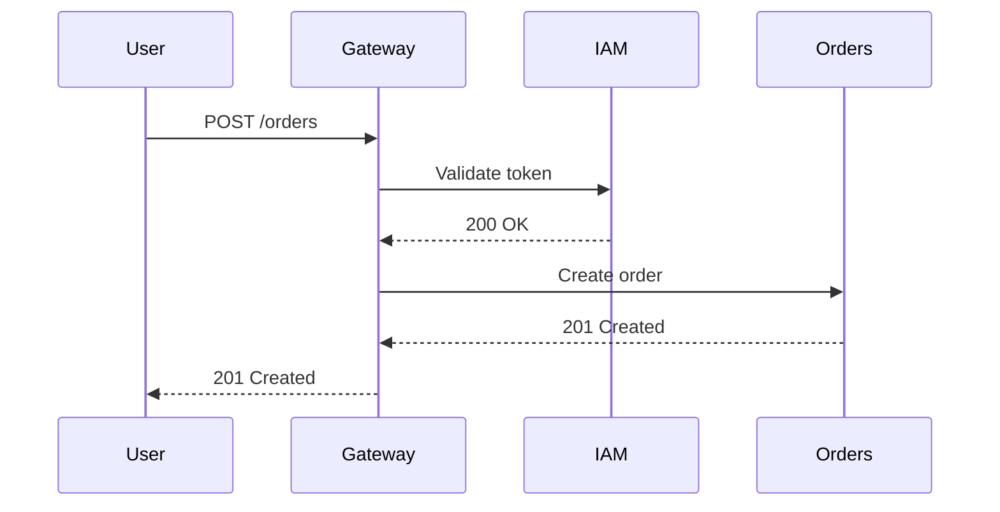
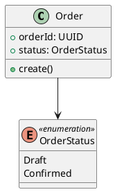

# 08 — UML Diagrams

> **What is this?** Visual representations of the system. Diagrams communicate in seconds
> what would take pages of text.

## The diagram rule

> **An outdated diagram is worse than no diagram** — it generates false confidence.
>
> Keep only the diagrams the team updates regularly. Better 3 current diagrams
> than 10 obsolete ones.

---

## Chosen format and workflow (decision)

> **Format: Mermaid, with one deliberate exception — class diagrams are PlantUML.** C4, sequence,
> state and ER diagrams live as `.mmd` files; class diagrams live as `.puml` files. Both go in
> `diagrams/source/`, one diagram per file, and are registered in `diagram-index.md`. The
> exception exists because Mermaid's `classDiagram` renders loosely (no real visibility markers,
> weak multiplicity placement); PlantUML reads like an actual textbook UML class diagram. Every
> other diagram type stays Mermaid-only — do not also move sequence/state/C4 diagrams to
> PlantUML.
>
> **How they are viewed (accurate):** GitHub/GitLab do **not** render standalone `.mmd` or `.puml`
> files — they only render ` ```mermaid ` / ` ```plantuml ` fenced blocks inside Markdown. So
> preview `.mmd` sources in **VS Code** (Markdown Preview Mermaid Support / Mermaid extension) or
> [mermaid.live](https://mermaid.live), and `.puml` sources in VS Code (PlantUML extension) or
> [plantuml.com/plantuml](https://www.plantuml.com/plantuml). When a diagram must be visible *on
> GitHub* (PR review, README), export it once — `mmdc` for `.mmd`, `node-plantuml` for `.puml`
> (needs a local Graphviz `dot`, see `diagram-index.md`) — to `diagrams/exports/*.svg` and link
> the SVG; never duplicate the diagram in a Markdown file, because two copies are two things to
> keep updated.
>
> draw.io below is kept as reference for the day a diagram outgrows both tools; new diagrams
> should not start there.

---

## Types of diagrams by purpose

### For architecture (recommended)
- **C4 — System Context (Level 1):** the system in relation to the outside world
- **C4 — Container (Level 2):** the microservices, DBs, and frontends of the system
- **C4 — Component (Level 3):** the internal components of a specific service

### For structure
- **Class:** domain classes, attributes, methods and the relationships between them — the OO
  view of the model (aggregates, invariants, which cross-context refs are deliberately not FKs),
  distinct from the column-level ER view

### For data
- **ER (Entity-Relationship):** tables and their relationships — one per service or one global

### For behavior
- **Sequence:** temporal flow of an operation that crosses multiple services
- **State:** lifecycle of an entity (e.g.: states of an order)
- **Activity:** flow of a complex business process

---

## Reference tools (Mermaid for everything except class diagrams, PlantUML for those)

### Mermaid — adopted for C4, sequence, state, ER


### PlantUML — adopted for class diagrams only

Do not use PlantUML for sequence, state, C4 or ER diagrams — those stay Mermaid, even though
PlantUML can technically draw them too. One tool per diagram type keeps the toolchain simple.

### Draw.io / Lucidchart
For more complex diagrams requiring free placement. Export as SVG to `diagrams/exports/`.

---

## Folder structure

```
08-uml/
├── diagram-index.md          ← Registry of all diagrams
├── diagrams/
│   ├── source/               ← Source files (.mmd — Mermaid; .puml — PlantUML, class diagrams only)
│   └── exports/              ← Optional exported images (.svg, .png)
```

**Naming convention:**
- `c1-system-context.mmd` — C4 Level 1 diagram (✅ done)
- `c2-container-diagram.mmd` — C4 Level 2 diagram (✅ done)
- `c3-attendance-service.mmd` — C4 Level 3 diagram of a service (✅ done)
- `cls-identity-authorization.puml` — Class diagram for a bounded-context cluster, PlantUML (✅ done)
- `seq-login.mmd` — Sequence diagram for the login flow (✅ done)
- `state-justification.mmd` — State diagram for a justification (✅ done)
- ER diagrams are **not** stored here: each domain already has one in `06-data/domains/*.md`
  (see the note in `diagram-index.md`)

### `diagram-index.md`
Registry of all diagrams with their purpose and location.

**Format (see `diagram-index.md` for the real tables):**
```markdown
| ID | Name | Type | Tool | Source file | Status | Description |
|----|------|------|------|-------------|--------|-------------|
| C4-02 | Container Diagram | C4 L2 | Mermaid | `source/c2-container-diagram.mmd` | ✅ Done | Clients, Kong, 9 services, data stores |
| CLS-01 | Identity & Authorization domain model | Class | PlantUML | `source/cls-identity-authorization.puml` | ✅ Done | Person, AppUser, UserSession, Role, Permission, UserRole |
| SEQ-01 | Facial attendance capture | Sequence | Mermaid | `source/seq-facial-attendance.mmd` | ✅ Done | Scan → match → record (unwired gaps called out) |
```

---

## Correlations with other sections

| Fed by... | What diagram to create |
|-----------|----------------------|
| `05-architecture/overview.md` | C4 Level 1 and 2 diagrams |
| `06-data/models.md` | ER diagrams per service |
| `02-domain/entities-and-rules.md` | Class diagrams per bounded-context cluster |
| `09-microservices/communication-patterns.md` | Sequence diagrams for flows |
| `02-domain/domain-map.md` | Bounded contexts diagram |
