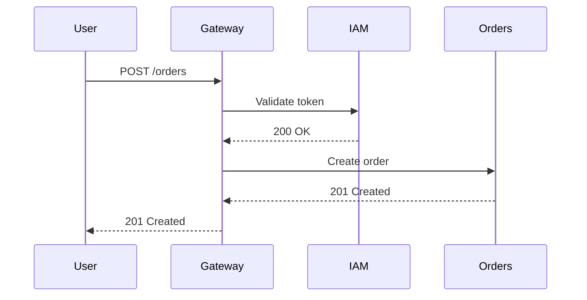
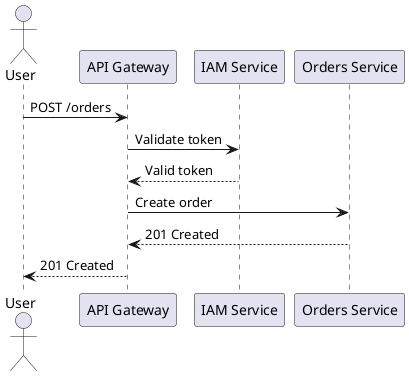

# 08 — UML Diagrams

> **What is this?** Visual representations of the system. Diagrams communicate in seconds
> what would take pages of text.

## The diagram rule

> **An outdated diagram is worse than no diagram** — it generates false confidence.
>
> Keep only the diagrams the team updates regularly. Better 3 current diagrams
> than 10 obsolete ones.

---

## Chosen format and workflow (decision)

> **Format: Mermaid only.** Every diagram lives as a `.mmd` file in `diagrams/source/`, one diagram
> per file, and is registered in `diagram-index.md`.
>
> **How they are viewed (accurate):** GitHub/GitLab do **not** render standalone `.mmd` files — they
> only render ` ```mermaid ` blocks inside Markdown. So preview the sources in **VS Code** (Markdown
> Preview Mermaid Support / Mermaid extension) or paste them into [mermaid.live](https://mermaid.live).
> When a diagram must be visible *on GitHub* (PR review, README), export it once with `mmdc` to
> `diagrams/exports/*.svg` and link the SVG — never duplicate the diagram in a Markdown file, because
> two copies are two things to keep updated.
>
> PlantUML and draw.io below are kept as reference for the day a diagram outgrows Mermaid; new
> diagrams should not start in those tools.

---

## Types of diagrams by purpose

### For architecture (recommended)
- **C4 — System Context (Level 1):** the system in relation to the outside world
- **C4 — Container (Level 2):** the microservices, DBs, and frontends of the system
- **C4 — Component (Level 3):** the internal components of a specific service

### For data
- **ER (Entity-Relationship):** tables and their relationships — one per service or one global

### For behavior
- **Sequence:** temporal flow of an operation that crosses multiple services
- **State:** lifecycle of an entity (e.g.: states of an order)
- **Activity:** flow of a complex business process

---

## Reference tools (Mermaid is the adopted one)

### Mermaid (supported on GitHub/GitLab)


### PlantUML (not adopted — reference only)


### Draw.io / Lucidchart
For more complex diagrams requiring free placement. Export as SVG to `diagrams/exports/`.

---

## Folder structure

```
08-uml/
├── diagram-index.md          ← Registry of all diagrams
├── diagrams/
│   ├── source/               ← Source files (.mmd — Mermaid)
│   └── exports/              ← Optional exported images (.svg, .png)
```

**Naming convention:**
- `c1-system-context.mmd` — C4 Level 1 diagram (✅ done)
- `c2-container-diagram.mmd` — C4 Level 2 diagram (✅ done)
- `c3-attendance-service.mmd` — C4 Level 3 diagram of a service
- `seq-login.mmd` — Sequence diagram for the login flow
- `erd-attendance.mmd` — ER diagram for the attendance schema
- `state-justification.mmd` — State diagram for a justification

### `diagram-index.md`
Registry of all diagrams with their purpose and location.

**Format (see `diagram-index.md` for the real tables):**
```markdown
| ID | Name | Type | Tool | Source file | Status | Description |
|----|------|------|------|-------------|--------|-------------|
| C4-02 | Container Diagram | C4 L2 | Mermaid | `source/c2-container-diagram.mmd` | ✅ Done | Clients, Kong, 9 services, data stores |
| SEQ-01 | Facial attendance capture | Sequence | Mermaid | `source/seq-facial-attendance.mmd` | ⬜ Planned | Scan → match → record → alert |
```

---

## Correlations with other sections

| Fed by... | What diagram to create |
|-----------|----------------------|
| `05-architecture/overview.md` | C4 Level 1 and 2 diagrams |
| `06-data/models.md` | ER diagrams per service |
| `09-microservices/communication-patterns.md` | Sequence diagrams for flows |
| `02-domain/domain-map.md` | Bounded contexts diagram |
