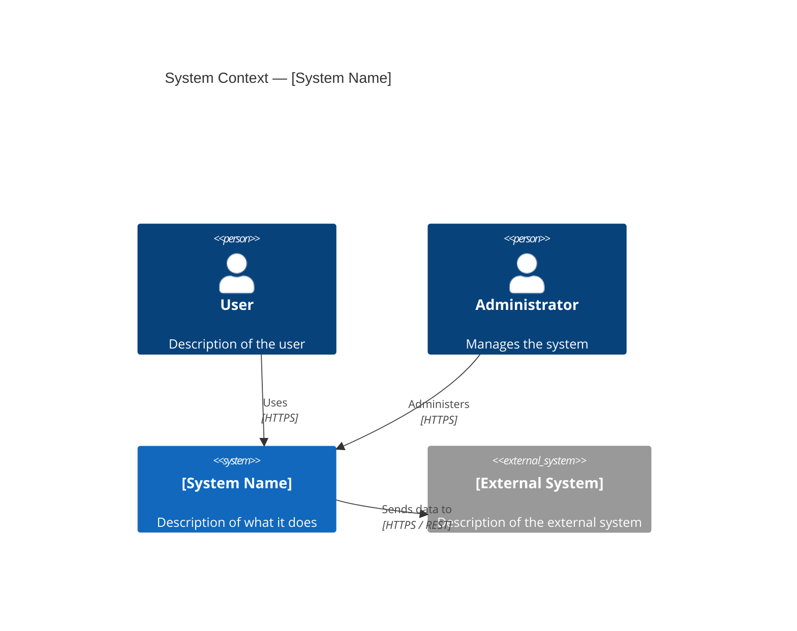
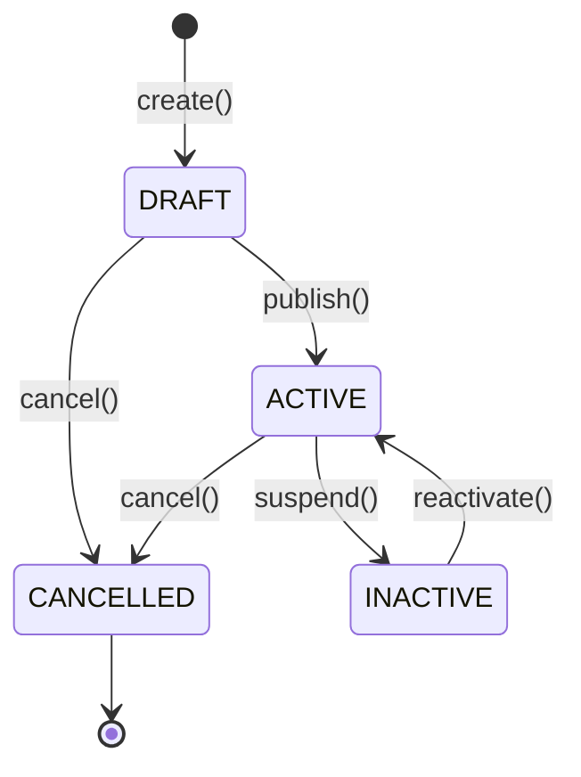
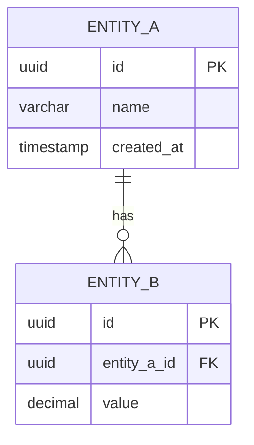
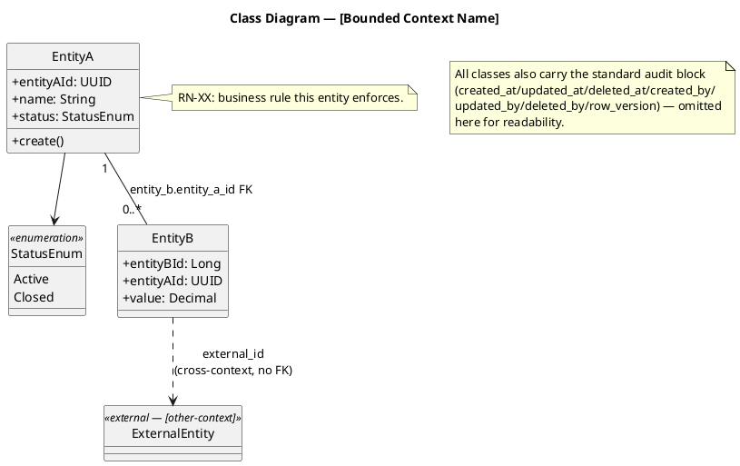

# Diagram Index

> **What to fill in here:** The registry of all system diagrams.
> **Chosen format: Mermaid**, with one deliberate exception (decision recorded in `README.md`) —
> C4, sequence, state and ER diagrams are `.mmd` files; **class diagrams are `.puml`
> (PlantUML)**, by explicit request, for proper UML class notation (visibility markers,
> associations with multiplicities, real `enum`/stereotype blocks) that Mermaid's `classDiagram`
> renders more loosely. All sources live in `08-uml/diagrams/source/`, one diagram per file. View
> `.mmd` in VS Code or mermaid.live; view `.puml` in VS Code (PlantUML extension) or
> plantuml.com/plantuml. GitHub renders neither format as a standalone file — only
> ` ```mermaid ` / ` ```plantuml ` fenced blocks inside Markdown — so export to
> `08-uml/diagrams/exports/*.svg` when a diagram must be visible there.

---

## When to create a diagram?

```
✓ When the flow involves 3+ services or actors
✓ When the architecture needs to be communicated to a non-technical stakeholder
✓ When data modeling is complex (ER diagram)
✓ When a bug took more than 2 hours to understand (retroactive sequence diagram)

✗ For simple 2-element flows — code describes them better
✗ To "document for documentation's sake" — an outdated diagram is worse than none
```

---

## File naming

```
[type]-[descriptive-name].mmd   (everything except class diagrams)
[type]-[descriptive-name].puml  (class diagrams only)

Examples (match the registry below):
  c1-system-context.mmd
  c2-container-diagram.mmd
  c3-attendance-service.mmd
  cls-identity.puml
  seq-facial-attendance.mmd
  state-class-session.mmd
  erd-attendance.mmd
```

---

## Diagram registry

### Architecture diagrams (C4)

| ID | Name | Type | Tool | Source file | Status | Description |
|----|------|------|------|-------------|--------|-------------|
| C4-01 | System Context | C4 L1 | Mermaid | `source/c1-system-context.mmd` | ✅ Done | Students, instructors and admins vs. FaceAttend EDU and its external systems |
| C4-02 | Container Diagram | C4 L2 | Mermaid | `source/c2-container-diagram.mmd` | ✅ Done | Clients, Kong, the 9 microservices and PostgreSQL / MongoDB / Redis / Kafka |
| C4-03 | ms-attendance components | C4 L3 | Mermaid | `source/c3-attendance-service.mmd` | ✅ Done | Internal components of the critical-path service (hexagonal ports & adapters) |
| C4-04 | ms-biometric components | C4 L3 | Mermaid | `source/c4-biometric-service.mmd` | ✅ Done | FastAPI routers calling repository ports directly (flatter than the Java hexagon, one dead use-case port) — the service where the biometric-update-case duplication from SEQ-04 physically lives |

### Class diagrams

| ID | Name | Tool | Source file | Status | Description |
|----|------|------|-------------|--------|-------------|
| CLS-01 | Identity domain model | PlantUML | `source/cls-identity.puml` | ✅ Done | Person, AppUser, UserSession, PasswordPolicy, Credentials — `01-identity` |
| CLS-02 | Authorization domain model | PlantUML | `source/cls-authorization.puml` | ✅ Done | Role, Permission, RolePermission, UserRole — `02-authorization` |
| CLS-03 | Academic domain model | PlantUML | `source/cls-academic.puml` | ✅ Done | School → Program → Cohort/Course, AcademicActorType, AcademicActor, Enrollment — `03-academic` |
| CLS-04 | Scheduling domain model | PlantUML | `source/cls-scheduling.puml` | ✅ Done | Environment, ScheduleBlock, ClassSession, with every cross-context ref to Academic marked no-FK — `04-scheduling` |
| CLS-05 | Attendance domain model | PlantUML | `source/cls-attendance.puml` | ✅ Done | AttendanceRecord, Justification(Type), SupportingDocument, AttendanceReport — `05-attendance` |
| CLS-06 | Biometric domain model | PlantUML | `source/cls-biometric.puml` | ✅ Done | BiometricUpdateCase plus the two MongoDB embedding collections — `06-biometric` |
| CLS-07 | Notification domain model | PlantUML | `source/cls-notification.puml` | ✅ Done | AlertType, Alert — `08-notification` (service 08; Notification is the 7th bounded context) |
| CLS-08 | Configuration domain model | PlantUML | `source/cls-configuration.puml` | ✅ Done | AcademicConfiguration, SecurityConfiguration — `07-configuration` (service 07; Configuration is the 8th bounded context) |

> **One per bounded context, matching `06-data/domains/*.md`'s own granularity** (7 ER files, one
> per context, plus a documented reason Biometric has no 8th) — not one per cluster and not one
> per microservice. `09-ms-quality` has no entry here: it is tooling, not a bounded context (see
> `02-domain/domain-map.md`'s 8-context table and `c2-container-diagram.mmd`'s own description of
> it). Cross-context classes a diagram depends on are drawn as empty `<<external — context>>`
> stubs, never duplicated with their own attributes — the owning diagram is the only place that
> attribute list lives.
>
> **Format exception:** class diagrams are PlantUML (`.puml`), not Mermaid — by explicit request,
> for real UML class notation (`+`/`-` visibility, typed attributes, associations with
> multiplicities on both ends, true `enum` blocks, `<<stereotype>>` markers) that reads closer to
> a textbook class diagram than Mermaid's `classDiagram` does. Render with
> `npx -y node-plantuml generate <file>.puml -o <file>.svg --svg` (needs a local Graphviz `dot`
> on PATH — `winget install Graphviz.Graphviz` — or paste into plantuml.com/plantuml). Every
> other diagram type in this folder stays Mermaid-only.
>
> Class diagrams show the OO/domain structure (aggregates, methods, invariants, and which
> cross-context references are deliberately **not** FKs) — a different concern from the ER
> diagrams below, which show the column-level SQL shape. See `02-domain/entities-and-rules.md` for
> the full prose version these were built from.

### Sequence diagrams

| ID | Name | Tool | Source file | Status | Description |
|----|------|------|-------------|--------|-------------|
| SEQ-01 | Facial attendance capture | Mermaid | `source/seq-facial-attendance.mmd` | ✅ Done | Mobile scan → gateway → biometric match → attendance record (event publish, with the unwired gaps called out) |
| SEQ-02 | Login flow | Mermaid | `source/seq-login.mmd` | ✅ Done | Login → opaque `sessionId` → edge check at Kong + per-service validation |
| SEQ-03 | Justification approval | Mermaid | `source/seq-justification-approval.mmd` | ✅ Done | Submit → attachments → review → Approved/Rejected |
| SEQ-04 | Biometric update case duplication | Mermaid | `source/seq-biometric-update-duplication.mmd` | ✅ Done | Two independent request/review implementations (ms-configuration/Postgres vs. ms-biometric/MongoDB), never synced — see ST-03 |
| SEQ-05 | Password recovery | Mermaid | `source/seq-password-recovery.mmd` | ✅ Done | forgot-password → verify-code → reset-password, the internal identity → notification e-mail call, and the anti-enumeration/cooldown/single-use details |
| SEQ-06 | Biometric real-time WebSocket channel | Mermaid | `source/seq-biometric-websocket.mmd` | ✅ Done | `/api/v1/biometric/ws` — idempotent frame replay and multi-client broadcast fan-out; used by the Web attendance kiosk (`useAttendanceKioskViewModel` → `biometricSocket.js`, session passed as `?token=`), not by Mobile |

### Activity diagrams

| ID | Name | Tool | Source file | Status | Description |
|----|------|------|-------------|--------|-------------|
| ACT-01 | Justification submission and review | Mermaid | `source/act-justification-process.mmd` | ✅ Done | The intended business process (Student / System / Reviewer swimlanes) per RN-32..36, with the unenforced-attachment and no-cascade gaps marked inline — complements SEQ-03 (API calls) and ST-02 (state transitions) without duplicating either |

> This is the diagram type the README names as part of this folder's scope that had zero
> examples until now. Mermaid has no native "activity diagram" keyword, so this uses
> `flowchart TD` with `subgraph` blocks as swimlanes — the standard way to represent a UML
> activity diagram with Mermaid. Dotted red edges mark a step that the business rules call for
> but the real implementation does not do.

### State diagrams

| ID | Name | Tool | Source file | Status | Description |
|----|------|------|-------------|--------|-------------|
| ST-01 | Class session lifecycle | Mermaid | `source/state-class-session.mmd` | ✅ Done | Open → Closed / Cancelled (incl. the unreachable `open()` guard) |
| ST-02 | Justification review | Mermaid | `source/state-justification.mmd` | ✅ Done | Pending → Approved / Rejected |
| ST-03 | Biometric update case | Mermaid | `source/state-biometric-update.mmd` | ✅ Done | Pending → In_Review → Approved / Rejected |

### ER diagrams (data)

| ID | Name | Tool | Source file | Status | Service |
|----|------|------|-------------|--------|---------|
| ERD-01 | Identity DB | Mermaid | `06-data/domains/01-identity.md` (erDiagram block) | ☑️ Covered elsewhere | ms-identity |
| ERD-02 | Attendance DB | Mermaid | `06-data/domains/05-attendance.md` (erDiagram block) | ☑️ Covered elsewhere | ms-attendance |

> ER diagrams exist per domain inside `06-data/domains/*.md` — create a standalone file here only
> when the ER view crosses more than one schema. ERD-01 and ERD-02 are single-schema views, so they
> live in `06-data` and are deliberately **not** duplicated here (an extra copy is an extra thing to
> keep updated). Checked: 7 of the 8 domain files carry one `erDiagram`; `06-biometric.md` has none
> because its only SQL table (`biometric_update_case`) is physically hosted in `configuration` and
> is already drawn in `08-configuration.md`, while the two embedding collections are MongoDB
> documents with no FKs to render.

---

## Diagram templates

### C4 L1 — Context (Mermaid)



### Sequence diagram (Mermaid)

```mermaid
sequenceDiagram
    actor U as User
    participant GW as API Gateway
    participant AUTH as Identity Service
    participant SA as Service A
    database DBA as Service A DB

    U->>GW: POST /resource {payload}
    GW->>AUTH: Validate session bearer
    AUTH-->>GW: 200 OK {claims}
    GW->>SA: POST /resource (with claims)
    SA->>DBA: INSERT
    DBA-->>SA: OK
    SA-->>GW: 201 Created {id}
    GW-->>U: 201 Created {id}
```

### State diagram (Mermaid)



### ER diagram (Mermaid)



### Class diagram (PlantUML — the one exception to Mermaid-only)



---

## Tools and rendering

**Adopted format: Mermaid**, except class diagrams which are **PlantUML** — `.mmd` / `.puml`
files under `diagrams/source/`.

| Tool | For what | How to use |
|------|---------|------------|
| Mermaid (adopted) | C4, sequence, state, ER | VS Code (Mermaid extension) or [mermaid.live](https://mermaid.live) — GitHub does **not** render standalone `.mmd` files |
| Mermaid CLI (`mmdc`) | SVG/PNG export for GitHub or slides | `npx -y @mermaid-js/mermaid-cli -i file.mmd -o ../exports/file.svg` |
| PlantUML (adopted for class diagrams only) | `.puml` class diagrams | VS Code (PlantUML extension) or [plantuml.com/plantuml](https://www.plantuml.com/plantuml) — do not use for any other diagram type |
| PlantUML CLI (`node-plantuml`) | SVG/PNG export, needs a local Graphviz `dot` on PATH | `npx -y node-plantuml generate file.puml -o ../exports/file.svg --svg` (install Graphviz once: `winget install Graphviz.Graphviz`, or `apt/brew install graphviz`) |
| draw.io (diagrams.net) | Only if free placement is truly needed | Export as XML to `diagrams/source/` + SVG to `diagrams/exports/` |

> **Windows / PowerShell note:** if `npx` fails with an execution-policy error, call `npx.cmd` instead
> (`npx.cmd -y @mermaid-js/mermaid-cli …` / `npx.cmd -y node-plantuml …`), or use `docker run`.
>
> **Without Graphviz installed**, `node-plantuml` still "succeeds" but silently renders a tiny
> placeholder image reading "No dot executable found" instead of the diagram — always check the
> output file is a few hundred lines / tens of KB, not a few dozen bytes, before trusting it.

**Optional rendering pipeline (exports only, never required):**
```bash
# One Mermaid file
npx -y @mermaid-js/mermaid-cli -i 08-uml/diagrams/source/c1-system-context.mmd \
  -o 08-uml/diagrams/exports/c1-system-context.svg

# All Mermaid sources (PowerShell)
Get-ChildItem 08-uml/diagrams/source/*.mmd | ForEach-Object {
  npx.cmd -y @mermaid-js/mermaid-cli -i $_.FullName -o "08-uml/diagrams/exports/$($_.BaseName).svg"
}

# One PlantUML class diagram
npx -y node-plantuml generate 08-uml/diagrams/source/cls-identity.puml \
  -o 08-uml/diagrams/exports/cls-identity.svg --svg

# All PlantUML sources (PowerShell)
Get-ChildItem 08-uml/diagrams/source/*.puml | ForEach-Object {
  npx.cmd -y node-plantuml generate $_.FullName -o "08-uml/diagrams/exports/$($_.BaseName).svg" --svg
}
```

---

## Correlations

- Architecture view → `05-architecture/overview.md`
- Domain bounded contexts → `02-domain/domain-map.md`
- ER models per service → `09-microservices/services/NN/data-model.md`
