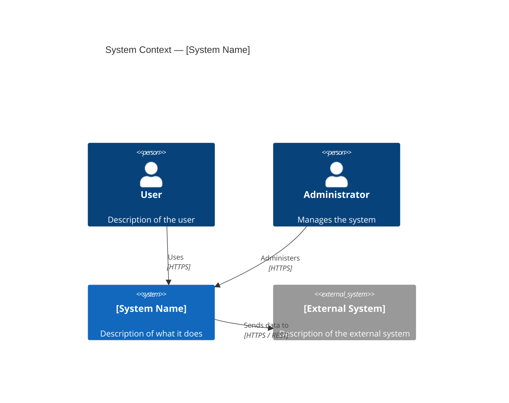
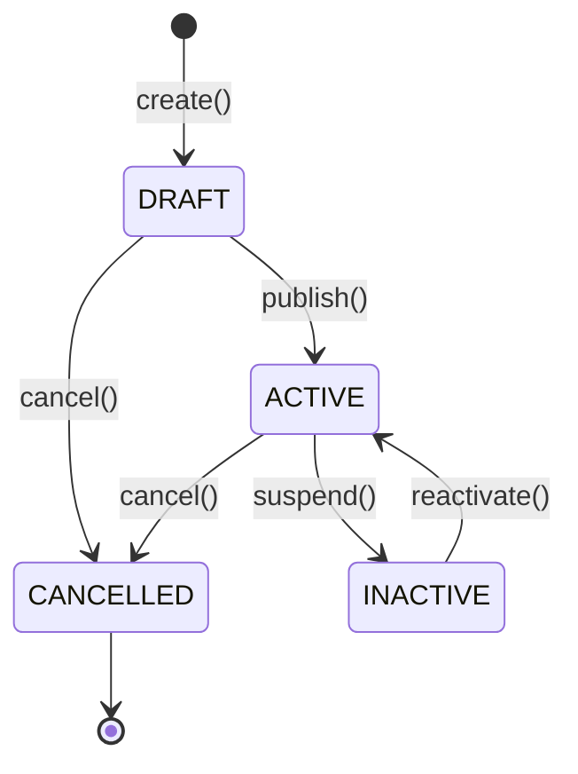
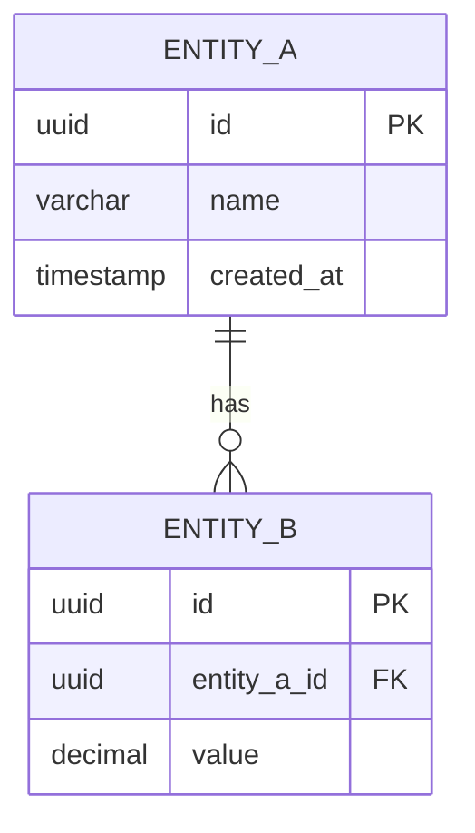

# Diagram Index

> **What to fill in here:** The registry of all system diagrams.
> **Chosen format: Mermaid** (decision recorded in `README.md`) — sources are `.mmd` files in
> `08-uml/diagrams/source/`, one diagram per file. View them in VS Code or mermaid.live; GitHub only
> renders ` ```mermaid ` blocks inside Markdown, so export to `08-uml/diagrams/exports/*.svg`
> when a diagram must be visible there.

---

## When to create a diagram?

```
✓ When the flow involves 3+ services or actors
✓ When the architecture needs to be communicated to a non-technical stakeholder
✓ When data modeling is complex (ER diagram)
✓ When a bug took more than 2 hours to understand (retroactive sequence diagram)

✗ For simple 2-element flows — code describes them better
✗ To "document for documentation's sake" — an outdated diagram is worse than none
```

---

## File naming

```
[type]-[descriptive-name].mmd

Examples (match the registry below):
  c1-system-context.mmd
  c2-container-diagram.mmd
  c3-attendance-service.mmd
  cls-identity-authorization.mmd
  seq-facial-attendance.mmd
  state-class-session.mmd
  erd-attendance.mmd
```

---

## Diagram registry

### Architecture diagrams (C4)

| ID | Name | Type | Tool | Source file | Status | Description |
|----|------|------|------|-------------|--------|-------------|
| C4-01 | System Context | C4 L1 | Mermaid | `source/c1-system-context.mmd` | ✅ Done | Students, instructors and admins vs. FaceAttend EDU and its external systems |
| C4-02 | Container Diagram | C4 L2 | Mermaid | `source/c2-container-diagram.mmd` | ✅ Done | Clients, Kong, the 9 microservices and PostgreSQL / MongoDB / Redis / Kafka |
| C4-03 | ms-attendance components | C4 L3 | Mermaid | `source/c3-attendance-service.mmd` | ✅ Done | Internal components of the critical-path service (hexagonal ports & adapters) |

### Class diagrams

| ID | Name | Tool | Source file | Status | Description |
|----|------|------|-------------|--------|-------------|
| CLS-01 | Identity & Authorization domain model | Mermaid | `source/cls-identity-authorization.mmd` | ✅ Done | Person, AppUser, UserSession, Role, Permission, UserRole — OO structure and invariants behind `01-identity` / `02-authorization` |
| CLS-02 | Academic & Scheduling domain model | Mermaid | `source/cls-academic-scheduling.mmd` | ✅ Done | School → Program → Cohort/Course, AcademicActor, Enrollment, Environment, ScheduleBlock, ClassSession, with cross-context refs marked no-FK |
| CLS-03 | Attendance & Biometric domain model | Mermaid | `source/cls-attendance-biometric.mmd` | ✅ Done | AttendanceRecord, Justification(Type), SupportingDocument, AttendanceReport, BiometricUpdateCase and the two MongoDB embedding collections |
| CLS-04 | Notification & Configuration domain model | Mermaid | `source/cls-notification-configuration.mmd` | ✅ Done | AlertType/Alert, AcademicConfiguration, SecurityConfiguration |

> Class diagrams show the OO/domain structure (aggregates, methods, invariants, and which
> cross-context references are deliberately **not** FKs) — a different concern from the ER
> diagrams below, which show the column-level SQL shape. Grouped by bounded-context cluster
> (not one per context) to avoid near-duplicate files; see `02-domain/entities-and-rules.md` for
> the full prose version these were built from.

### Sequence diagrams

| ID | Name | Tool | Source file | Status | Description |
|----|------|------|-------------|--------|-------------|
| SEQ-01 | Facial attendance capture | Mermaid | `source/seq-facial-attendance.mmd` | ✅ Done | Mobile scan → gateway → biometric match → attendance record (event publish, with the unwired gaps called out) |
| SEQ-02 | Login flow | Mermaid | `source/seq-login.mmd` | ✅ Done | Login → opaque `sessionId` → edge check at Kong + per-service validation |
| SEQ-03 | Justification approval | Mermaid | `source/seq-justification-approval.mmd` | ✅ Done | Submit → attachments → review → Approved/Rejected |

### State diagrams

| ID | Name | Tool | Source file | Status | Description |
|----|------|------|-------------|--------|-------------|
| ST-01 | Class session lifecycle | Mermaid | `source/state-class-session.mmd` | ✅ Done | Open → Closed / Cancelled (incl. the unreachable `open()` guard) |
| ST-02 | Justification review | Mermaid | `source/state-justification.mmd` | ✅ Done | Pending → Approved / Rejected |
| ST-03 | Biometric update case | Mermaid | `source/state-biometric-update.mmd` | ✅ Done | Pending → In_Review → Approved / Rejected |

### ER diagrams (data)

| ID | Name | Tool | Source file | Status | Service |
|----|------|------|-------------|--------|---------|
| ERD-01 | Identity DB | Mermaid | `06-data/domains/01-identity.md` (erDiagram block) | ☑️ Covered elsewhere | ms-identity |
| ERD-02 | Attendance DB | Mermaid | `06-data/domains/05-attendance.md` (erDiagram block) | ☑️ Covered elsewhere | ms-attendance |

> ER diagrams exist per domain inside `06-data/domains/*.md` — create a standalone file here only
> when the ER view crosses more than one schema. ERD-01 and ERD-02 are single-schema views, so they
> live in `06-data` and are deliberately **not** duplicated here (an extra copy is an extra thing to
> keep updated). Checked: 7 of the 8 domain files carry one `erDiagram`; `06-biometric.md` has none
> because its only SQL table (`biometric_update_case`) is physically hosted in `configuration` and
> is already drawn in `08-configuration.md`, while the two embedding collections are MongoDB
> documents with no FKs to render.

---

## Diagram templates

### C4 L1 — Context (Mermaid)



### Sequence diagram (Mermaid)

```mermaid
sequenceDiagram
    actor U as User
    participant GW as API Gateway
    participant AUTH as Identity Service
    participant SA as Service A
    database DBA as Service A DB

    U->>GW: POST /resource {payload}
    GW->>AUTH: Validate session bearer
    AUTH-->>GW: 200 OK {claims}
    GW->>SA: POST /resource (with claims)
    SA->>DBA: INSERT
    DBA-->>SA: OK
    SA-->>GW: 201 Created {id}
    GW-->>U: 201 Created {id}
```

### State diagram (Mermaid)



### ER diagram (Mermaid)



---

## Tools and rendering

**Adopted format: Mermaid** — every diagram is a `.mmd` file under `diagrams/source/`.

| Tool | For what | How to use |
|------|---------|------------|
| Mermaid (adopted) | C4, sequence, state, ER | VS Code (Mermaid extension) or [mermaid.live](https://mermaid.live) — GitHub does **not** render standalone `.mmd` files |
| Mermaid CLI (`mmdc`) | SVG/PNG export for GitHub or slides | `npx -y @mermaid-js/mermaid-cli -i file.mmd -o ../exports/file.svg` |
| PlantUML | Fallback only (rejected format) | Keep the README section for reference; do not add new `.puml` files |
| draw.io (diagrams.net) | Only if free placement is truly needed | Export as XML to `diagrams/source/` + SVG to `diagrams/exports/` |

> **Windows / PowerShell note:** if `npx` fails with an execution-policy error, call `npx.cmd` instead
> (`npx.cmd -y @mermaid-js/mermaid-cli …`), or use `docker run`.

**Optional rendering pipeline (exports only, never required):**
```bash
# One file
npx -y @mermaid-js/mermaid-cli -i 08-uml/diagrams/source/c1-system-context.mmd \
  -o 08-uml/diagrams/exports/c1-system-context.svg

# All sources (PowerShell)
Get-ChildItem 08-uml/diagrams/source/*.mmd | ForEach-Object {
  npx.cmd -y @mermaid-js/mermaid-cli -i $_.FullName -o "08-uml/diagrams/exports/$($_.BaseName).svg"
}
```

---

## Correlations

- Architecture view → `05-architecture/overview.md`
- Domain bounded contexts → `02-domain/domain-map.md`
- ER models per service → `09-microservices/services/NN/data-model.md`
