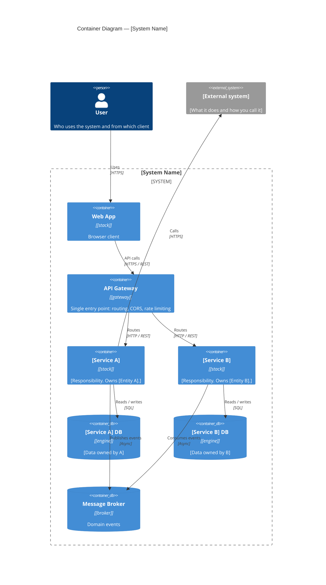

# Template: C4 Container diagram

> **Status:** template only — the real diagram for this project already exists at
> [`c2-container-diagram.mmd`](./c2-container-diagram.mmd) (registered as C4-02 in
> [`../../diagram-index.md`](../../diagram-index.md)). **Do not copy this file to create a new
> diagram**: create a new `.mmd` file in `diagrams/source/` and add a row to the registry.

---

## How to add a new C4 diagram

1. Create `diagrams/source/<name>.mmd` (see the naming rules in `../../diagram-index.md`).
2. Start from the skeleton below — one diagram, one file, Mermaid only.
3. Preview it in VS Code (Mermaid extension) or on [mermaid.live](https://mermaid.live).
   GitHub does **not** render standalone `.mmd` files; export to SVG (step 5) if it must be visible there.
4. Register it in `../../diagram-index.md` with ID, type and status.
5. Only if needed: `npx.cmd -y @mermaid-js/mermaid-cli -i diagrams/source/<name>.mmd -o diagrams/exports/<name>.svg`

## Skeleton (C4 Level 2)

## Conventions for this project

| Element | When to use it |
|---------|----------------|
| `Container` | Deployable microservice or app (one per service — see `09-microservices/service-catalog.md`) |
| `ContainerDb` | Database, cache or broker |
| `Person` | Human actor (student, instructor, administrator) |
| `System_Ext` | Third-party system you do not control (e.g. `countriesnow.space`, SMTP) |

**Accuracy rules (this repo):**
- Kong authenticates **at the edge**: only `cors` + `rate-limiting` plugins and a global
  `pre-function` (opaque `sessionId` introspected against identity, no `jwt`, no Redis token
  blacklist — Redis holds rate-limit counters only); the Java services check the same
  `sessionId` again (plus RBAC) — see `07-api/authentication.md`.
- No payment gateway exists in this system; do not add one to a diagram.
- Ports, stacks and DB engines must match `09-microservices/service-catalog.md`.

---

## Correlations

- Service catalog → `09-microservices/service-catalog.md`
- Each service detail → `09-microservices/services/`
- All diagrams index → `08-uml/diagram-index.md`
